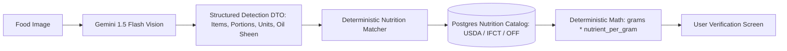
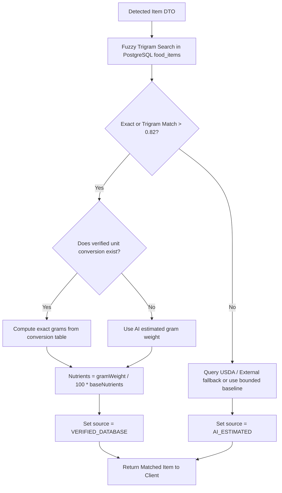

# CAL METER — Multimodal AI Food Recognition Pipeline

**Document Version:** 1.0.0  
**Status:** Approved Architecture Draft  
**Owner:** Technical Lead & AI Systems Architect  
**Last Updated:** November 2026  

---

## 1. Architectural Philosophy: The Decoupled Intelligence Pattern

A critical vulnerability in naive AI diet apps is allowing Large Multimodal Models (LMMs) to hallucinate calorie and macronutrient numbers directly from pixel data. LLMs are notoriously imprecise calculators, and identical food photos can yield wild variance in estimated calories (e.g., 250 kcal on Monday, 650 kcal on Tuesday).

CAL METER solves this with the **Decoupled Intelligence Pattern**:
1. **Multimodal Vision:** Visual models (Gemini 1.5 Flash) perform **identification, volumetric estimation, and cooking medium inference**. The model does *not* calculate calories.
2. **Deterministic Nutritional Valuation:** The backend matching engine queries verified biochemical nutrition tables (USDA FoodData Central, Indian Food Composition Tables, Open Food Facts) and multiplies standard 100g nutrient profiles by the calculated mass.
3. **Transparent Uncertainty:** When an item cannot be mapped to certified tables, a bounded model estimate is used as an explicitly tagged fallback (`source: AI_ESTIMATED`).



---

## 2. Multimodal Provider Abstraction (`IVisionProvider`)

To ensure commercial independence and zero vendor lock-in, all AI interactions implement a unified interface:

```typescript
export interface FoodDetectionResult {
  detectedItems: DetectedFoodItem[];
  sceneContext: {
    plateType?: 'STAINLESS_THALI' | 'CERAMIC_PLATE' | 'BOWL' | 'TAKEAWAY_CONTAINER';
    overallConfidence: number;
    ambientLighting: 'GOOD' | 'POOR' | 'GLARE';
  };
  rawLatencyMs: number;
}

export interface DetectedFoodItem {
  canonicalName: string;
  regionalName?: string;
  cuisine: string;
  cookingMethod: 'BOILED' | 'STEAMED' | 'SAUTEED' | 'DEEP_FRIED' | 'RAW' | 'CURRIED_RICH' | 'CURRIED_LIGHT';
  portion: {
    quantity: number;
    unit: 'katori' | 'piece' | 'roti' | 'cup' | 'tablespoon' | 'gram' | 'bowl';
    estimatedWeightGrams: number;
  };
  confidence: number; // 0.0 to 1.0
  visualIndicators: {
    oilSheen: 'DRY' | 'MODERATE' | 'HEAVY';
    apparentSizeCm?: number;
  };
}

export interface IVisionProvider {
  analyzeFoodImage(imageBuffer: Buffer, mimeType: string): Promise<FoodDetectionResult>;
}
```

Google Gemini 1.5 Flash is the default implementation (`GeminiVisionProvider`) due to its sub-1.5s latency, robust native JSON output mode, and low token cost. Claude 3.5 Sonnet and OpenAI GPT-4o are configured as secondary fallback providers.

---

## 3. Gemini System Prompt & Structured Schema

### 3.1. System Instructions
```text
You are an expert culinary AI and clinical nutrition vision specialist with deep knowledge of global cuisines, with particular expertise in Indian regional cooking (North Indian, South Indian, Bengali, Maharashtrian, Gujarati, etc.), home-cooked preparations, and restaurant dishes.

Your task is to analyze food photographs and extract an exact inventory of all edible items present.

STRICT RULES:
1. Identify all distinct food items, side dishes, breads, rice, and condiments separately.
2. For mixed dishes (like Biryani, Thali, or Salad), break down the primary components or identify the exact regional preparation.
3. Observe visual cues: plate size, container depth, oil sheen, gravy viscosity, and garnish.
4. Estimate portions using culturally appropriate serving units:
   - For Indian curries, dal, and yogurt: use "katori" (assume 1 standard katori = ~200g/ml; small = ~150g; large = ~250g).
   - For flatbreads: use "piece" / "roti" (note if dry phulka or brushed with ghee/butter).
   - For rice/grains: use "cup" (~150g cooked) or "ladle".
   - For international/western items: use standard pieces, cups, or estimated grams.
5. Distinguish gravy bases:
   - Tomato-onion light gravy (e.g. homestyle chicken curry or rajma).
   - Cream/cashew/butter rich gravy (e.g. Paneer Butter Masala, Dal Makhani).
   - Coconut-based gravy (e.g. South Indian vegetable kurma).
6. Assign a realistic confidence score between 0.00 and 1.00 for each item.
7. Return ONLY valid JSON adhering strictly to the provided JSON Schema. Do NOT include markdown code blocks or explanatory text.
```

### 3.2. Response JSON Schema Enforcement
The model is executed with `responseMimeType: "application/json"` and `responseSchema` configured to force strict schema adherence:

```json
{
  "type": "object",
  "properties": {
    "detectedItems": {
      "type": "array",
      "items": {
        "type": "object",
        "properties": {
          "canonicalName": { "type": "string" },
          "regionalName": { "type": "string" },
          "cuisine": { "type": "string" },
          "cookingMethod": { 
            "type": "string",
            "enum": ["BOILED", "STEAMED", "SAUTEED", "DEEP_FRIED", "RAW", "CURRIED_RICH", "CURRIED_LIGHT"]
          },
          "portion": {
            "type": "object",
            "properties": {
              "quantity": { "type": "number" },
              "unit": { "type": "string", "enum": ["katori", "piece", "roti", "cup", "tablespoon", "gram", "bowl"] },
              "estimatedWeightGrams": { "type": "number" }
            },
            "required": ["quantity", "unit", "estimatedWeightGrams"]
          },
          "confidence": { "type": "number" },
          "visualIndicators": {
            "type": "object",
            "properties": {
              "oilSheen": { "type": "string", "enum": ["DRY", "MODERATE", "HEAVY"] }
            },
            "required": ["oilSheen"]
          }
        },
        "required": ["canonicalName", "portion", "confidence", "cookingMethod", "visualIndicators"]
      }
    },
    "sceneContext": {
      "type": "object",
      "properties": {
        "plateType": { "type": "string", "enum": ["STAINLESS_THALI", "CERAMIC_PLATE", "BOWL", "TAKEAWAY_CONTAINER"] },
        "overallConfidence": { "type": "number" },
        "ambientLighting": { "type": "string", "enum": ["GOOD", "POOR", "GLARE"] }
      },
      "required": ["overallConfidence", "ambientLighting"]
    }
  },
  "required": ["detectedItems", "sceneContext"]
}
```

---

## 4. Indian Food Disambiguation Rules

Indian meals pose specific recognition edge cases. The vision worker executes heuristic rules:

| Visual Ambiguity | Resolution Heuristic | Default Assumption |
| :--- | :--- | :--- |
| **Dal Tadka vs. Dal Makhani** | Yellow pulse vs. black urad lentil with heavy cream swirl. | Yellow = Toor Dal Tadka (180 kcal/katori). Black/Brown = Dal Makhani (280 kcal/katori). |
| **Phulka vs. Paratha** | Thin, puffed, flour-dusted vs. layered, flaky, golden oil/ghee patches. | Thin/matte = Phulka (75 kcal). Layered/golden = Plain Paratha (160 kcal). |
| **Steamed Rice vs. Pulao vs. Biryani** | White single grain vs. spiced/colored with cumin/peas vs. layered with marinated protein. | White = Steamed Basmati. Spiced = Vegetable Pulao. Multi-color/meat = Biryani. |
| **Paneer vs. Tofu** | Texture opacity, soft curd edges vs. firm pressed block edges. | Indian context defaults to Dairy Paneer; option pill provided on review screen. |

---

## 5. Deterministic Matching Algorithm

Once the vision worker receives `detectedItems`, it executes the matching pipeline:



### Mathematical Formulation of Final Nutrients:
$$\text{Nutrient}_{\text{total}} = \left( \frac{\text{GramWeight}}{100} \right) \times \text{Nutrient}_{\text{per 100g}}$$

$$\text{Confidence}_{\text{final}} = \text{Confidence}_{\text{vision}} \times \text{Similarity}_{\text{text match}}$$

---

## 6. Performance, Latency, and Cost Benchmarks

| Metric | Target SLA | Benchmark Strategy |
| :--- | :--- | :--- |
| **Client Upload Latency** | < 600 ms | Compression to 1024x1024 JPEG @ 0.8 quality (~180 KB). |
| **Vision Inference (Gemini)** | < 1,400 ms | Gemini 1.5 Flash with minimal system instruction overhead. |
| **Database Match & Response** | < 150 ms | Trigram indexes and in-memory Redis catalog lookups. |
| **Total End-to-End Latency** | **< 2.2 seconds** | Meets the Cal AI benchmark for instantaneous user feel. |
| **Cost Per Scan** | **~$0.00045 USD** | ~350 image input tokens + ~200 output tokens on Gemini Flash. 100,000 scans cost ~$45. |
