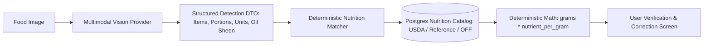
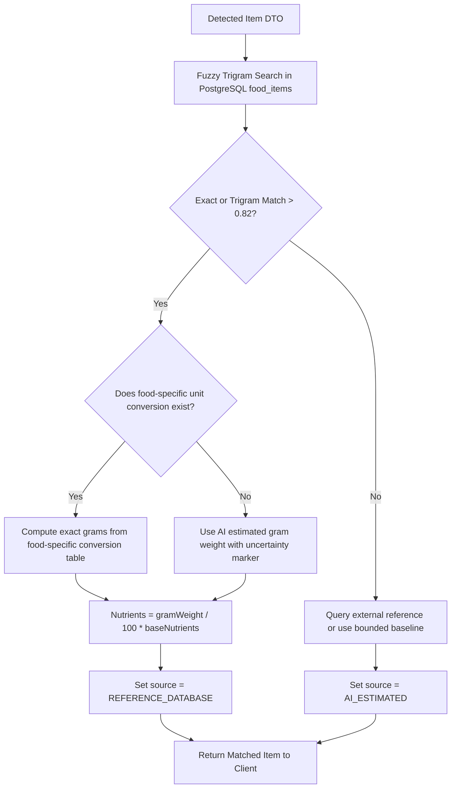

# CAL METER — Multimodal AI Food Recognition Pipeline

**Document Version:** 1.1.0  
**Status:** Approved Architecture Specification  
**Owner:** Technical Lead & AI Systems Architect  
**Last Updated:** November 2026

---

## 1. Architectural Philosophy: The Decoupled Intelligence Pattern

A critical vulnerability in naive AI diet apps is allowing Large Multimodal Models (LMMs) to hallucinate calorie and macronutrient numbers directly from pixel data. LLMs are imprecise calculators, and identical food photos can yield substantial variance in estimated calories.

CAL METER solves this with the **Decoupled Intelligence Pattern**:

1. **Multimodal Vision:** Visual models perform **identification, volumetric estimation, and cooking medium inference**. The model does _not_ calculate calories.
2. **Estimates With Uncertainty:** All visual identification and volumetric estimates are treated explicitly as **statistical estimates with inherent uncertainty**. Confidence tiers (High / Moderate / Review Needed) and transparent disclaimers are communicated to the user.
3. **Deterministic Nutritional Valuation:** The backend matching engine queries verified nutrition tables (USDA FoodData Central, Open Food Facts under ODbL terms, and Indian regional food tables subject to commercial licensing verification) and multiplies standard 100g nutrient profiles by the calculated mass.
4. **Fallback Modeling:** When an item cannot be mapped to certified tables, a bounded model estimate is used as an explicitly tagged fallback (`source: AI_ESTIMATED`) with clear uncertainty markers.



---

## 2. Multimodal Provider & Model Selection Process

Rather than hardcoding an assumption of an older model (such as Gemini 1.5 Flash), CAL METER establishes a formal **Provider and Model Selection Process** to be executed prior to production implementation:

### Model Evaluation Criteria:

1. **Official Documentation Verification:** Verify current production status, deprecation timelines, pricing per million tokens, and multimodal latency through the provider's active developer documentation (Google Cloud Vertex AI / Gemini API, Anthropic Claude API, OpenAI Vision API).
2. **Structured JSON Output Support:** Native schema enforcement (e.g. `responseSchema` or tool/function calling) must be guaranteed with zero markdown wrapping.
3. **Multimodal Benchmarks on Food Images:** Evaluate against our 100-image Golden Benchmark Suite (multi-item Indian thalis, packaged goods, complex gravies).
4. **Cost & Latency Thresholds:** Target cost < $0.002 per scan; target provider inference latency < 1.5 seconds.

### Provider Abstraction (`IVisionProvider`)

All AI interactions implement a unified interface to ensure zero vendor lock-in:

```typescript
export interface FoodDetectionResult {
  detectedItems: DetectedFoodItem[];
  sceneContext: {
    plateType?: 'STAINLESS_THALI' | 'CERAMIC_PLATE' | 'BOWL' | 'TAKEAWAY_CONTAINER';
    overallConfidence: number;
    ambientLighting: 'GOOD' | 'POOR' | 'GLARE';
  };
  rawLatencyMs: number;
}

export interface DetectedFoodItem {
  canonicalName: string;
  regionalName?: string;
  cuisine: string;
  cookingMethod:
    'BOILED' | 'STEAMED' | 'SAUTEED' | 'DEEP_FRIED' | 'RAW' | 'CURRIED_RICH' | 'CURRIED_LIGHT';
  portion: {
    quantity: number;
    unit: 'katori' | 'piece' | 'roti' | 'cup' | 'tablespoon' | 'gram' | 'bowl';
    estimatedWeightGrams: number;
  };
  confidence: number; // 0.0 to 1.0
  visualIndicators: {
    oilSheen: 'DRY' | 'MODERATE' | 'HEAVY';
    apparentSizeCm?: number;
  };
}

export interface IVisionProvider {
  analyzeFoodImage(imageBuffer: Buffer, mimeType: string): Promise<FoodDetectionResult>;
}
```

---

## 3. Provider-Agnostic System Prompt & Structured Schema

### 3.1. System Instructions

```text
You are an expert culinary AI and clinical nutrition vision specialist with deep knowledge of global cuisines, with particular expertise in Indian regional cooking (North Indian, South Indian, Bengali, Maharashtrian, Gujarati, etc.), home-cooked preparations, and restaurant dishes.

Your task is to analyze food photographs and extract an exact inventory of all edible items present.

STRICT RULES:
1. Identify all distinct food items, side dishes, breads, rice, and condiments separately.
2. For mixed dishes (like Biryani, Thali, or Salad), break down the primary components or identify the exact regional preparation.
3. Treat all visual identifications and volume estimations as statistical estimates with inherent uncertainty.
4. Estimate portions using food-specific, culturally appropriate serving units:
   - For Indian curries, dal, and yogurt: use "katori" (note food-specific density: dal ~200g, dry sabzi ~140g).
   - For flatbreads: use "piece" / "roti" (note if dry phulka or brushed with ghee/butter).
   - For rice/grains: use "cup" (~150g cooked) or "ladle".
   - For international/western items: use standard pieces, cups, or estimated grams.
5. Distinguish gravy bases:
   - Tomato-onion light gravy (e.g. homestyle chicken curry or rajma).
   - Cream/cashew/butter rich gravy (e.g. Paneer Butter Masala, Dal Makhani).
   - Coconut-based gravy (e.g. South Indian vegetable kurma).
6. Assign a realistic confidence score between 0.00 and 1.00 for each item.
7. Return ONLY valid JSON adhering strictly to the provided JSON Schema. Do NOT include markdown code blocks or explanatory text.
```

### 3.2. Response JSON Schema

The schema enforces required fields, strict string enums, and numerical bounds to prevent runtime parsing failures.

---

## 4. Indian Food Disambiguation Rules

Indian meals pose specific recognition edge cases. The vision pipeline applies heuristic rules to disambiguate:

| Visual Ambiguity                       | Resolution Heuristic                                                                      | Default Assumption                                                              |
| :------------------------------------- | :---------------------------------------------------------------------------------------- | :------------------------------------------------------------------------------ |
| **Dal Tadka vs. Dal Makhani**          | Yellow pulse vs. black urad lentil with heavy cream swirl.                                | Yellow = Toor Dal Tadka. Black/Brown = Dal Makhani.                             |
| **Phulka vs. Paratha**                 | Thin, puffed, flour-dusted vs. layered, flaky, golden oil/ghee patches.                   | Thin/matte = Phulka (~35g). Layered/golden = Plain Paratha (~70g).              |
| **Steamed Rice vs. Pulao vs. Biryani** | White single grain vs. spiced/colored with cumin/peas vs. layered with marinated protein. | White = Steamed Basmati. Spiced = Vegetable Pulao. Multi-color/meat = Biryani.  |
| **Paneer vs. Tofu**                    | Texture opacity, soft curd edges vs. firm pressed block edges.                            | Indian context defaults to Dairy Paneer; option pill provided on review screen. |

---

## 5. Deterministic Matching Algorithm

Once the vision worker receives `detectedItems`, it executes the matching pipeline:



---

## 6. Performance, Latency, and Cost Targets

_Note: Latency and throughput figures represent unverified engineering design targets until benchmarked in production._

| Metric                        | Unverified Design Target  | Engineering Strategy                                                |
| :---------------------------- | :------------------------ | :------------------------------------------------------------------ |
| **Client Upload Latency**     | Target: < 600 ms          | Compression to 1024x1024 JPEG @ 0.8 quality (~180 KB).              |
| **Vision Model Inference**    | Target: < 1,400 ms        | Efficient multimodal model selection verified against current docs. |
| **Database Match & Response** | Target: < 150 ms          | Trigram indexes and in-memory Redis catalog lookups.                |
| **Total End-to-End Latency**  | **Target: < 2.5 seconds** | Unverified target for responsive user feel.                         |
| **Cost Per Scan Target**      | **Target: < $0.002 USD**  | Model token economy optimization and prompt efficiency.             |
