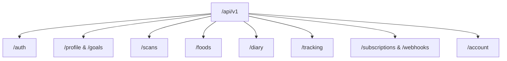

# CAL METER — REST API Specification

**Document Version:** 1.0.0  
**Status:** Approved Architecture Draft  
**Owner:** Backend Architect  
**Base URL:** `https://api.calmeter.app/api/v1` (Production) / `http://localhost:4000/api/v1` (Local)  
**Last Updated:** November 2026

---

## 1. Global Conventions & Protocol Standards

### 1.1. Transport & Content Negotiation

- **Protocol:** HTTPS / TLS 1.3 only (TLS 1.2 minimum acceptable).
- **Format:** `application/json` for all request bodies and responses.
- **Character Encoding:** UTF-8.
- **Date/Time Representation:** ISO 8601 strings in UTC (`YYYY-MM-DDTHH:mm:ss.sssZ`).
- **Dates (calendar days):** ISO 8601 Date strings (`YYYY-MM-DD`).

### 1.2. Authentication & Authorization

Every authenticated endpoint requires a Firebase ID Token in the HTTP Authorization header:

```http
Authorization: Bearer <FIREBASE_ID_TOKEN>
```

The API server validates the cryptographic signature against Google's public key certificate set, extracts `uid`, looks up the internal PostgreSQL `User` record, and binds the tenant context to `req.user`.

### 1.3. Standard Response Envelopes

#### Success Envelope (`200 OK`, `201 Created`, `202 Accepted`)

```json
{
  "success": true,
  "data": { ... },
  "meta": {
    "page": 1,
    "limit": 20,
    "total": 142
  }
}
```

#### Error Envelope (`4xx Client Errors`, `5xx Server Errors`)

```json
{
  "success": false,
  "error": {
    "code": "VALIDATION_ERROR",
    "message": "Invalid request parameters provided.",
    "details": [
      {
        "field": "heightCm",
        "issue": "Height must be a positive number greater than 50 cm."
      }
    ]
  }
}
```

### 1.4. Standard Error Code Taxonomy

| HTTP Code | Error Code                 | Description                                          |
| :-------- | :------------------------- | :--------------------------------------------------- |
| `400`     | `VALIDATION_ERROR`         | Request payload failed Zod schema validation.        |
| `401`     | `AUTH_UNAUTHORIZED`        | Missing, malformed, or expired Bearer token.         |
| `403`     | `FORBIDDEN_RESOURCE`       | User attempted to access another tenant's record.    |
| `403`     | `SUBSCRIPTION_REQUIRED`    | Feature gated behind CAL METER Pro entitlement.      |
| `404`     | `RESOURCE_NOT_FOUND`       | Requested entity ID does not exist.                  |
| `429`     | `RATE_LIMIT_EXCEEDED`      | Request threshold breached. Try again later.         |
| `429`     | `DAILY_SCAN_LIMIT_REACHED` | Free tier daily AI scan quota reached (3 scans/day). |
| `500`     | `INTERNAL_SERVER_ERROR`    | Unexpected server failure. Tracked in Sentry.        |

---

## 2. API Endpoints by Module



---

### Module 1: Authentication & User Sync (`/auth`)

#### `POST /auth/sync`

Synchronizes the authenticated Firebase identity with the internal PostgreSQL database. Called immediately upon mobile app login/signup.

- **Headers:** `Authorization: Bearer <token>`
- **Request Body:**

```json
{
  "email": "user@example.com",
  "name": "Rohan Sharma"
}
```

- **Response `200 OK`:**

```json
{
  "success": true,
  "data": {
    "id": "c1f7a0b5-783a-4db3-98fa-123456789abc",
    "firebaseUid": "vK792xN903M...",
    "email": "user@example.com",
    "name": "Rohan Sharma",
    "isOnboarded": true,
    "role": "USER",
    "createdAt": "2026-11-10T05:30:00.000Z"
  }
}
```

#### `GET /auth/me`

Retrieves current authenticated user session and subscription entitlement status.

---

### Module 2: Profile & Nutrition Goals (`/profile`, `/goals`)

#### `GET /profile`

Retrieves the user's biometric profile and dietary preferences.

#### `PUT /profile`

Updates user biometrics and recalculates baseline requirements.

- **Request Body (Zod Validated):**

```json
{
  "gender": "MALE",
  "dob": "1997-04-15",
  "heightCm": 178.5,
  "currentWeightKg": 82.0,
  "targetWeightKg": 75.0,
  "activityLevel": "MODERATELY_ACTIVE",
  "dietPreference": "VEGETARIAN",
  "primaryGoal": "LOSE_WEIGHT",
  "paceKgPerWeek": 0.5,
  "timezone": "Asia/Kolkata",
  "preferredUnits": "METRIC"
}
```

#### `GET /goals`

Returns current active daily calorie and macronutrient targets.

#### `PUT /goals`

Manual override of daily targets by user.

- **Request Body:**

```json
{
  "dailyCalories": 2100,
  "proteinGrams": 150,
  "carbsGrams": 220,
  "fatGrams": 65,
  "fiberGrams": 35,
  "waterMl": 3000
}
```

---

### Module 3: Food Scans & Vision Engine (`/scans`)

#### `POST /scans/presign-upload`

Generates a short-lived presigned S3 PUT URL for direct image uploading. Checks daily scan quota prior to issuance.

- **Request Body:**

```json
{
  "contentType": "image/jpeg",
  "fileSizeBytes": 204850
}
```

- **Response `201 Created`:**

```json
{
  "success": true,
  "data": {
    "scanId": "8f3b6c20-639a-4c91-a1b4-abcdef012345",
    "uploadUrl": "https://storage.calmeter.app/scans/8f3b6c20...?X-Amz-Signature=...",
    "storageKey": "scans/2026/11/10/8f3b6c20.jpg",
    "expiresInSeconds": 300
  }
}
```

#### `POST /scans/:id/analyze`

Dispatches the uploaded image to the BullMQ background queue for Gemini multimodal processing.

- **Path Parameter:** `id` (UUID from presign step)
- **Response `202 Accepted`:**

```json
{
  "success": true,
  "data": {
    "scanId": "8f3b6c20-639a-4c91-a1b4-abcdef012345",
    "status": "PROCESSING",
    "estimatedLatencyMs": 2000
  }
}
```

#### `GET /scans/:id`

Polls analysis status or fetches final detected food items with matched nutritional data.

- **Response `200 OK` (when status = "COMPLETED"):**

```json
{
  "success": true,
  "data": {
    "scanId": "8f3b6c20-639a-4c91-a1b4-abcdef012345",
    "status": "COMPLETED",
    "latencyMs": 1840,
    "detectedItems": [
      {
        "id": "det-1",
        "name": "Dal Tadka",
        "confidence": 0.94,
        "portionAmount": 1.0,
        "servingUnit": "katori",
        "gramWeight": 200,
        "matchedFood": {
          "id": "fd-indian-0042",
          "name": "Yellow Dal Tadka (Home-style)",
          "source": "INDIAN_FCT_NIN",
          "calories": 184.0,
          "protein": 9.2,
          "carbs": 24.5,
          "fat": 5.6
        }
      },
      {
        "id": "det-2",
        "name": "Phulka Roti",
        "confidence": 0.98,
        "portionAmount": 2.0,
        "servingUnit": "piece",
        "gramWeight": 70,
        "matchedFood": {
          "id": "fd-indian-0010",
          "name": "Whole Wheat Roti (Without Ghee)",
          "source": "INDIAN_FCT_NIN",
          "calories": 160.0,
          "protein": 5.4,
          "carbs": 32.0,
          "fat": 0.8
        }
      }
    ],
    "totalEstimatedCalories": 344.0
  }
}
```

---

### Module 4: Food Catalog & Search (`/foods`)

#### `GET /foods/search?q={query}&page=1&limit=20`

Searches verified foods, regional recipes, and user custom foods using fuzzy trigram indexing.

#### `GET /foods/barcode/:barcode`

Fetches verified packaged product by barcode (EAN/UPC). Queries Redis -> PostgreSQL -> Open Food Facts.

#### `POST /foods/custom`

Creates a private custom food item for the authenticated user.

---

### Module 5: Food Diary & Meal Entries (`/diary`)

#### `GET /diary/:date`

Fetches complete daily log for specified date (`YYYY-MM-DD`), including calorie budget calculations and individual meal breakdowns.

- **Response `200 OK`:**

```json
{
  "success": true,
  "data": {
    "date": "2026-11-10",
    "calorieGoal": 2100,
    "caloriesConsumed": 1450,
    "caloriesRemaining": 650,
    "macros": {
      "protein": { "consumed": 110.5, "target": 150.0 },
      "carbs": { "consumed": 160.2, "target": 220.0 },
      "fat": { "consumed": 42.0, "target": 65.0 },
      "fiber": { "consumed": 24.0, "target": 35.0 }
    },
    "meals": [
      {
        "id": "meal-entry-uuid-1",
        "mealType": "BREAKFAST",
        "totalCalories": 420.0,
        "items": [
          {
            "id": "mfi-uuid-1",
            "foodName": "Rolled Oats with Milk & Honey",
            "portionAmount": 1.0,
            "servingUnit": "bowl",
            "gramWeight": 250,
            "calories": 420.0,
            "protein": 14.0,
            "carbs": 68.0,
            "fat": 7.0,
            "loggedMethod": "SEARCH"
          }
        ]
      },
      {
        "id": "meal-entry-uuid-2",
        "mealType": "LUNCH",
        "totalCalories": 1030.0,
        "items": [ ... ]
      }
    ]
  }
}
```

#### `POST /diary/meals`

Commits a verified meal (from AI scan or multi-item builder) to a meal slot.

- **Request Body:**

```json
{
  "date": "2026-11-10",
  "mealType": "LUNCH",
  "notes": "Post-workout lunch",
  "items": [
    {
      "foodItemId": "fd-indian-0042",
      "foodName": "Yellow Dal Tadka",
      "portionAmount": 1.5,
      "servingUnit": "katori",
      "gramWeight": 300,
      "calories": 276.0,
      "protein": 13.8,
      "carbs": 36.75,
      "fat": 8.4,
      "loggedMethod": "AI_PHOTO",
      "confidenceScore": 0.94
    }
  ]
}
```

#### `PUT /diary/items/:itemId`

Updates the portion amount or serving unit of an existing logged food item. Automatically re-computes parent meal and daily totals.

#### `DELETE /diary/items/:itemId`

Deletes an individual food item.

#### `DELETE /diary/meals/:id`

Deletes an entire meal slot for that day.

---

### Module 6: Tracking (`/tracking`)

- `GET /tracking/weight`: Returns time-series historical weight readings.
- `POST /tracking/weight`: Records a new weight measurement (`{ "weightKg": 81.6, "notes": "Morning fasted" }`).
- `GET /tracking/water/:date`: Returns water consumption in ml for that day.
- `POST /tracking/water`: Logs water intake increment (`{ "amountMl": 250, "date": "2026-11-10" }`).

---

### Module 7: Subscriptions & Webhooks (`/subscriptions`, `/webhooks`)

- `GET /subscriptions/status`: Retrieves real-time subscription status, expiration date, and active entitlements.
- `POST /webhooks/revenuecat`: Receives signed RevenueCat server-to-server webhook events (`INITIAL_PURCHASE`, `RENEWAL`, `CANCELLATION`, `EXPIRATION`). Validates authorization bearer token and synchronizes internal `Subscription` table.

---

### Module 8: Privacy & Data Sovereignty (`/account`)

- `POST /account/export`: Enqueues full GDPR data export bundle generation. User receives email with encrypted download link.
- `DELETE /account`: Enforces Apple App Store Guideline 5.1.1(v). Immediately revokes auth tokens, deletes S3 image assets, cascades deletes all user database records, and triggers RevenueCat/PostHog deletion events.
