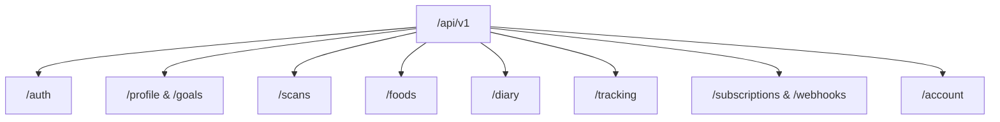

# CAL METER — REST API Specification

**Document Version:** 1.0.0  
**Status:** Approved Architecture Draft  
**Owner:** Backend Architect  
**Base URL:** `https://api.calmeter.app/api/v1` (Production) / `http://localhost:4000/api/v1` (Local)  
**Last Updated:** November 2026

---

## 1. Global Conventions & Protocol Standards

### 1.1. Transport & Content Negotiation

- **Protocol:** HTTPS / TLS 1.3 only (TLS 1.2 minimum acceptable).
- **Format:** `application/json` for all request bodies and responses.
- **Character Encoding:** UTF-8.
- **Date/Time Representation:** ISO 8601 strings in UTC (`YYYY-MM-DDTHH:mm:ss.sssZ`).
- **Dates (calendar days):** ISO 8601 Date strings (`YYYY-MM-DD`).

### 1.2. Authentication & Authorization

Every authenticated endpoint requires a Firebase ID Token in the HTTP Authorization header:

```http
Authorization: Bearer <FIREBASE_ID_TOKEN>
```

The API server validates the cryptographic signature against Google's public key certificate set, extracts `uid`, looks up the internal PostgreSQL `User` record, and binds the tenant context to `req.user`.

### 1.3. Standard Response Envelopes

#### Success Envelope (`200 OK`, `201 Created`, `202 Accepted`)

```json
{
  "success": true,
  "data": { ... },
  "meta": {
    "page": 1,
    "limit": 20,
    "total": 142
  }
}
```

#### Error Envelope (`4xx Client Errors`, `5xx Server Errors`)

```json
{
  "success": false,
  "error": {
    "code": "VALIDATION_ERROR",
    "message": "Invalid request parameters provided.",
    "details": [
      {
        "field": "heightCm",
        "issue": "Height must be a positive number greater than 50 cm."
      }
    ]
  }
}
```

### 1.4. Standard Error Code Taxonomy

| HTTP Code | Error Code                 | Description                                          |
| :-------- | :------------------------- | :--------------------------------------------------- |
| `400`     | `VALIDATION_ERROR`         | Request payload failed Zod schema validation.        |
| `401`     | `AUTH_UNAUTHORIZED`        | Missing, malformed, or expired Bearer token.         |
| `403`     | `FORBIDDEN_RESOURCE`       | User attempted to access another tenant's record.    |
| `403`     | `SUBSCRIPTION_REQUIRED`    | Feature gated behind CAL METER Pro entitlement.      |
| `404`     | `RESOURCE_NOT_FOUND`       | Requested entity ID does not exist.                  |
| `429`     | `RATE_LIMIT_EXCEEDED`      | Request threshold breached. Try again later.         |
| `429`     | `DAILY_SCAN_LIMIT_REACHED` | Free tier daily AI scan quota reached (3 scans/day). |
| `500`     | `INTERNAL_SERVER_ERROR`    | Unexpected server failure. Tracked in Sentry.        |

---

## 2. API Endpoints by Module



---

### Module 1: Authentication & User Sync (`/auth`)

#### `POST /auth/sync`

Synchronizes the authenticated Firebase identity with the internal PostgreSQL database. Called immediately upon mobile app login/signup.

- **Headers:** `Authorization: Bearer <token>`
- **Request Body:**

```json
{
  "email": "user@example.com",
  "name": "Rohan Sharma"
}
```

- **Response `200 OK`:**

```json
{
  "success": true,
  "data": {
    "id": "c1f7a0b5-783a-4db3-98fa-123456789abc",
    "firebaseUid": "vK792xN903M...",
    "email": "user@example.com",
    "name": "Rohan Sharma",
    "isOnboarded": true,
    "role": "USER",
    "createdAt": "2026-11-10T05:30:00.000Z"
  }
}
```

#### `GET /auth/me`

Retrieves current authenticated user session and subscription entitlement status.

---

### Module 2: Profile & Nutrition Goals (`/profile`, `/goals`)

#### `GET /profile`

Retrieves the user's biometric profile and dietary preferences.

#### `PUT /profile`

Updates user biometrics and recalculates baseline requirements.

- **Request Body (Zod Validated):**

```json
{
  "gender": "MALE",
  "dob": "1997-04-15",
  "heightCm": 178.5,
  "currentWeightKg": 82.0,
  "targetWeightKg": 75.0,
  "activityLevel": "MODERATELY_ACTIVE",
  "dietPreference": "VEGETARIAN",
  "primaryGoal": "LOSE_WEIGHT",
  "paceKgPerWeek": 0.5,
  "timezone": "Asia/Kolkata",
  "preferredUnits": "METRIC"
}
```

#### `GET /goals`

Returns current active daily calorie and macronutrient targets.

#### `PUT /goals`

Manual override of daily targets by user.

- **Request Body:**

```json
{
  "dailyCalories": 2100,
  "proteinGrams": 150,
  "carbsGrams": 220,
  "fatGrams": 65,
  "fiberGrams": 35,
  "waterMl": 3000
}
```

---

### Module 3: Food Scans & Vision Engine (`/scans`)

#### `POST /scans`

Initializes a new food scan record and validates the daily scan quota (free users capped at 3 scans/day).

- **Headers:** `Authorization: Bearer <token>`
- **Request Body (optional):**

```json
{
  "mealType": "LUNCH",
  "notes": "Office canteen lunch"
}
```

- **Response `201 Created`:**

```json
{
  "success": true,
  "data": {
    "scanId": "8f3b6c20-639a-4c91-a1b4-abcdef012345",
    "status": "CREATED",
    "createdAt": "2026-11-10T12:00:00.000Z"
  }
}
```

- **Error `429 Too Many Requests`:**

```json
{
  "success": false,
  "error": {
    "code": "DAILY_SCAN_LIMIT_REACHED",
    "message": "Daily scan limit reached. You have used 3 of 3 scans today. Upgrade to CAL METER Pro for unlimited scans."
  }
}
```

#### `POST /scans/:id/upload-url`

Generates a secure, short-lived presigned upload URL or storage token for direct S3-compatible image upload.

- **Headers:** `Authorization: Bearer <token>`
- **Request Body:**

```json
{
  "contentType": "image/jpeg",
  "fileSizeBytes": 204850
}
```

- **Response `200 OK`:**

```json
{
  "success": true,
  "data": {
    "scanId": "8f3b6c20-639a-4c91-a1b4-abcdef012345",
    "uploadUrl": "https://storage.calmeter.app/scans/8f3b6c20...?token=...",
    "storageKey": "scans/user-uuid/8f3b6c20.jpg",
    "expiresInSeconds": 300
  }
}
```

#### `POST /scans/:id/upload`

Uploads the image file directly to the backend. Validates magic bytes (JPEG/PNG/WebP), strips all EXIF metadata, enforces dimension constraints (100x100 to 8192x8192), stores the image in tenant-isolated storage, and transitions the scan status to `UPLOADED`.

- **Headers:** `Authorization: Bearer <token>`, `Content-Type: image/jpeg` (or `multipart/form-data`)
- **Response `200 OK`:**

```json
{
  "success": true,
  "data": {
    "scanId": "8f3b6c20-639a-4c91-a1b4-abcdef012345",
    "status": "UPLOADED",
    "imageWidth": 1024,
    "imageHeight": 1024,
    "fileSizeBytes": 184320,
    "mimeType": "image/jpeg"
  }
}
```

#### `POST /scans/upload`

Convenience combined endpoint: creates a scan record and uploads the image in a single HTTP transaction. Enforces daily quotas and performs all image sanitization steps.

- **Headers:** `Authorization: Bearer <token>`, `Content-Type: image/jpeg`
- **Response `201 Created`:** Returns scan metadata with status `UPLOADED`.

#### `POST /scans/:id/process`

Executes the AI multimodal recognition pipeline, matches identified candidates against the verified database, and deterministically computes nutrition using `@calmeter/shared` formulas. Transitions scan status to `NEEDS_REVIEW`.

- **Headers:** `Authorization: Bearer <token>`
- **Request Body (optional):**

```json
{
  "async": false
}
```

- **Response `200 OK`:**

```json
{
  "success": true,
  "data": {
    "scanId": "8f3b6c20-639a-4c91-a1b4-abcdef012345",
    "status": "NEEDS_REVIEW",
    "items": [
      {
        "id": "item-1",
        "name": "Dal Tadka",
        "confidence": 0.94,
        "portion": {
          "amount": 1,
          "unit": "katori",
          "grams": 200,
          "confidence": 0.92
        },
        "selectedMatch": {
          "foodItemId": "7f8b9c0d-1234-4567-89ab-cdef01234567",
          "name": "Yellow Dal Tadka (Home-style)",
          "source": "REFERENCE_INDIAN"
        },
        "matchOptions": [
          {
            "foodItemId": "7f8b9c0d-1234-4567-89ab-cdef01234567",
            "name": "Yellow Dal Tadka (Home-style)",
            "score": 0.96,
            "source": "REFERENCE_INDIAN"
          }
        ],
        "nutrients": {
          "calories": 184.0,
          "protein": 9.2,
          "carbs": 24.5,
          "fat": 5.6,
          "fiber": 4.2
        }
      }
    ],
    "totalNutrients": {
      "calories": 344.0,
      "protein": 14.6,
      "carbs": 56.5,
      "fat": 6.4,
      "fiber": 8.4
    }
  }
}
```

#### `GET /scans/:id`

Retrieves the complete state, detected items, match options, and calculated nutrients of a scan.

- **Headers:** `Authorization: Bearer <token>`
- **Response `200 OK`:** Returns full `ScanDetailResponse`.

#### `PATCH /scans/:id/corrections`

Applies user adjustments to portions, replaces matched food candidates, or removes/adds items on the review sheet. Recomputes all totals deterministically using `@calmeter/shared` formulas.

- **Headers:** `Authorization: Bearer <token>`
- **Request Body:**

```json
{
  "items": [
    {
      "itemId": "item-1",
      "portionAmount": 1.5,
      "portionUnit": "katori",
      "gramWeight": 300,
      "selectedFoodItemId": "7f8b9c0d-1234-4567-89ab-cdef01234567"
    }
  ]
}
```

- **Response `200 OK`:** Returns updated scan detail with recomputed nutrients.

#### `POST /scans/:id/confirm`

Commits the reviewed food scan into the user's permanent daily diary. Appends items to `meal_food_items` linked to the user's meal entry slot. Operation is idempotent: calling multiple times returns the existing diary meal entry without duplicating items.

- **Headers:** `Authorization: Bearer <token>`
- **Request Body (optional):**

```json
{
  "mealType": "LUNCH",
  "date": "2026-11-10"
}
```

- **Response `200 OK`:**

```json
{
  "success": true,
  "data": {
    "scanId": "8f3b6c20-639a-4c91-a1b4-abcdef012345",
    "status": "COMPLETED",
    "mealEntryId": "5e1a2b3c-4d5e-6f7a-8b9c-0d1e2f3a4b5c",
    "confirmedAt": "2026-11-10T12:05:00.000Z"
  }
}
```

#### `POST /scans/:id/cancel`

Discards an unconfirmed scan and transitions the status to `CANCELLED`.

- **Headers:** `Authorization: Bearer <token>`
- **Response `200 OK`:**

```json
{
  "success": true,
  "data": {
    "scanId": "8f3b6c20-639a-4c91-a1b4-abcdef012345",
    "status": "CANCELLED"
  }
}
```

---

### Module 4: Food Catalog & Search (`/foods`)

#### `GET /foods`

Searches verified reference foods, regional recipes, and user custom foods using fuzzy trigram matching, brand filtering, barcode lookup, cuisine filters, and alias matching.

- **Headers:** `Authorization: Bearer <token>`
- **Query Parameters:**
  - `q` (string, optional): Text query matching item name, brand, or regional aliases (_e.g. "roti", "phulka", "amul butter"_).
  - `barcode` (string, optional): Exact barcode (EAN-13, EAN-8, UPC-A).
  - `category` (string, optional): Category slug or ID.
  - `cuisine` (string, optional): Regional cuisine (_e.g. "North Indian", "South Indian", "Italian"_).
  - `isVerified` (boolean, optional): Filter by official verification status.
  - `isCustom` (boolean, optional): When `true`, filters to authenticated user's own custom foods.
  - `page` (number, default: 1): 1-indexed pagination.
  - `limit` (number, default: 20, max: 100): Results per page.
  - `sortBy` (string, default: "relevance"): `"relevance" | "name" | "calories" | "createdAt"`.
  - `sortOrder` (string, default: "desc"): `"asc" | "desc"`.
- **Multi-Tenant Scoping:** Authenticated users see public/verified foods, plus their own private custom foods. They never see other users' custom foods.
- **Response `200 OK`:**

```json
{
  "success": true,
  "data": {
    "items": [
      {
        "id": "7f8b9c0d-1234-4567-89ab-cdef01234567",
        "name": "Whole Wheat Roti / Phulka",
        "localNames": ["Phulka", "Chapati", "Roti"],
        "brand": null,
        "barcode": null,
        "source": "REFERENCE_INDIAN",
        "cuisine": "North Indian",
        "isCustom": false,
        "isVerified": true,
        "confidenceScore": 0.98,
        "standardWeightGrams": 100.0,
        "servingSize": 35.0,
        "servingUnit": "piece",
        "calories": 264.0,
        "protein": 9.2,
        "carbs": 55.4,
        "fat": 1.2,
        "fiber": 8.6,
        "servings": [
          {
            "id": "srv-1",
            "unitName": "piece",
            "servingDescription": "1 medium phulka (approx. 6 inch)",
            "gramWeight": 35.0,
            "provenance": "REFERENCE_CURATED",
            "isDefault": true
          },
          {
            "id": "srv-2",
            "unitName": "roti",
            "servingDescription": "1 medium roti",
            "gramWeight": 35.0,
            "provenance": "REFERENCE_CURATED",
            "isDefault": false
          }
        ]
      }
    ],
    "meta": {
      "page": 1,
      "limit": 20,
      "total": 1,
      "totalPages": 1
    }
  }
}
```

#### `GET /foods/barcode/:barcode`

Looks up a packaged product by its barcode string (EAN-13, EAN-8, UPC-A, UPC-E, or Code 128). Automatically normalizes whitespace and punctuation, validates the GS1 Modulo-10 checksum, expands UPC-E, queries the local PostgreSQL catalog, falls back to Open Food Facts, and atomically caches results.

- **Headers:** `Authorization: Bearer <token>`
- **Path Parameters:**
  - `barcode` (string, required): Clean or unnormalized barcode value (1 to 64 chars).
- **Validation:**
  - Validates checksum using GS1 Modulo-10 rules.
  - Returns `400 Bad Request` if invalid check digit or unsupported symbology.
- **Data Quality & Attribution:**
  - Explicit `dataQuality` indicator (`VERIFIED`, `EXTERNAL_SOURCE`, `USER_ENTERED`).
  - Open Food Facts items include attribution and license (`ODbL 1.0`).
  - Strict preservation of `null` vs `0` for unmeasured micronutrients.
- **Response `200 OK`:**

```json
{
  "success": true,
  "data": {
    "id": "f8d38b69-8f4b-4f76-805c-5dc9dc98f822",
    "barcode": "8901030825484",
    "additionalBarcodes": [],
    "name": "Knorr Classic Mixed Vegetable Soup",
    "brand": "Knorr",
    "manufacturer": "Hindustan Unilever Ltd",
    "imageUrl": "https://images.openfoodfacts.org/images/products/890/103/082/5484/front_en.jpg",
    "categories": ["Soups", "Packaged Foods"],
    "countries": ["India"],
    "ingredientsText": "Dehydrated vegetables, corn starch, salt, spices.",
    "allergens": ["Gluten", "Celery"],
    "servingSize": 50.0,
    "servingUnit": "packet",
    "standardWeightGrams": 100.0,
    "netWeightGrams": 50.0,
    "isLiquid": false,
    "nutrientsPer100g": {
      "calories": 320.0,
      "protein": 7.5,
      "carbs": 64.0,
      "fat": 3.2,
      "saturatedFat": 1.1,
      "transFat": 0.0,
      "fiber": 4.5,
      "sugar": 12.0,
      "addedSugar": null,
      "sodium": 1250.0,
      "micronutrients": {}
    },
    "nutrientsPerServing": {
      "calories": 160.0,
      "protein": 3.75,
      "carbs": 32.0,
      "fat": 1.6,
      "saturatedFat": 0.55,
      "transFat": 0.0,
      "fiber": 2.25,
      "sugar": 6.0,
      "addedSugar": null,
      "sodium": 625.0,
      "micronutrients": {}
    },
    "servingConversions": [],
    "source": "OPEN_FOOD_FACTS",
    "attribution": "Open Food Facts contributors",
    "license": "ODbL 1.0",
    "isVerified": true,
    "dataQuality": "EXTERNAL_SOURCE",
    "missingNutrients": ["addedSugar", "cholesterol", "vitaminD"]
  }
}
```

#### `POST /foods/barcode/lookup`

Manually looks up a barcode via JSON request body for environments where URL path encoding is restricted or complex search metadata is supplied.

- **Headers:** `Authorization: Bearer <token>`, `Content-Type: application/json`
- **Request Body:**

```json
{
  "barcode": "8901030825484"
}
```

- **Response `200 OK`:** Same schema as `GET /foods/barcode/:barcode`.

#### `GET /foods/:id`

Retrieves complete nutritional and recipe details for a specific food item, including its full micronutrient profile, serving conversions, recipe ingredients, and aliases.

- **Headers:** `Authorization: Bearer <token>`
- **Path Parameter:** `id` (UUID)
- **Tenant Protection:** If the requested food is custom and created by another user, returns `404 Not Found` (anti-enumeration protection).
- **Response `200 OK`:**

```json
{
  "success": true,
  "data": {
    "id": "7f8b9c0d-1234-4567-89ab-cdef01234567",
    "name": "Dal Tadka (Home-style)",
    "localNames": ["Yellow Dal", "Toor Dal Tadka"],
    "brand": null,
    "barcode": null,
    "source": "REFERENCE_INDIAN",
    "cuisine": "North Indian",
    "state": "Pan-Indian",
    "prepMethod": "Tempered with cumin, garlic, and ghee",
    "isCustom": false,
    "isVerified": true,
    "standardWeightGrams": 100.0,
    "servingSize": 200.0,
    "servingUnit": "katori",
    "calories": 92.0,
    "protein": 4.6,
    "carbs": 12.2,
    "fat": 2.8,
    "fiber": 3.1,
    "nutrientProfile": {
      "calories": 92.0,
      "protein": 4.6,
      "carbs": 12.2,
      "fat": 2.8,
      "saturatedFat": 1.1,
      "transFat": 0.0,
      "fiber": 3.1,
      "sugar": 0.8,
      "addedSugar": 0.0,
      "sodium": 280.0,
      "cholesterol": 3.0,
      "potassium": 190.0,
      "calcium": 24.0,
      "iron": 1.3,
      "vitaminD": null,
      "vitaminB12": null,
      "micronutrients": {
        "magnesium_mg": 28.0,
        "zinc_mg": 0.9
      }
    },
    "servings": [
      {
        "id": "srv-dal-1",
        "unitName": "katori",
        "servingDescription": "1 standard bowl/katori (~200g)",
        "gramWeight": 200.0,
        "provenance": "REFERENCE_CURATED",
        "isDefault": true
      }
    ],
    "aliases": [
      { "id": "al-1", "alias": "yellow dal", "language": "en", "isPrimary": true },
      { "id": "al-2", "alias": "toor dal", "language": "hi", "isPrimary": false }
    ]
  }
}
```

#### `GET /foods/:id/servings`

Retrieves all configured serving unit conversions for a food item.

- **Headers:** `Authorization: Bearer <token>`
- **Path Parameter:** `id` (UUID)
- **Response `200 OK`:**

```json
{
  "success": true,
  "data": [
    {
      "id": "srv-1",
      "foodItemId": "7f8b9c0d-1234-4567-89ab-cdef01234567",
      "unitName": "katori",
      "servingDescription": "1 standard bowl/katori (~200g)",
      "gramWeight": 200.0,
      "mlVolume": 200.0,
      "provenance": "REFERENCE_CURATED",
      "isDefault": true
    }
  ]
}
```

#### `POST /foods`

Creates a private custom food item for the authenticated user with validated nutritional macros and custom serving units.

- **Headers:** `Authorization: Bearer <token>`
- **Request Body (Zod Validated):**

```json
{
  "name": "Mom's Special Paneer Bhurji",
  "brand": "Homemade",
  "cuisine": "North Indian",
  "servingSize": 150.0,
  "servingUnit": "katori",
  "standardWeightGrams": 100.0,
  "calories": 185.0,
  "protein": 11.2,
  "carbs": 4.5,
  "fat": 13.8,
  "fiber": 1.5,
  "nutrientProfile": {
    "saturatedFat": 6.8,
    "sodium": 340.0,
    "calcium": 180.0
  },
  "servings": [
    {
      "unitName": "katori",
      "servingDescription": "1 medium bowl",
      "gramWeight": 150.0,
      "isDefault": true
    }
  ],
  "aliases": ["Paneer Bhurji", "Scrambled Cottage Cheese"]
}
```

- **Response `201 Created`:** Returns complete `FoodItemDetail` with `isCustom: true`, `isVerified: false`, and `createdByUserId` set to the caller.

#### `PATCH /foods/:id`

Updates fields on a user's own custom food item.

- **Headers:** `Authorization: Bearer <token>`
- **Path Parameter:** `id` (UUID)
- **Tenant & Ownership Security:**
  - Cannot modify verified global catalog foods (`403 Forbidden` / `404 Not Found`).
  - Cannot modify custom foods belonging to other users (`404 Not Found` anti-enumeration).
- **Request Body:** Partial `UpdateCustomFoodSchema` (e.g. update calories, protein, or brand).
- **Response `200 OK`:** Returns updated `FoodItemDetail`.

#### `DELETE /foods/:id`

Soft-deletes a user's own custom food item by marking `isArchived = true`.

- **Headers:** `Authorization: Bearer <token>`
- **Path Parameter:** `id` (UUID)
- **Data Integrity:** Historical diary entries (`meal_food_items`) referencing this food item are preserved intact.
- **Tenant & Ownership Security:** Returns `404 Not Found` if the item is not a custom food owned by the caller.
- **Response `200 OK`:**

```json
{
  "success": true,
  "data": { "message": "Custom food item archived successfully." }
}
```

---

### Module 5: Food Diary & Meal Entries (`/diary`)

#### `GET /diary/:date`

Fetches the complete daily log for the specified date (`YYYY-MM-DD`), including daily nutrient totals, all four meal slots (`BREAKFAST`, `LUNCH`, `DINNER`, `SNACK`), and individual food items with their immutable historical nutrient snapshots.

- **Headers:** `Authorization: Bearer <token>`
- **Path Parameter:** `date` (ISO date `YYYY-MM-DD`)
- **Response `200 OK`:**

```json
{
  "success": true,
  "data": {
    "date": "2026-11-10",
    "dailyTotals": {
      "calories": 550.0,
      "protein": 35.0,
      "carbs": 75.0,
      "fat": 12.0,
      "fiber": 9.5,
      "sugar": 3.8,
      "sodium": 420.0,
      "micronutrients": {
        "calcium_mg": 140.0,
        "iron_mg": 3.2
      }
    },
    "meals": [
      {
        "id": "meal-entry-uuid-1",
        "mealType": "BREAKFAST",
        "date": "2026-11-10",
        "notes": null,
        "totalCalories": 240.0,
        "totalProtein": 8.0,
        "totalCarbs": 48.0,
        "totalFat": 2.0,
        "totalFiber": 6.0,
        "totalSugar": 1.0,
        "totalSodium": 180.0,
        "items": [
          {
            "id": "mfi-uuid-1",
            "foodItemId": "fd-roti-001",
            "foodName": "Whole Wheat Roti",
            "portionAmount": 2.0,
            "servingUnit": "piece",
            "gramWeight": 70.0,
            "calories": 240.0,
            "protein": 8.0,
            "carbs": 48.0,
            "fat": 2.0,
            "fiber": 6.0,
            "sugar": 1.0,
            "sodium": 180.0,
            "micronutrients": {},
            "scanId": null,
            "notes": null,
            "loggedMethod": "SEARCH",
            "createdAt": "2026-11-10T08:30:00.000Z",
            "updatedAt": "2026-11-10T08:30:00.000Z"
          }
        ]
      }
    ]
  }
}
```

#### `GET /diary/summary/:date`

Calculates consumed nutrients against the user's active `NutritionGoal` on the specified date, deriving consumed vs target values and remaining calories/macros.

- **Headers:** `Authorization: Bearer <token>`
- **Path Parameter:** `date` (ISO date `YYYY-MM-DD`)
- **Response `200 OK`:**

```json
{
  "success": true,
  "data": {
    "date": "2026-11-10",
    "calorieGoal": 2100,
    "caloriesConsumed": 550.0,
    "caloriesRemaining": 1550.0,
    "macros": {
      "protein": { "consumed": 35.0, "target": 140.0, "remaining": 105.0 },
      "carbs": { "consumed": 75.0, "target": 220.0, "remaining": 145.0 },
      "fat": { "consumed": 12.0, "target": 65.0, "remaining": 53.0 },
      "fiber": { "consumed": 9.5, "target": 35.0, "remaining": 25.5 }
    }
  }
}
```

#### `POST /diary/entries`

Logs one or more food items into a meal slot for a specific date. Food items can be linked to catalog items (`foodItemId`), AI scan records (`scanId`), or logged manually with custom macros. Servings are deterministically resolved against database conversion factors, nutrients are scaled via `@calmeter/shared`, immutable historical snapshots are saved, and meal totals are atomically re-computed.

- **Headers:** `Authorization: Bearer <token>`
- **Request Body (Zod Validated):**

```json
{
  "date": "2026-11-10",
  "mealType": "LUNCH",
  "notes": "Post-workout lunch",
  "items": [
    {
      "foodItemId": "7f8b9c0d-1234-4567-89ab-cdef01234567",
      "foodName": "Yellow Dal Tadka",
      "portionAmount": 1.5,
      "servingUnit": "katori",
      "loggedMethod": "SEARCH"
    }
  ]
}
```

- **Response `201 Created`:** Returns complete `MealEntryResponseDto` including created food item snapshots and updated meal totals.

#### `GET /diary/entries/:id`

Retrieves a single logged food item by ID with multi-tenant ownership enforcement.

- **Headers:** `Authorization: Bearer <token>`
- **Path Parameter:** `id` (UUID of `MealFoodItem`)
- **Tenant Protection:** Returns `404 Not Found` if item does not exist or belongs to another user.
- **Response `200 OK`:** Returns `MealFoodItemDto`.

#### `PATCH /diary/entries/:id`

Updates the portion amount, serving unit, meal slot, or food item of an existing logged item. Re-converts weights, scales nutrients, and atomically recalculates the parent meal's total calories and macros.

- **Headers:** `Authorization: Bearer <token>`
- **Path Parameter:** `id` (UUID of `MealFoodItem`)
- **Request Body:** Partial `UpdateMealFoodItemRequestSchema` (e.g. `{ "portionAmount": 2.0, "servingUnit": "katori" }`).
- **Response `200 OK`:** Returns updated `MealFoodItemDto`.

#### `DELETE /diary/entries/:id`

Deletes a logged food item and atomically recalculates the parent meal's totals. If no items remain in the meal slot, the meal totals are safely reset to zero.

- **Headers:** `Authorization: Bearer <token>`
- **Path Parameter:** `id` (UUID of `MealFoodItem`)
- **Response `200 OK`:**

```json
{
  "success": true,
  "data": { "message": "Meal food item deleted successfully." }
}
```

---

### Module 6: Tracking (`/tracking`)

- `GET /tracking/weight`: Returns time-series historical weight readings.
- `POST /tracking/weight`: Records a new weight measurement (`{ "weightKg": 81.6, "notes": "Morning fasted" }`).
- `GET /tracking/water/:date`: Returns water consumption in ml for that day.
- `POST /tracking/water`: Logs water intake increment (`{ "amountMl": 250, "date": "2026-11-10" }`).

---

### Module 7: Subscriptions & Webhooks (`/subscriptions`, `/webhooks`)

- `GET /subscriptions/status`: Retrieves real-time subscription status, expiration date, and active entitlements.
- `POST /webhooks/revenuecat`: Receives signed RevenueCat server-to-server webhook events (`INITIAL_PURCHASE`, `RENEWAL`, `CANCELLATION`, `EXPIRATION`). Validates authorization bearer token and synchronizes internal `Subscription` table.

---

### Module 8: Privacy & Data Sovereignty (`/account`)

- `POST /account/export`: Enqueues full GDPR data export bundle generation. User receives email with encrypted download link.
- `DELETE /account`: Enforces Apple App Store Guideline 5.1.1(v). Immediately revokes auth tokens, deletes S3 image assets, cascades deletes all user database records, and triggers RevenueCat/PostHog deletion events.
