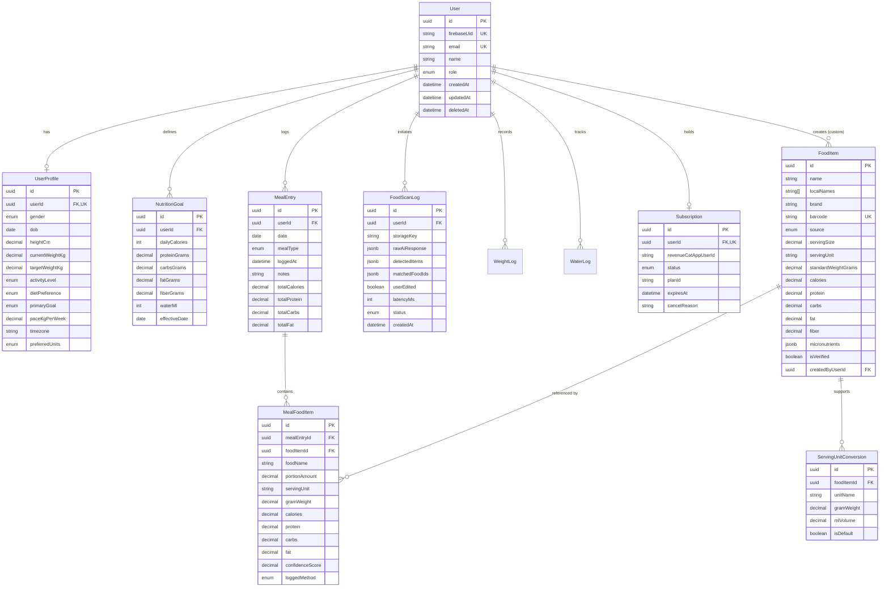

# CAL METER — Database Design & Schema Specification

**Document Version:** 1.0.0  
**Status:** Approved Architecture Draft  
**Owner:** Backend Architect & Database Administrator  
**Last Updated:** November 2026

---

## 1. Relational Model & Entity-Relationship Architecture

CAL METER uses **PostgreSQL 16** managed via **Prisma ORM**. The data model is optimized for multi-tenant isolation, rapid historical lookups, sub-millisecond barcode matches, and deterministic nutritional aggregation.



---

## 2. Complete Prisma Schema Definition (`schema.prisma`)

```prisma
datasource db {
  provider = "postgresql"
  url      = env("DATABASE_URL")
}

generator client {
  provider        = "prisma-client-js"
  previewFeatures = ["fullTextSearch"]
}

// -------------------------------------------------------------
// ENUMS
// -------------------------------------------------------------

enum UserRole {
  USER
  ADMIN
  NUTRITIONIST
}

enum Gender {
  MALE
  FEMALE
  OTHER
  PREFER_NOT_TO_SAY
}

enum ActivityLevel {
  SEDENTARY          // Desk job, little to no exercise
  LIGHTLY_ACTIVE     // Light exercise 1-3 days/week
  MODERATELY_ACTIVE  // Moderate exercise 3-5 days/week
  VERY_ACTIVE        // Hard exercise 6-7 days/week
  EXTRA_ACTIVE       // Very hard exercise or physical job
}

enum PrimaryGoal {
  LOSE_WEIGHT
  MAINTAIN_WEIGHT
  BUILD_MUSCLE
}

enum DietPreference {
  ANY
  VEGETARIAN
  VEGAN
  EGGETARIAN
  JAIN
  KETO
  HALAL
}

enum UnitSystem {
  METRIC   // kg, cm, ml
  IMPERIAL // lbs, feet/inches, fl oz
}

enum FoodSource {
  USDA_FOOD_DATA_CENTRAL
  OPEN_FOOD_FACTS
  INDIAN_FCT_NIN
  CUSTOM_USER
  VERIFIED_COMMUNITY
}

enum MealType {
  BREAKFAST
  LUNCH
  DINNER
  SNACK
}

enum LoggedMethod {
  AI_PHOTO
  GALLERY_PHOTO
  BARCODE
  SEARCH
  MANUAL_ENTRY
  VOICE
}

enum ScanStatus {
  PENDING
  PROCESSING
  COMPLETED
  FAILED
}

enum SubscriptionStatus {
  FREE
  TRIAL
  ACTIVE
  PAST_DUE
  CANCELED
  EXPIRED
}

// -------------------------------------------------------------
// MODELS
// -------------------------------------------------------------

model User {
  id           String      @id @default(uuid()) @db.Uuid
  firebaseUid  String      @unique @map("firebase_uid")
  email        String?     @unique
  name         String?
  role         UserRole    @default(USER)
  createdAt    DateTime    @default(now()) @map("created_at")
  updatedAt    DateTime    @updatedAt @map("updated_at")
  deletedAt    DateTime?   @map("deleted_at")

  profile      UserProfile?
  goals        NutritionGoal[]
  meals        MealEntry[]
  scans        FoodScanLog[]
  weights      WeightLog[]
  waters       WaterLog[]
  subscription Subscription?
  customFoods  FoodItem[]        @relation("UserCustomFoods")
  deletionReq  DeletionRequest?

  @@index([deletedAt])
  @@map("users")
}

model UserProfile {
  id                String         @id @default(uuid()) @db.Uuid
  userId            String         @unique @map("user_id") @db.Uuid
  gender            Gender         @default(PREFER_NOT_TO_SAY)
  dob               DateTime?      @db.Date
  heightCm          Decimal        @map("height_cm") @db.Decimal(5, 2)
  currentWeightKg   Decimal        @map("current_weight_kg") @db.Decimal(5, 2)
  targetWeightKg    Decimal        @map("target_weight_kg") @db.Decimal(5, 2)
  activityLevel     ActivityLevel  @default(MODERATELY_ACTIVE) @map("activity_level")
  dietPreference    DietPreference @default(ANY) @map("diet_preference")
  primaryGoal       PrimaryGoal    @default(LOSE_WEIGHT) @map("primary_goal")
  paceKgPerWeek     Decimal        @default(0.50) @map("pace_kg_per_week") @db.Decimal(3, 2)
  timezone          String         @default("Asia/Kolkata")
  preferredUnits    UnitSystem     @default(METRIC) @map("preferred_units")
  createdAt         DateTime       @default(now()) @map("created_at")
  updatedAt         DateTime       @updatedAt @map("updated_at")

  user              User           @relation(fields: [userId], references: [id], onDelete: Cascade)

  @@map("user_profiles")
}

model NutritionGoal {
  id            String    @id @default(uuid()) @db.Uuid
  userId        String    @map("user_id") @db.Uuid
  dailyCalories Int       @map("daily_calories")
  proteinGrams  Decimal   @map("protein_grams") @db.Decimal(6, 2)
  carbsGrams    Decimal   @map("carbs_grams") @db.Decimal(6, 2)
  fatGrams      Decimal   @map("fat_grams") @db.Decimal(6, 2)
  fiberGrams    Decimal   @default(30.00) @map("fiber_grams") @db.Decimal(6, 2)
  waterMl       Int       @default(2500) @map("water_ml")
  effectiveDate DateTime  @default(now()) @map("effective_date") @db.Date
  createdAt     DateTime  @default(now()) @map("created_at")

  user          User      @relation(fields: [userId], references: [id], onDelete: Cascade)

  @@index([userId, effectiveDate(sort: Desc)])
  @@map("nutrition_goals")
}

model FoodItem {
  id                  String                  @id @default(uuid()) @db.Uuid
  name                String                  @db.VarChar(255)
  localNames          String[]                @default([]) @map("local_names")
  brand               String?                 @db.VarChar(255)
  barcode             String?                 @unique @db.VarChar(64)
  source              FoodSource              @default(CUSTOM_USER)
  servingSize         Decimal                 @default(100.00) @map("serving_size") @db.Decimal(8, 2)
  servingUnit         String                  @default("g") @map("serving_unit") @db.VarChar(50)
  standardWeightGrams Decimal                 @default(100.00) @map("standard_weight_grams") @db.Decimal(8, 2)
  calories            Decimal                 @db.Decimal(8, 2)
  protein             Decimal                 @db.Decimal(8, 2)
  carbs               Decimal                 @db.Decimal(8, 2)
  fat                 Decimal                 @db.Decimal(8, 2)
  fiber               Decimal                 @default(0.00) @db.Decimal(8, 2)
  micronutrients      Json                    @default("{}")
  isVerified          Boolean                 @default(false) @map("is_verified")
  createdByUserId     String?                 @map("created_by_user_id") @db.Uuid
  createdAt           DateTime                @default(now()) @map("created_at")
  updatedAt           DateTime                @updatedAt @map("updated_at")

  createdByUser       User?                   @relation("UserCustomFoods", fields: [createdByUserId], references: [id], onDelete: SetNull)
  servingConversions  ServingUnitConversion[]
  mealFoodItems       MealFoodItem[]

  @@index([name])
  @@index([barcode])
  @@index([source, isVerified])
  @@map("food_items")
}

model ServingUnitConversion {
  id          String   @id @default(uuid()) @db.Uuid
  foodItemId  String   @map("food_item_id") @db.Uuid
  unitName    String   @map("unit_name") @db.VarChar(50) // e.g. "katori", "roti", "cup", "tbsp"
  gramWeight  Decimal  @map("gram_weight") @db.Decimal(8, 2)
  mlVolume    Decimal? @map("ml_volume") @db.Decimal(8, 2)
  isDefault   Boolean  @default(false) @map("is_default")
  createdAt   DateTime @default(now()) @map("created_at")

  foodItem    FoodItem @relation(fields: [foodItemId], references: [id], onDelete: Cascade)

  @@unique([foodItemId, unitName])
  @@map("serving_unit_conversions")
}

model MealEntry {
  id            String         @id @default(uuid()) @db.Uuid
  userId        String         @map("user_id") @db.Uuid
  date          DateTime       @db.Date
  mealType      MealType       @map("meal_type")
  loggedAt      DateTime       @default(now()) @map("logged_at")
  notes         String?        @db.VarChar(500)
  totalCalories Decimal        @default(0.00) @map("total_calories") @db.Decimal(8, 2)
  totalProtein  Decimal        @default(0.00) @map("total_protein") @db.Decimal(8, 2)
  totalCarbs    Decimal        @default(0.00) @map("total_carbs") @db.Decimal(8, 2)
  totalFat      Decimal        @default(0.00) @map("total_fat") @db.Decimal(8, 2)
  createdAt     DateTime       @default(now()) @map("created_at")
  updatedAt     DateTime       @updatedAt @map("updated_at")

  user          User           @relation(fields: [userId], references: [id], onDelete: Cascade)
  items         MealFoodItem[]

  @@unique([userId, date, mealType])
  @@index([userId, date])
  @@map("meal_entries")
}

model MealFoodItem {
  id              String       @id @default(uuid()) @db.Uuid
  mealEntryId     String       @map("meal_entry_id") @db.Uuid
  foodItemId      String?      @map("food_item_id") @db.Uuid
  foodName        String       @map("food_name") @db.VarChar(255)
  portionAmount   Decimal      @default(1.00) @map("portion_amount") @db.Decimal(6, 2)
  servingUnit     String       @map("serving_unit") @db.VarChar(50)
  gramWeight      Decimal      @map("gram_weight") @db.Decimal(8, 2)
  calories        Decimal      @db.Decimal(8, 2)
  protein         Decimal      @db.Decimal(8, 2)
  carbs           Decimal      @db.Decimal(8, 2)
  fat             Decimal      @db.Decimal(8, 2)
  confidenceScore Decimal?     @map("confidence_score") @db.Decimal(3, 2)
  loggedMethod    LoggedMethod @default(SEARCH) @map("logged_method")
  createdAt       DateTime     @default(now()) @map("created_at")
  updatedAt       DateTime     @updatedAt @map("updated_at")

  mealEntry       MealEntry    @relation(fields: [mealEntryId], references: [id], onDelete: Cascade)
  foodItem        FoodItem?    @relation(fields: [foodItemId], references: [id], onDelete: SetNull)

  @@index([mealEntryId])
  @@map("meal_food_items")
}

model FoodScanLog {
  id             String     @id @default(uuid()) @db.Uuid
  userId         String     @map("user_id") @db.Uuid
  storageKey     String     @map("storage_key") @db.VarChar(500)
  rawAiResponse  Json       @map("raw_ai_response")
  detectedItems  Json       @map("detected_items")
  matchedFoodIds Json       @default("[]") @map("matched_food_ids")
  userEdited     Boolean    @default(false) @map("user_edited")
  latencyMs      Int        @map("latency_ms")
  status         ScanStatus @default(PENDING)
  createdAt      DateTime   @default(now()) @map("created_at")

  user           User       @relation(fields: [userId], references: [id], onDelete: Cascade)

  @@index([userId, createdAt(sort: Desc)])
  @@map("food_scan_logs")
}

model WeightLog {
  id        String   @id @default(uuid()) @db.Uuid
  userId    String   @map("user_id") @db.Uuid
  weightKg  Decimal  @map("weight_kg") @db.Decimal(5, 2)
  loggedAt  DateTime @default(now()) @map("logged_at")
  notes     String?  @db.VarChar(255)

  user      User     @relation(fields: [userId], references: [id], onDelete: Cascade)

  @@index([userId, loggedAt(sort: Desc)])
  @@map("weight_logs")
}

model WaterLog {
  id        String   @id @default(uuid()) @db.Uuid
  userId    String   @map("user_id") @db.Uuid
  date      DateTime @db.Date
  amountMl  Int      @map("amount_ml")
  loggedAt  DateTime @default(now()) @map("logged_at")

  user      User     @relation(fields: [userId], references: [id], onDelete: Cascade)

  @@index([userId, date])
  @@map("water_logs")
}

model Subscription {
  id                  String             @id @default(uuid()) @db.Uuid
  userId              String             @unique @map("user_id") @db.Uuid
  revenueCatAppUserId String             @unique @map("rc_app_user_id")
  status              SubscriptionStatus @default(FREE)
  planId              String?            @map("plan_id")
  expiresAt           DateTime?          @map("expires_at")
  cancelReason        String?            @map("cancel_reason")
  createdAt           DateTime           @default(now()) @map("created_at")
  updatedAt           DateTime           @updatedAt @map("updated_at")

  user                User               @relation(fields: [userId], references: [id], onDelete: Cascade)

  @@map("subscriptions")
}

model DeletionRequest {
  id          String   @id @default(uuid()) @db.Uuid
  userId      String   @unique @map("user_id") @db.Uuid
  requestedAt DateTime @default(now()) @map("requested_at")
  scheduledAt DateTime @map("scheduled_at")
  isProcessed Boolean  @default(false) @map("is_processed")

  user        User     @relation(fields: [userId], references: [id], onDelete: Cascade)

  @@map("deletion_requests")
}
```

---

## 3. Database Constraints, Indexes, & Performance Optimization

### 3.1. Compound Uniqueness & Tenant Protection

- **`MealEntry(userId, date, mealType)`:** Enforces that a user has at most one record per meal slot per day. New items are appended to `MealFoodItem` linked to this canonical slot entry.
- **`ServingUnitConversion(foodItemId, unitName)`:** Disallows duplicate unit definitions for the same food item.

### 3.2. Indexing Strategy

- **`B-Tree on (userId, date)`:** Eliminates table scans when querying the daily nutrition dashboard or historical weekly views.
- **`Hash / B-Tree on FoodItem(barcode)`:** Guarantees instantaneous $O(1)$ lookups during barcode scanning.
- **`GIN Index on FoodItem(name, localNames)`:** Built using PostgreSQL `pg_trgm` (trigram) extension for fuzzy substring matching across regional Indian and English dishes.

```sql
-- Trigram Index for Fuzzy Food Search
CREATE EXTENSION IF NOT EXISTS pg_trgm;

CREATE INDEX idx_food_items_name_trgm
ON food_items USING gin (name gin_trgm_ops);
```

---

## 4. Migration & Seeding Strategy

1. **Initial Baseline Migration:** Executed via `prisma migrate dev --name init_core_schema`.
2. **Seed Pipeline (`prisma/seed.ts`):**
   - Populates essential conversion matrices (_katori_, _roti_, _cup_, _scoop_, _piece_).
   - Ingests canonical reference datasets:
     - Top 500 common Indian regional recipes (from Indian Food Composition Tables / ICMR-NIN).
     - Top 1,000 standard whole foods from USDA FoodData Central (fruits, vegetables, meats, grains).
3. **Database Maintenance:** Nightly automated vacuuming and index re-indexing scheduled during low-traffic windows (03:00 UTC).
