# CAL METER — Database Design & Schema Specification

**Document Version:** 1.0.0  
**Status:** Approved Architecture Draft  
**Owner:** Backend Architect & Database Administrator  
**Last Updated:** November 2026

---

## 1. Relational Model & Entity-Relationship Architecture

CAL METER uses **PostgreSQL 16** managed via **Prisma ORM**. The data model is optimized for multi-tenant isolation, rapid historical lookups, sub-millisecond barcode matches, and deterministic nutritional aggregation.

```mermaid
erDiagram
    User ||--o| UserProfile : "has"
    User ||--o{ NutritionGoal : "defines"
    User ||--o{ MealEntry : "logs"
    User ||--o{ FoodScanLog : "initiates"
    User ||--o{ WeightLog : "records"
    User ||--o{ WaterLog : "tracks"
    User ||--o{ ExerciseLog : "performs"
    User ||--o{ CoachMessage : "converses"
    User ||--o{ CoachInsight : "receives"
    User ||--o| Subscription : "holds"
    User ||--o{ RevenueCatWebhookEvent : "receives events"
    User ||--o{ UserFeatureUsage : "tracks daily usage"
    User ||--o{ FoodItem : "creates (custom)"

    MealEntry ||--o{ MealFoodItem : "contains"
    FoodItem ||--o{ MealFoodItem : "referenced by"
    FoodItem ||--o{ FoodBarcode : "identifiable by"
    FoodItem ||--o{ ServingUnitConversion : "supports"
    FoodItem ||--o| FoodNutrientProfile : "detailed profile"
    FoodItem ||--o{ FoodAlias : "known as"
    FoodItem ||--o{ FoodIngredient : "recipe composed of"
    FoodCategory ||--o{ FoodItem : "categorizes"
    FoodDataSource ||--o{ FoodItem : "sources"
    FoodDataSource ||--o{ FoodImportBatch : "tracks"
    FoodImportBatch ||--o{ FoodItem : "imports"

    User {
        uuid id PK
        string firebaseUid UK
        string email UK
        string name
        enum role
        datetime createdAt
        datetime updatedAt
        datetime deletedAt
    }

    UserProfile {
        uuid id PK
        uuid userId FK,UK
        enum gender
        enum biologicalSex
        date dob
        decimal heightCm
        decimal currentWeightKg
        decimal targetWeightKg
        enum activityLevel
        enum dietPreference
        enum primaryGoal
        decimal paceKgPerWeek
        string timezone
        enum preferredUnits
    }

    NutritionGoal {
        uuid id PK
        uuid userId FK
        int dailyCalories
        decimal proteinGrams
        decimal carbsGrams
        decimal fatGrams
        decimal fiberGrams
        int waterMl
        date effectiveDate
        enum status
        enum primaryGoal
        decimal targetWeightKg
        datetime createdAt
        datetime updatedAt
    }

    FoodCategory {
        uuid id PK
        string name UK
        string slug UK
        string description
    }

    FoodDataSource {
        uuid id PK
        enum source UK
        string name
        string license
        string licenseUrl
        string attribution
    }

    FoodImportBatch {
        uuid id PK
        enum source FK
        string batchNumber UK
        enum status
        int totalRecords
        int importedRecords
        int failedRecords
        int skippedRecords
        jsonb errorLog
    }

    FoodItem {
        uuid id PK
        string name
        string[] localNames
        string brand
        string barcode UK
        enum source
        string externalId
        string cuisine
        string state
        string prepMethod
        boolean isCustom
        boolean isVerified
        boolean isArchived
        decimal confidenceScore
        decimal servingSize
        string servingUnit
        decimal standardWeightGrams
        decimal calories
        decimal protein
        decimal carbs
        decimal fat
        decimal fiber
        jsonb micronutrients
        uuid categoryId FK
        uuid dataSourceId FK
        uuid importBatchId FK
        uuid createdByUserId FK
        string imageUrl
        string manufacturer
        string ingredientsText
        string[] allergens
        string[] countries
        decimal netWeightGrams
    }

    FoodBarcode {
        uuid id PK
        uuid foodItemId FK
        string barcode UK
        enum format
        string country
        datetime createdAt
    }

    FoodNutrientProfile {
        uuid id PK
        uuid foodItemId FK,UK
        decimal calories
        decimal protein
        decimal carbs
        decimal fat
        decimal saturatedFat
        decimal transFat
        decimal fiber
        decimal sugar
        decimal addedSugar
        decimal sodium
        decimal cholesterol
        decimal potassium
        decimal calcium
        decimal iron
        decimal vitaminD
        decimal vitaminB12
        jsonb micronutrients
    }

    ServingUnitConversion {
        uuid id PK
        uuid foodItemId FK
        string unitName
        string servingDescription
        decimal gramWeight
        decimal mlVolume
        string provenance
        boolean isDefault
    }

    FoodAlias {
        uuid id PK
        uuid foodItemId FK
        string alias
        string language
        boolean isPrimary
    }

    FoodIngredient {
        uuid id PK
        uuid parentFoodItemId FK
        uuid ingredientFoodItemId FK
        string ingredientName
        decimal gramWeight
        string notes
        int orderIndex
    }

    MealEntry {
        uuid id PK
        uuid userId FK
        date date
        enum mealType
        datetime loggedAt
        string notes
        decimal totalCalories
        decimal totalProtein
        decimal totalCarbs
        decimal totalFat
    }

    MealFoodItem {
        uuid id PK
        uuid mealEntryId FK
        uuid foodItemId FK
        string foodName
        decimal portionAmount
        string servingUnit
        decimal gramWeight
        decimal calories
        decimal protein
        decimal carbs
        decimal fat
        decimal confidenceScore
        enum loggedMethod
    }

    FoodScanLog {
        uuid id PK
        uuid userId FK
        string storageKey
        jsonb rawAiResponse
        jsonb detectedItems
        jsonb matchedFoodIds
        boolean userEdited
        int latencyMs
        enum status
        datetime createdAt
    }

    Subscription {
        uuid id PK
        uuid userId FK,UK
        string revenueCatAppUserId UK
        enum tier
        enum status
        enum store
        string planId
        string productId
        string entitlementId
        datetime originalPurchaseDate
        datetime latestPurchaseDate
        datetime expiresAt
        boolean autoRenewStatus
        boolean isSandbox
        datetime billingIssueDetectedAt
        datetime lastEventTimestamp
        string cancelReason
        jsonb rawPayload
    }

    RevenueCatWebhookEvent {
        uuid id PK
        string eventId UK
        string eventType
        string appUserId
        uuid userId FK
        string productId
        string periodType
        datetime eventTimestamp
        enum status
        jsonb rawPayload
        datetime createdAt
    }

    UserFeatureUsage {
        uuid id PK
        uuid userId FK
        enum feature
        date date
        int count
        datetime createdAt
        datetime updatedAt
    }

    WeightLog {
        uuid id PK
        uuid userId FK
        decimal weightKg
        datetime loggedAt
        string notes
        string source
        datetime updatedAt
    }

    WaterLog {
        uuid id PK
        uuid userId FK
        date date
        int amountMl
        datetime loggedAt
        string source
        datetime updatedAt
    }

    ExerciseLog {
        uuid id PK
        uuid userId FK
        string name
        enum category
        int durationMinutes
        datetime performedAt
        date date
        decimal distanceKm
        enum intensity
        decimal caloriesBurned
        enum calorieSource
        decimal metValue
        string notes
        datetime createdAt
        datetime updatedAt
    }

    CoachMessage {
        uuid id PK
        uuid userId FK
        enum role
        string content
        json metadata
        datetime createdAt
    }

    CoachInsight {
        uuid id PK
        uuid userId FK
        date date
        enum type
        enum category
        string title
        string message
        string actionableTip
        string periodAnalyzed
        json metricData
        datetime generatedAt
        datetime createdAt
    }
```



---

## 2. Complete Prisma Schema Definition (`schema.prisma`)

```prisma
datasource db {
  provider = "postgresql"
  url      = env("DATABASE_URL")
}

generator client {
  provider        = "prisma-client-js"
  previewFeatures = ["fullTextSearch"]
}

// -------------------------------------------------------------
// ENUMS
// -------------------------------------------------------------

enum UserRole {
  USER
  ADMIN
  NUTRITIONIST
}

enum Gender {
  MALE
  FEMALE
  OTHER
  PREFER_NOT_TO_SAY
}

enum ActivityLevel {
  SEDENTARY          // Desk job, little to no exercise
  LIGHTLY_ACTIVE     // Light exercise 1-3 days/week
  MODERATELY_ACTIVE  // Moderate exercise 3-5 days/week
  VERY_ACTIVE        // Hard exercise 6-7 days/week
  EXTRA_ACTIVE       // Very hard exercise or physical job
}

enum PrimaryGoal {
  LOSE_WEIGHT
  MAINTAIN_WEIGHT
  BUILD_MUSCLE
}

enum DietPreference {
  ANY
  VEGETARIAN
  VEGAN
  EGGETARIAN
  JAIN
  KETO
  HALAL
}

enum UnitSystem {
  METRIC   // kg, cm, ml
  IMPERIAL // lbs, feet/inches, fl oz
}

enum FoodSource {
  USDA_FOOD_DATA_CENTRAL
  OPEN_FOOD_FACTS
  INDIAN_FCT_NIN
  CUSTOM_USER
  VERIFIED_COMMUNITY
}

enum MealType {
  BREAKFAST
  LUNCH
  DINNER
  SNACK
}

enum LoggedMethod {
  AI_PHOTO
  GALLERY_PHOTO
  BARCODE
  SEARCH
  MANUAL_ENTRY
  VOICE
}

enum ScanStatus {
  CREATED
  UPLOADED
  QUEUED
  PROCESSING
  NEEDS_REVIEW
  COMPLETED
  FAILED
  CANCELLED
  PENDING
}

enum SubscriptionStatus {
  FREE
  TRIAL
  ACTIVE
  PAST_DUE
  CANCELED
  EXPIRED
}

enum SubscriptionTier {
  FREE
  PREMIUM
}

enum SubscriptionStore {
  APP_STORE
  PLAY_STORE
  STRIPE
  PROMOTIONAL
  UNKNOWN
}

enum WebhookEventStatus {
  PROCESSED
  IGNORED_DUPLICATE
  IGNORED_OUT_OF_ORDER
  FAILED
}

enum FeatureKey {
  AI_PHOTO_SCAN
  BARCODE_SCAN
  NUTRITION_LABEL_SCAN
  COACH_CHAT
  PERSONALIZED_INSIGHTS
  HISTORY_RANGE
  MEAL_RECOMMENDATIONS
  ADVANCED_ANALYTICS
}

enum ImportStatus {
  PENDING
  PROCESSING
  COMPLETED
  FAILED
}

enum ExerciseCategory {
  WALKING
  RUNNING
  CYCLING
  SWIMMING
  GYM_WORKOUT
  STRENGTH_TRAINING
  YOGA
  SPORTS
  OTHER
}

enum ExerciseIntensity {
  LIGHT
  MODERATE
  VIGOROUS
}

enum CalorieEstimateSource {
  MET_FORMULA
  MANUAL_ENTRY
  DEVICE
}

// -------------------------------------------------------------
// MODELS
// -------------------------------------------------------------

model User {
  id           String      @id @default(uuid()) @db.Uuid
  firebaseUid  String      @unique @map("firebase_uid")
  email        String?     @unique
  name         String?
  role         UserRole    @default(USER)
  createdAt    DateTime    @default(now()) @map("created_at")
  updatedAt    DateTime    @updatedAt @map("updated_at")
  deletedAt    DateTime?   @map("deleted_at")

  profile      UserProfile?
  goals        NutritionGoal[]
  meals        MealEntry[]
  scans        FoodScanLog[]
  weights      WeightLog[]
  waters       WaterLog[]
  subscription Subscription?
  customFoods  FoodItem[]        @relation("UserCustomFoods")
  deletionReq  DeletionRequest?

  @@index([deletedAt])
  @@map("users")
}

model UserProfile {
  id                String          @id @default(uuid()) @db.Uuid
  userId            String          @unique @map("user_id") @db.Uuid
  gender            Gender          @default(PREFER_NOT_TO_SAY)
  biologicalSex     BiologicalSex?  @map("biological_sex")
  dob               DateTime?       @db.Date
  heightCm          Decimal         @map("height_cm") @db.Decimal(5, 2)
  currentWeightKg   Decimal         @map("current_weight_kg") @db.Decimal(5, 2)
  targetWeightKg    Decimal?        @map("target_weight_kg") @db.Decimal(5, 2)
  activityLevel     ActivityLevel   @default(MODERATELY_ACTIVE) @map("activity_level")
  dietPreference    DietPreference  @default(ANY) @map("diet_preference")
  primaryGoal       PrimaryGoal     @default(LOSE_WEIGHT) @map("primary_goal")
  paceKgPerWeek     Decimal         @default(0.50) @map("pace_kg_per_week") @db.Decimal(3, 2)
  timezone          String          @default("Asia/Kolkata")
  preferredUnits    UnitSystem      @default(METRIC) @map("preferred_units")
  createdAt         DateTime        @default(now()) @map("created_at")
  updatedAt         DateTime        @updatedAt @map("updated_at")

  user              User            @relation(fields: [userId], references: [id], onDelete: Cascade)

  @@map("user_profiles")
}

model NutritionGoal {
  id             String       @id @default(uuid()) @db.Uuid
  userId         String       @map("user_id") @db.Uuid
  dailyCalories  Int          @map("daily_calories")
  proteinGrams   Decimal      @map("protein_grams") @db.Decimal(6, 2)
  carbsGrams     Decimal      @map("carbs_grams") @db.Decimal(6, 2)
  fatGrams       Decimal      @map("fat_grams") @db.Decimal(6, 2)
  fiberGrams     Decimal      @default(30.00) @map("fiber_grams") @db.Decimal(6, 2)
  waterMl        Int          @default(2500) @map("water_ml")
  effectiveDate  DateTime     @default(now()) @map("effective_date") @db.Date
  status         GoalStatus   @default(ACTIVE)
  primaryGoal    PrimaryGoal? @map("primary_goal")
  targetWeightKg Decimal?     @map("target_weight_kg") @db.Decimal(5, 2)
  createdAt      DateTime     @default(now()) @map("created_at")
  updatedAt      DateTime     @updatedAt @map("updated_at")

  user           User         @relation(fields: [userId], references: [id], onDelete: Cascade)

  @@index([userId, effectiveDate(sort: Desc)])
  @@index([userId, status])
  @@map("nutrition_goals")
}

model FoodCategory {
  id          String     @id @default(uuid()) @db.Uuid
  name        String     @unique @db.VarChar(100)
  slug        String     @unique @db.VarChar(100)
  description String?    @db.VarChar(500)
  createdAt   DateTime   @default(now()) @map("created_at")
  updatedAt   DateTime   @updatedAt @map("updated_at")

  foods       FoodItem[]

  @@map("food_categories")
}

model FoodDataSource {
  id            String            @id @default(uuid()) @db.Uuid
  source        FoodSource        @unique
  name          String            @db.VarChar(100)
  license       String            @db.VarChar(150)
  licenseUrl    String?           @map("license_url") @db.VarChar(500)
  attribution   String?           @db.VarChar(500)
  description   String?           @db.VarChar(1000)
  createdAt     DateTime          @default(now()) @map("created_at")
  updatedAt     DateTime          @updatedAt @map("updated_at")

  foods         FoodItem[]
  importBatches FoodImportBatch[]

  @@map("food_data_sources")
}

model FoodImportBatch {
  id              String          @id @default(uuid()) @db.Uuid
  source          FoodSource
  batchNumber     String          @unique @map("batch_number") @db.VarChar(100)
  status          ImportStatus    @default(PENDING)
  totalRecords    Int             @default(0) @map("total_records")
  importedRecords Int             @default(0) @map("imported_records")
  failedRecords   Int             @default(0) @map("failed_records")
  skippedRecords  Int             @default(0) @map("skipped_records")
  errorLog        Json            @default("[]") @map("error_log")
  metadata        Json            @default("{}")
  startedAt       DateTime        @default(now()) @map("started_at")
  completedAt     DateTime?       @map("completed_at")

  dataSource      FoodDataSource? @relation(fields: [source], references: [source], onDelete: Cascade)
  foods           FoodItem[]

  @@index([source, status])
  @@map("food_import_batches")
}

model FoodItem {
  id                  String                  @id @default(uuid()) @db.Uuid
  name                String                  @db.VarChar(255)
  localNames          String[]                @default([]) @map("local_names")
  brand               String?                 @db.VarChar(255)
  barcode             String?                 @unique @db.VarChar(64)
  source              FoodSource              @default(CUSTOM_USER)
  externalId          String?                 @map("external_id") @db.VarChar(100)
  cuisine             String?                 @db.VarChar(50)
  state               String?                 @db.VarChar(30)
  prepMethod          String?                 @map("prep_method") @db.VarChar(50)
  isCustom            Boolean                 @default(false) @map("is_custom")
  isVerified          Boolean                 @default(false) @map("is_verified")
  isArchived          Boolean                 @default(false) @map("is_archived")
  confidenceScore     Decimal?                @map("confidence_score") @db.Decimal(3, 2)
  servingSize         Decimal                 @default(100.00) @map("serving_size") @db.Decimal(8, 2)
  servingUnit         String                  @default("g") @map("serving_unit") @db.VarChar(50)
  standardWeightGrams Decimal                 @default(100.00) @map("standard_weight_grams") @db.Decimal(8, 2)
  calories            Decimal                 @db.Decimal(8, 2)
  protein             Decimal                 @db.Decimal(8, 2)
  carbs               Decimal                 @db.Decimal(8, 2)
  fat                 Decimal                 @db.Decimal(8, 2)
  fiber               Decimal                 @default(0.00) @db.Decimal(8, 2)
  micronutrients      Json                    @default("{}")
  categoryId          String?                 @map("category_id") @db.Uuid
  dataSourceId        String?                 @map("data_source_id") @db.Uuid
  importBatchId       String?                 @map("import_batch_id") @db.Uuid
  createdByUserId     String?                 @map("created_by_user_id") @db.Uuid
  imageUrl            String?                 @map("image_url") @db.VarChar(1000)
  manufacturer        String?                 @db.VarChar(255)
  ingredientsText     String?                 @map("ingredients_text") @db.Text
  allergens           String[]                @default([]) @map("allergens")
  countries           String[]                @default([]) @map("countries")
  netWeightGrams      Decimal?                @map("net_weight_grams") @db.Decimal(8, 2)
  createdAt           DateTime                @default(now()) @map("created_at")
  updatedAt           DateTime                @updatedAt @map("updated_at")

  createdByUser       User?                   @relation("UserCustomFoods", fields: [createdByUserId], references: [id], onDelete: SetNull)
  category            FoodCategory?           @relation(fields: [categoryId], references: [id], onDelete: SetNull)
  dataSource          FoodDataSource?         @relation(fields: [dataSourceId], references: [id], onDelete: SetNull)
  importBatch         FoodImportBatch?        @relation(fields: [importBatchId], references: [id], onDelete: SetNull)

  nutrientProfile     FoodNutrientProfile?
  servingConversions  ServingUnitConversion[]
  aliases             FoodAlias[]
  barcodes            FoodBarcode[]
  mealFoodItems       MealFoodItem[]
  recipeIngredients   FoodIngredient[]        @relation("ParentRecipe")
  usedAsIngredientIn  FoodIngredient[]        @relation("IngredientItem")

  @@index([name])
  @@index([barcode])
  @@index([source, isVerified])
  @@index([cuisine])
  @@index([categoryId])
  @@index([createdByUserId])
  @@index([externalId])
  @@index([isCustom, isArchived])
  @@map("food_items")
}

model FoodBarcode {
  id         String        @id @default(uuid()) @db.Uuid
  foodItemId String        @map("food_item_id") @db.Uuid
  barcode    String        @unique @db.VarChar(64)
  format     BarcodeFormat @default(EAN_13)
  country    String?       @db.VarChar(10)
  createdAt  DateTime      @default(now()) @map("created_at")

  foodItem   FoodItem      @relation(fields: [foodItemId], references: [id], onDelete: Cascade)

  @@index([foodItemId])
  @@index([barcode, format])
  @@map("food_barcodes")
}

model FoodNutrientProfile {
  id             String    @id @default(uuid()) @db.Uuid
  foodItemId     String    @unique @map("food_item_id") @db.Uuid
  calories       Decimal   @db.Decimal(8, 2)
  protein        Decimal   @db.Decimal(8, 2)
  carbs          Decimal   @db.Decimal(8, 2)
  fat            Decimal   @db.Decimal(8, 2)
  saturatedFat   Decimal?  @map("saturated_fat") @db.Decimal(8, 2)
  transFat       Decimal?  @map("trans_fat") @db.Decimal(8, 2)
  fiber          Decimal?  @db.Decimal(8, 2)
  sugar          Decimal?  @db.Decimal(8, 2)
  addedSugar     Decimal?  @map("added_sugar") @db.Decimal(8, 2)
  sodium         Decimal?  @db.Decimal(8, 2)
  cholesterol    Decimal?  @db.Decimal(8, 2)
  potassium      Decimal?  @db.Decimal(8, 2)
  calcium        Decimal?  @db.Decimal(8, 2)
  iron           Decimal?  @db.Decimal(8, 2)
  vitaminD       Decimal?  @map("vitamin_d") @db.Decimal(8, 2)
  vitaminB12     Decimal?  @map("vitamin_b12") @db.Decimal(8, 2)
  micronutrients Json      @default("{}")
  createdAt      DateTime  @default(now()) @map("created_at")
  updatedAt      DateTime  @updatedAt @map("updated_at")

  foodItem       FoodItem  @relation(fields: [foodItemId], references: [id], onDelete: Cascade)

  @@map("food_nutrient_profiles")
}

model ServingUnitConversion {
  id                 String   @id @default(uuid()) @db.Uuid
  foodItemId         String   @map("food_item_id") @db.Uuid
  unitName           String   @map("unit_name") @db.VarChar(50)
  servingDescription String?  @map("serving_description") @db.VarChar(100)
  gramWeight         Decimal  @map("gram_weight") @db.Decimal(8, 2)
  mlVolume           Decimal? @map("ml_volume") @db.Decimal(8, 2)
  provenance         String   @default("USER_CONFIGURED") @db.VarChar(50)
  isDefault          Boolean  @default(false) @map("is_default")
  createdAt          DateTime @default(now()) @map("created_at")

  foodItem           FoodItem @relation(fields: [foodItemId], references: [id], onDelete: Cascade)

  @@unique([foodItemId, unitName])
  @@index([foodItemId])
  @@map("serving_unit_conversions")
}

model FoodAlias {
  id         String   @id @default(uuid()) @db.Uuid
  foodItemId String   @map("food_item_id") @db.Uuid
  alias      String   @db.VarChar(255)
  language   String?  @db.VarChar(20)
  isPrimary  Boolean  @default(false) @map("is_primary")
  createdAt  DateTime @default(now()) @map("created_at")

  foodItem   FoodItem @relation(fields: [foodItemId], references: [id], onDelete: Cascade)

  @@unique([foodItemId, alias])
  @@index([alias])
  @@map("food_aliases")
}

model FoodIngredient {
  id                   String    @id @default(uuid()) @db.Uuid
  parentFoodItemId     String    @map("parent_food_item_id") @db.Uuid
  ingredientFoodItemId String?   @map("ingredient_food_item_id") @db.Uuid
  ingredientName       String    @map("ingredient_name") @db.VarChar(255)
  gramWeight           Decimal?  @map("gram_weight") @db.Decimal(8, 2)
  notes                String?   @db.VarChar(255)
  orderIndex           Int       @default(0) @map("order_index")
  createdAt            DateTime  @default(now()) @map("created_at")

  parentFoodItem       FoodItem  @relation("ParentRecipe", fields: [parentFoodItemId], references: [id], onDelete: Cascade)
  ingredientFoodItem   FoodItem? @relation("IngredientItem", fields: [ingredientFoodItemId], references: [id], onDelete: SetNull)

  @@index([parentFoodItemId])
  @@map("food_ingredients")
}

model MealEntry {
  id            String         @id @default(uuid()) @db.Uuid
  userId        String         @map("user_id") @db.Uuid
  date          DateTime       @db.Date
  mealType      MealType       @map("meal_type")
  loggedAt      DateTime       @default(now()) @map("logged_at")
  notes         String?        @db.VarChar(500)
  totalCalories Decimal        @default(0.00) @map("total_calories") @db.Decimal(8, 2)
  totalProtein  Decimal        @default(0.00) @map("total_protein") @db.Decimal(8, 2)
  totalCarbs    Decimal        @default(0.00) @map("total_carbs") @db.Decimal(8, 2)
  totalFat      Decimal        @default(0.00) @map("total_fat") @db.Decimal(8, 2)
  totalFiber    Decimal        @default(0.00) @map("total_fiber") @db.Decimal(8, 2)
  totalSugar    Decimal        @default(0.00) @map("total_sugar") @db.Decimal(8, 2)
  totalSodium   Decimal        @default(0.00) @map("total_sodium") @db.Decimal(8, 2)
  createdAt     DateTime       @default(now()) @map("created_at")
  updatedAt     DateTime       @updatedAt @map("updated_at")

  user          User           @relation(fields: [userId], references: [id], onDelete: Cascade)
  items         MealFoodItem[]
  scans         FoodScanLog[]

  @@unique([userId, date, mealType])
  @@index([userId, date])
  @@map("meal_entries")
}

model MealFoodItem {
  id              String       @id @default(uuid()) @db.Uuid
  mealEntryId     String       @map("meal_entry_id") @db.Uuid
  foodItemId      String?      @map("food_item_id") @db.Uuid
  foodName        String       @map("food_name") @db.VarChar(255)
  portionAmount   Decimal      @default(1.00) @map("portion_amount") @db.Decimal(6, 2)
  servingUnit     String       @map("serving_unit") @db.VarChar(50)
  gramWeight      Decimal      @map("gram_weight") @db.Decimal(8, 2)
  calories        Decimal      @db.Decimal(8, 2)
  protein         Decimal      @db.Decimal(8, 2)
  carbs           Decimal      @db.Decimal(8, 2)
  fat             Decimal      @db.Decimal(8, 2)
  fiber           Decimal?     @db.Decimal(8, 2)
  sugar           Decimal?     @db.Decimal(8, 2)
  sodium          Decimal?     @db.Decimal(8, 2)
  micronutrients  Json         @default("{}")
  scanId          String?      @map("scan_id") @db.Uuid
  notes           String?      @db.VarChar(500)
  confidenceScore Decimal?     @map("confidence_score") @db.Decimal(3, 2)
  loggedMethod    LoggedMethod @default(SEARCH) @map("logged_method")
  createdAt       DateTime     @default(now()) @map("created_at")
  updatedAt       DateTime     @updatedAt @map("updated_at")

  mealEntry       MealEntry    @relation(fields: [mealEntryId], references: [id], onDelete: Cascade)
  foodItem        FoodItem?    @relation(fields: [foodItemId], references: [id], onDelete: SetNull)
  scan            FoodScanLog? @relation("ScanFoodItems", fields: [scanId], references: [id], onDelete: SetNull)

  @@index([mealEntryId])
  @@index([foodItemId])
  @@index([scanId])
  @@map("meal_food_items")
}

model FoodScanLog {
  id               String      @id @default(uuid()) @db.Uuid
  userId           String      @map("user_id") @db.Uuid
  storageKey       String?     @map("storage_key") @db.VarChar(500)
  mimeType         String?     @map("mime_type") @db.VarChar(50)
  fileSizeBytes    Int?        @map("file_size_bytes")
  imageWidth       Int?        @map("image_width")
  imageHeight      Int?        @map("image_height")
  provider         String?     @db.VarChar(50)
  model            String?     @db.VarChar(100)
  promptTokens     Int?        @map("prompt_tokens")
  completionTokens Int?        @map("completion_tokens")
  rawAiResponse    Json?       @map("raw_ai_response")
  detectedItems    Json?       @map("detected_items")
  matchedFoodIds   Json        @default("[]") @map("matched_food_ids")
  userCorrections  Json?       @map("user_corrections")
  nutritionResult  Json?       @map("nutrition_result")
  errorMessage     String?     @map("error_message") @db.Text
  failureReason    String?     @map("failure_reason") @db.VarChar(100)
  mealEntryId      String?     @map("meal_entry_id") @db.Uuid
  mealType         MealType?   @map("meal_type")
  userEdited       Boolean     @default(false) @map("user_edited")
  latencyMs        Int?        @map("latency_ms")
  status           ScanStatus  @default(PENDING)
  createdAt        DateTime    @default(now()) @map("created_at")
  uploadedAt       DateTime?   @map("uploaded_at")
  processedAt      DateTime?   @map("processed_at")
  confirmedAt      DateTime?   @map("confirmed_at")
  cancelledAt      DateTime?   @map("cancelled_at")

  user             User        @relation(fields: [userId], references: [id], onDelete: Cascade)
  mealEntry        MealEntry?  @relation(fields: [mealEntryId], references: [id], onDelete: SetNull)
  mealItems        MealFoodItem[] @relation("ScanFoodItems")

  @@index([userId, createdAt(sort: Desc)])
  @@index([mealEntryId])
  @@map("food_scan_logs")
}

model WeightLog {
  id        String   @id @default(uuid()) @db.Uuid
  userId    String   @map("user_id") @db.Uuid
  weightKg  Decimal  @map("weight_kg") @db.Decimal(5, 2)
  loggedAt  DateTime @default(now()) @map("logged_at")
  notes     String?  @db.VarChar(255)
  source    String   @default("MANUAL") @db.VarChar(50)
  updatedAt DateTime @default(now()) @updatedAt @map("updated_at")

  user      User     @relation(fields: [userId], references: [id], onDelete: Cascade)

  @@index([userId, loggedAt(sort: Desc)])
  @@map("weight_logs")
}

model WaterLog {
  id        String   @id @default(uuid()) @db.Uuid
  userId    String   @map("user_id") @db.Uuid
  date      DateTime @db.Date
  amountMl  Int      @map("amount_ml")
  loggedAt  DateTime @default(now()) @map("logged_at")
  source    String   @default("MANUAL") @db.VarChar(50)
  updatedAt DateTime @default(now()) @updatedAt @map("updated_at")

  user      User     @relation(fields: [userId], references: [id], onDelete: Cascade)

  @@index([userId, date])
  @@map("water_logs")
}

model ExerciseLog {
  id              String                @id @default(uuid()) @db.Uuid
  userId          String                @map("user_id") @db.Uuid
  name            String                @db.VarChar(100)
  category        ExerciseCategory
  durationMinutes Int                   @map("duration_minutes")
  performedAt     DateTime              @default(now()) @map("performed_at")
  date            DateTime              @default(now()) @map("date") @db.Date
  distanceKm      Decimal?              @map("distance_km") @db.Decimal(6, 2)
  intensity       ExerciseIntensity     @default(MODERATE)
  caloriesBurned  Decimal?              @map("calories_burned") @db.Decimal(7, 2)
  calorieSource   CalorieEstimateSource? @map("calorie_source")
  metValue        Decimal?              @map("met_value") @db.Decimal(4, 2)
  notes           String?               @db.VarChar(500)
  createdAt       DateTime              @default(now()) @map("created_at")
  updatedAt       DateTime              @default(now()) @updatedAt @map("updated_at")

  user            User                  @relation(fields: [userId], references: [id], onDelete: Cascade)

  @@index([userId, date(sort: Desc)])
  @@index([userId, performedAt(sort: Desc)])
  @@index([userId, category])
  @@map("exercise_logs")
}

model CoachMessage {
  id        String    @id @default(uuid()) @db.Uuid
  userId    String    @map("user_id") @db.Uuid
  role      CoachRole @default(USER)
  content   String    @db.Text
  metadata  Json?     @db.JsonB
  createdAt DateTime  @default(now()) @map("created_at")

  user      User      @relation(fields: [userId], references: [id], onDelete: Cascade)

  @@index([userId, createdAt(sort: Desc)])
  @@map("coach_messages")
}

model CoachInsight {
  id             String          @id @default(uuid()) @db.Uuid
  userId         String          @map("user_id") @db.Uuid
  date           DateTime        @default(now()) @map("date") @db.Date
  type           InsightType
  category       InsightCategory
  title          String          @db.VarChar(150)
  message        String          @db.Text
  actionableTip  String?         @map("actionable_tip") @db.VarChar(300)
  periodAnalyzed String          @map("period_analyzed") @db.VarChar(50)
  metricData     Json?           @map("metric_data") @db.JsonB
  generatedAt    DateTime        @default(now()) @map("generated_at")
  createdAt      DateTime        @default(now()) @map("created_at")

  user           User            @relation(fields: [userId], references: [id], onDelete: Cascade)

  @@index([userId, date(sort: Desc)])
  @@index([userId, type])
  @@map("coach_insights")
}

model Subscription {
  id                     String             @id @default(uuid()) @db.Uuid
  userId                 String             @unique @map("user_id") @db.Uuid
  revenueCatAppUserId    String             @unique @map("rc_app_user_id")
  tier                   SubscriptionTier   @default(FREE)
  status                 SubscriptionStatus @default(FREE)
  store                  SubscriptionStore  @default(UNKNOWN)
  planId                 String?            @map("plan_id")
  productId              String?            @map("product_id")
  entitlementId          String?            @map("entitlement_id")
  originalPurchaseDate   DateTime?          @map("original_purchase_date")
  latestPurchaseDate     DateTime?          @map("latest_purchase_date")
  expiresAt              DateTime?          @map("expires_at")
  autoRenewStatus        Boolean            @default(false) @map("auto_renew_status")
  isSandbox              Boolean            @default(false) @map("is_sandbox")
  billingIssueDetectedAt DateTime?          @map("billing_issue_detected_at")
  lastEventTimestamp     DateTime?          @map("last_event_timestamp")
  cancelReason           String?            @map("cancel_reason")
  rawPayload             Json?              @map("raw_payload") @db.JsonB
  createdAt              DateTime           @default(now()) @map("created_at")
  updatedAt              DateTime           @updatedAt @map("updated_at")

  user                   User               @relation(fields: [userId], references: [id], onDelete: Cascade)

  @@index([userId, status])
  @@index([userId, tier])
  @@map("subscriptions")
}

model RevenueCatWebhookEvent {
  id             String             @id @default(uuid()) @db.Uuid
  eventId        String             @unique @map("event_id")
  eventType      String             @map("event_type")
  appUserId      String             @map("app_user_id")
  userId         String?            @map("user_id") @db.Uuid
  productId      String?            @map("product_id")
  periodType     String?            @map("period_type")
  eventTimestamp DateTime           @map("event_timestamp")
  status         WebhookEventStatus @default(PROCESSED)
  rawPayload     Json               @map("raw_payload") @db.JsonB
  createdAt      DateTime           @default(now()) @map("created_at")

  user           User?              @relation(fields: [userId], references: [id], onDelete: SetNull)

  @@index([eventId])
  @@index([appUserId])
  @@index([userId])
  @@index([eventType])
  @@map("revenuecat_webhook_events")
}

model UserFeatureUsage {
  id        String     @id @default(uuid()) @db.Uuid
  userId    String     @map("user_id") @db.Uuid
  feature   FeatureKey
  date      DateTime   @db.Date
  count     Int        @default(0)
  createdAt DateTime   @default(now()) @map("created_at")
  updatedAt DateTime   @updatedAt @map("updated_at")

  user      User       @relation(fields: [userId], references: [id], onDelete: Cascade)

  @@unique([userId, feature, date])
  @@index([userId, date])
  @@map("user_feature_usage")
}

model DeletionRequest {
  id          String   @id @default(uuid()) @db.Uuid
  userId      String   @unique @map("user_id") @db.Uuid
  requestedAt DateTime @default(now()) @map("requested_at")
  scheduledAt DateTime @map("scheduled_at")
  isProcessed Boolean  @default(false) @map("is_processed")

  user        User     @relation(fields: [userId], references: [id], onDelete: Cascade)

  @@map("deletion_requests")
}
```

---

## 3. Database Constraints, Indexes, & Performance Optimization

### 3.1. Compound Uniqueness & Tenant Protection

- **`MealEntry(userId, date, mealType)`:** Enforces that a user has at most one record per meal slot per day. New items are appended to `MealFoodItem` linked to this canonical slot entry.
- **`ServingUnitConversion(foodItemId, unitName)`:** Disallows duplicate unit definitions for the same food item (`@@unique([foodItemId, unitName])`).
- **`FoodAlias(foodItemId, alias)`:** Disallows duplicate alias text on the same food item (`@@unique([foodItemId, alias])`).
- **`FoodImportBatch(batchNumber)`:** Enforces global batch uniqueness for idempotent ingestion (`@unique`).
- **`FoodDataSource(source)`:** Enforces 1-to-1 mapping for registered authoritative data sources (`@unique`).

### 3.2. Native PostgreSQL CHECK Constraints

CAL METER enforces domain safety directly in PostgreSQL via additive migrations to guarantee numeric validity regardless of the client or direct query execution:

```sql
-- Enforced via migration 20261110120000_food_database_foundation
ALTER TABLE "food_items"
  ADD CONSTRAINT "chk_food_items_calories_non_neg" CHECK ("calories" >= 0),
  ADD CONSTRAINT "chk_food_items_protein_non_neg" CHECK ("protein" >= 0),
  ADD CONSTRAINT "chk_food_items_carbs_non_neg" CHECK ("carbs" >= 0),
  ADD CONSTRAINT "chk_food_items_fat_non_neg" CHECK ("fat" >= 0),
  ADD CONSTRAINT "chk_food_items_confidence_score_range" CHECK (
    "confidence_score" IS NULL OR ("confidence_score" >= 0.00 AND "confidence_score" <= 1.00)
  );

ALTER TABLE "food_nutrient_profiles"
  ADD CONSTRAINT "chk_food_nutrient_profiles_calories_non_neg" CHECK ("calories" >= 0),
  ADD CONSTRAINT "chk_food_nutrient_profiles_protein_non_neg" CHECK ("protein" >= 0),
  ADD CONSTRAINT "chk_food_nutrient_profiles_carbs_non_neg" CHECK ("carbs" >= 0),
  ADD CONSTRAINT "chk_food_nutrient_profiles_fat_non_neg" CHECK ("fat" >= 0);

-- Enforced via migration 20261110140000_food_diary_foundation
ALTER TABLE "meal_entries"
  ADD CONSTRAINT "chk_meal_entries_total_calories_non_neg" CHECK ("total_calories" >= 0),
  ADD CONSTRAINT "chk_meal_entries_total_protein_non_neg" CHECK ("total_protein" >= 0),
  ADD CONSTRAINT "chk_meal_entries_total_carbs_non_neg" CHECK ("total_carbs" >= 0),
  ADD CONSTRAINT "chk_meal_entries_total_fat_non_neg" CHECK ("total_fat" >= 0),
  ADD CONSTRAINT "chk_meal_entries_total_fiber_non_neg" CHECK ("total_fiber" >= 0),
  ADD CONSTRAINT "chk_meal_entries_total_sugar_non_neg" CHECK ("total_sugar" >= 0),
  ADD CONSTRAINT "chk_meal_entries_total_sodium_non_neg" CHECK ("total_sodium" >= 0);

ALTER TABLE "meal_food_items"
  ADD CONSTRAINT "chk_meal_food_items_portion_positive" CHECK ("portion_amount" > 0),
  ADD CONSTRAINT "chk_meal_food_items_gram_weight_positive" CHECK ("gram_weight" > 0),
  ADD CONSTRAINT "chk_meal_food_items_calories_non_neg" CHECK ("calories" >= 0),
  ADD CONSTRAINT "chk_meal_food_items_protein_non_neg" CHECK ("protein" >= 0),
  ADD CONSTRAINT "chk_meal_food_items_carbs_non_neg" CHECK ("carbs" >= 0),
  ADD CONSTRAINT "chk_meal_food_items_fat_non_neg" CHECK ("fat" >= 0);
```

### 3.3. Indexing Strategy

- **`B-Tree on (userId, date)`:** Eliminates table scans when querying the daily nutrition dashboard or historical weekly views.
- **`B-Tree on FoodItem(barcode)`:** Guarantees instantaneous $O(1)$ lookups during barcode scanning.
- **`B-Tree on FoodItem(cuisine)` & `FoodItem(categoryId)`:** Rapid category and regional cuisine filtering.
- **`B-Tree on FoodItem(createdByUserId)`:** Scoped tenant isolation queries for custom foods.
- **`B-Tree on FoodItem(isCustom, isArchived)`:** Eliminates soft-deleted and archived records from the active search index.
- **`B-Tree on FoodAlias(alias)`:** Accelerates regional synonym lookups (_phulka_, _chapati_, _roti_).
- **`GIN Index on FoodItem(name, localNames)`:** Built using PostgreSQL `pg_trgm` (trigram) extension for fuzzy substring matching across regional Indian and English dishes.

```sql
-- Trigram Index for Fuzzy Food Search
CREATE EXTENSION IF NOT EXISTS pg_trgm;

CREATE INDEX idx_food_items_name_trgm
ON food_items USING gin (name gin_trgm_ops);
```

---

## 4. Migration & Seeding Strategy

1. **Initial Baseline Migration:** Executed via `prisma migrate dev --name init_core_schema`.
2. **Seed Pipeline (`prisma/seed.ts`):**
   - Populates essential conversion matrices (_katori_, _roti_, _cup_, _scoop_, _piece_).
   - Ingests canonical reference datasets:
     - Top 500 common Indian regional recipes (from Indian Food Composition Tables / ICMR-NIN).
     - Top 1,000 standard whole foods from USDA FoodData Central (fruits, vegetables, meats, grains).
3. **Database Maintenance:** Nightly automated vacuuming and index re-indexing scheduled during low-traffic windows (03:00 UTC).

---

## 5. Notifications, Analytics & Production Observability Models (Part 13)

### 5.1. Schema Entities

#### 1. DeviceToken (`device_tokens`)

Stores Firebase Cloud Messaging (FCM) registration tokens with device hardware metadata and multi-device support per user account.

| Column         | Type             | Constraints                      | Description                                  |
| :------------- | :--------------- | :------------------------------- | :------------------------------------------- |
| `id`           | `UUID`           | PK, Default `gen_random_uuid()`  | Unique device registration identifier        |
| `user_id`      | `UUID`           | FK `users.id`, ON DELETE CASCADE | Associated authenticated user                |
| `token`        | `VARCHAR(512)`   | UNIQUE, NOT NULL                 | Device push registration token               |
| `platform`     | `DevicePlatform` | NOT NULL, DEFAULT `'ANDROID'`    | `IOS`, `ANDROID`, `WEB`                      |
| `device_model` | `VARCHAR(100)`   | NULLABLE                         | Client hardware model (e.g. Pixel 8)         |
| `os_version`   | `VARCHAR(50)`    | NULLABLE                         | Operating system version                     |
| `app_version`  | `VARCHAR(50)`    | NULLABLE                         | Client application build version             |
| `is_active`    | `BOOLEAN`        | NOT NULL, DEFAULT `true`         | Active status (false on logout/unregistered) |
| `last_seen_at` | `TIMESTAMPTZ(6)` | NOT NULL, DEFAULT `NOW()`        | Timestamp of last heartbeat/token update     |
| `created_at`   | `TIMESTAMPTZ(6)` | NOT NULL, DEFAULT `NOW()`        | Initial registration timestamp               |
| `updated_at`   | `TIMESTAMPTZ(6)` | NOT NULL, DEFAULT `NOW()`        | Last modification timestamp                  |

#### 2. NotificationPreference (`notification_preferences`)

Per-user notification scheduling, category switches, water reminder intervals, and timezone-aware quiet hours.

| Column                 | Type          | Constraints                              | Description                                |
| :--------------------- | :------------ | :--------------------------------------- | :----------------------------------------- |
| `id`                   | `UUID`        | PK, Default `gen_random_uuid()`          | Unique preference identifier               |
| `user_id`              | `UUID`        | UNIQUE, FK `users.id`, ON DELETE CASCADE | 1-to-1 association with user account       |
| `enabled`              | `BOOLEAN`     | NOT NULL, DEFAULT `true`                 | Master notifications switch                |
| `meal_reminders`       | `BOOLEAN`     | NOT NULL, DEFAULT `true`                 | Master switch for meal check-in prompts    |
| `breakfast_reminder`   | `BOOLEAN`     | NOT NULL, DEFAULT `true`                 | Breakfast reminder switch                  |
| `lunch_reminder`       | `BOOLEAN`     | NOT NULL, DEFAULT `true`                 | Lunch reminder switch                      |
| `dinner_reminder`      | `BOOLEAN`     | NOT NULL, DEFAULT `true`                 | Dinner reminder switch                     |
| `water_reminders`      | `BOOLEAN`     | NOT NULL, DEFAULT `true`                 | Periodic hydration reminder switch         |
| `daily_summary`        | `BOOLEAN`     | NOT NULL, DEFAULT `true`                 | Evening nutrition balance recap switch     |
| `weekly_summary`       | `BOOLEAN`     | NOT NULL, DEFAULT `true`                 | Weekly progress review switch              |
| `weight_reminders`     | `BOOLEAN`     | NOT NULL, DEFAULT `true`                 | Morning weigh-in reminder switch           |
| `coach_insights`       | `BOOLEAN`     | NOT NULL, DEFAULT `true`                 | Proactive coach tip notifications          |
| `breakfast_time`       | `VARCHAR(5)`  | NOT NULL, DEFAULT `'08:30'`              | User local breakfast reminder (`HH:mm`)    |
| `lunch_time`           | `VARCHAR(5)`  | NOT NULL, DEFAULT `'13:00'`              | User local lunch reminder (`HH:mm`)        |
| `dinner_time`          | `VARCHAR(5)`  | NOT NULL, DEFAULT `'20:00'`              | User local dinner reminder (`HH:mm`)       |
| `daily_summary_time`   | `VARCHAR(5)`  | NOT NULL, DEFAULT `'21:30'`              | User local evening summary (`HH:mm`)       |
| `weight_reminder_time` | `VARCHAR(5)`  | NOT NULL, DEFAULT `'08:00'`              | User local weight reminder (`HH:mm`)       |
| `water_interval_hours` | `INTEGER`     | NOT NULL, DEFAULT `2`                    | Interval between hydration prompts (1-12h) |
| `quiet_hours_start`    | `VARCHAR(5)`  | DEFAULT `'22:00'`                        | Sleep quiet window start (`HH:mm`)         |
| `quiet_hours_end`      | `VARCHAR(5)`  | DEFAULT `'07:00'`                        | Sleep quiet window end (`HH:mm`)           |
| `timezone`             | `VARCHAR(64)` | NOT NULL, DEFAULT `'Asia/Kolkata'`       | User IANA timezone string                  |

#### 3. NotificationHistory (`notification_history`)

Auditable record of dispatched push alerts with delivery status and device counts.

| Column           | Type                         | Constraints                      | Description                                                              |
| :--------------- | :--------------------------- | :------------------------------- | :----------------------------------------------------------------------- |
| `id`             | `UUID`                       | PK, Default `gen_random_uuid()`  | Unique delivery record ID                                                |
| `user_id`        | `UUID`                       | FK `users.id`, ON DELETE CASCADE | Recipient user                                                           |
| `category`       | `NotificationCategory`       | NOT NULL                         | Categorical reminder type                                                |
| `title`          | `VARCHAR(200)`               | NOT NULL                         | Rendered notification title                                              |
| `body`           | `TEXT`                       | NOT NULL                         | Rendered notification message                                            |
| `data`           | `JSONB`                      | NULLABLE                         | Deep link route and payload parameters                                   |
| `status`         | `NotificationDeliveryStatus` | NOT NULL, DEFAULT `'PENDING'`    | `PENDING`, `SENT`, `FAILED`, `SKIPPED_QUIET_HOURS`, `SKIPPED_PREFERENCE` |
| `device_count`   | `INTEGER`                    | NOT NULL, DEFAULT `0`            | Number of devices successfully targeted                                  |
| `failure_reason` | `TEXT`                       | NULLABLE                         | Error message if dispatch failed                                         |
| `sent_at`        | `TIMESTAMPTZ(6)`             | NULLABLE                         | Exact delivery timestamp                                                 |
| `created_at`     | `TIMESTAMPTZ(6)`             | NOT NULL, DEFAULT `NOW()`        | Record creation timestamp                                                |

#### 4. AnalyticsEvent (`analytics_events`)

Anonymized, privacy-scrubbed product analytics event store.

| Column            | Type             | Constraints                       | Description                            |
| :---------------- | :--------------- | :-------------------------------- | :------------------------------------- |
| `id`              | `UUID`           | PK, Default `gen_random_uuid()`   | Unique event ID                        |
| `user_id`         | `UUID`           | FK `users.id`, ON DELETE SET NULL | Optional user UUID (null for pre-auth) |
| `event_name`      | `VARCHAR(100)`   | NOT NULL                          | Standard taxonomy event identifier     |
| `properties`      | `JSONB`          | NOT NULL                          | Sanitized zero-PII event metadata      |
| `device_platform` | `VARCHAR(20)`    | NULLABLE                          | `ANDROID`, `IOS`, `WEB`                |
| `app_version`     | `VARCHAR(50)`    | NULLABLE                          | Client version string                  |
| `session_id`      | `VARCHAR(100)`   | NULLABLE                          | Anonymous session token                |
| `timestamp`       | `TIMESTAMPTZ(6)` | NOT NULL, DEFAULT `NOW()`         | Event occurrence time                  |

---

## 6. Web Admin Panel, Operations & Governance Models (Part 14)

### 6.1. Schema Entities

#### 1. AdminUser (`admin_users`)

Stores authorized administrative staff accounts provisioned exclusively by `SUPER_ADMIN` operators.

| Column          | Type             | Constraints                         | Description                                                            |
| :-------------- | :--------------- | :---------------------------------- | :--------------------------------------------------------------------- |
| `id`            | `UUID`           | PK, Default `gen_random_uuid()`     | Unique internal administrator identifier                               |
| `firebase_uid`  | `VARCHAR(128)`   | UNIQUE, NOT NULL                    | Firebase Authentication identity UID                                   |
| `email`         | `VARCHAR(255)`   | UNIQUE, NOT NULL                    | Corporate administrator email                                          |
| `name`          | `VARCHAR(100)`   | NOT NULL                            | Full name of administrative operator                                   |
| `role`          | `AdminRole`      | NOT NULL, DEFAULT `'SUPPORT_ADMIN'` | `SUPER_ADMIN`, `OPERATIONS_ADMIN`, `NUTRITION_EDITOR`, `SUPPORT_ADMIN` |
| `is_active`     | `BOOLEAN`        | NOT NULL, DEFAULT `true`            | Active account status flag (false denies all administrative actions)   |
| `last_login_at` | `TIMESTAMPTZ(6)` | NULLABLE                            | Timestamp of most recent admin console authentication                  |
| `created_by`    | `UUID`           | NULLABLE                            | ID of the super administrator who provisioned the account              |
| `created_at`    | `TIMESTAMPTZ(6)` | NOT NULL, DEFAULT `NOW()`           | Provisioning timestamp                                                 |
| `updated_at`    | `TIMESTAMPTZ(6)` | NOT NULL, DEFAULT `NOW()`           | Last update timestamp                                                  |

#### 2. AdminAuditLog (`admin_audit_logs`)

Immutable, append-only operational audit trail recording every state-changing administrative action.

| Column            | Type             | Constraints                            | Description                                                          |
| :---------------- | :--------------- | :------------------------------------- | :------------------------------------------------------------------- |
| `id`              | `UUID`           | PK, Default `gen_random_uuid()`        | Unique audit event identifier                                        |
| `admin_id`        | `UUID`           | FK `admin_users.id`, ON DELETE CASCADE | Administrative operator responsible for the mutation                 |
| `action`          | `VARCHAR(100)`   | NOT NULL                               | Standard audit action (e.g. `USER_SUSPEND`, `FOOD_CREATE`)           |
| `target_resource` | `VARCHAR(100)`   | NOT NULL                               | Target entity category (`user`, `food_item`, `recipe`, `admin_user`) |
| `target_id`       | `VARCHAR(100)`   | NULLABLE                               | Primary key or reference identifier of the affected record           |
| `details`         | `JSONB`          | NULLABLE                               | Structured mutation diff (previous vs new state)                     |
| `reason`          | `TEXT`           | NULLABLE                               | Mandatory operator justification text for destructive actions        |
| `ip_address`      | `VARCHAR(45)`    | NULLABLE                               | IPv4/IPv6 address of the originating administrator request           |
| `user_agent`      | `VARCHAR(255)`   | NULLABLE                               | Client browser/agent string                                          |
| `request_id`      | `VARCHAR(100)`   | NULLABLE                               | Correlation ID linking back to application server logs               |
| `status`          | `VARCHAR(20)`    | NOT NULL, DEFAULT `'SUCCESS'`          | Result status (`SUCCESS` or `FAILURE`)                               |
| `created_at`      | `TIMESTAMPTZ(6)` | NOT NULL, DEFAULT `NOW()`              | Audit entry timestamp (immutable)                                    |

#### 3. SupportTicket (`support_tickets`) & SupportTicketNote (`support_ticket_notes`)

Internal customer support ticketing system with internal operator communication threads.

| Column              | Type                    | Constraints                             | Description                                                                            |
| :------------------ | :---------------------- | :-------------------------------------- | :------------------------------------------------------------------------------------- |
| `id`                | `UUID`                  | PK, Default `gen_random_uuid()`         | Unique ticket identifier                                                               |
| `user_id`           | `UUID`                  | FK `users.id`, ON DELETE SET NULL       | Associated end-user account (null for unauthenticated inquiries)                       |
| `user_email`        | `VARCHAR(255)`          | NULLABLE                                | Contact email address                                                                  |
| `category`          | `SupportTicketCategory` | NOT NULL                                | `ACCOUNT_BILLING`, `FOOD_DATABASE`, `AI_SCAN_FAILURE`, `BUG_REPORT`, `GENERAL_INQUIRY` |
| `priority`          | `SupportTicketPriority` | NOT NULL, DEFAULT `'MEDIUM'`            | `LOW`, `MEDIUM`, `HIGH`, `URGENT`                                                      |
| `status`            | `SupportTicketStatus`   | NOT NULL, DEFAULT `'OPEN'`              | `OPEN`, `IN_PROGRESS`, `WAITING_ON_USER`, `RESOLVED`, `CLOSED`                         |
| `subject`           | `VARCHAR(200)`          | NOT NULL                                | Ingestion subject line                                                                 |
| `message`           | `TEXT`                  | NOT NULL                                | Full text description of inquiry or issue                                              |
| `assigned_admin_id` | `UUID`                  | FK `admin_users.id`, ON DELETE SET NULL | Operator assigned to manage the ticket                                                 |
| `resolution_notes`  | `TEXT`                  | NULLABLE                                | Final operator summary upon ticket closure                                             |
| `created_at`        | `TIMESTAMPTZ(6)`        | NOT NULL, DEFAULT `NOW()`               | Ticket filing timestamp                                                                |
| `updated_at`        | `TIMESTAMPTZ(6)`        | NOT NULL, DEFAULT `NOW()`               | Last update timestamp                                                                  |

#### 4. NotificationCampaign (`notification_campaigns`)

Outbound broadcast campaigns targeted by subscriber tier or user activity.

| Column            | Type                         | Constraints                             | Description                                                            |
| :---------------- | :--------------------------- | :-------------------------------------- | :--------------------------------------------------------------------- |
| `id`              | `UUID`                       | PK, Default `gen_random_uuid()`         | Unique campaign identifier                                             |
| `title`           | `VARCHAR(200)`               | NOT NULL                                | Notification banner title                                              |
| `body`            | `TEXT`                       | NOT NULL                                | Broadcast copy content                                                 |
| `category`        | `NotificationCategory`       | NOT NULL                                | System reminder category                                               |
| `deep_link`       | `VARCHAR(255)`               | NULLABLE                                | Client navigation route (e.g. `calmeter://paywall`)                    |
| `target_audience` | `VARCHAR(50)`                | NOT NULL, DEFAULT `'ALL'`               | `ALL`, `FREE_TIER`, `PREMIUM_TIER`                                     |
| `status`          | `NotificationCampaignStatus` | NOT NULL, DEFAULT `'DRAFT'`             | `DRAFT`, `SCHEDULED`, `PROCESSING`, `COMPLETED`, `CANCELLED`, `FAILED` |
| `scheduled_at`    | `TIMESTAMPTZ(6)`             | NULLABLE                                | Future dispatch execution window                                       |
| `sent_at`         | `TIMESTAMPTZ(6)`             | NULLABLE                                | Actual execution timestamp                                             |
| `total_targeted`  | `INTEGER`                    | NOT NULL, DEFAULT `0`                   | Total matching active device tokens targeted                           |
| `total_sent`      | `INTEGER`                    | NOT NULL, DEFAULT `0`                   | Dispatched notifications count                                         |
| `total_failed`    | `INTEGER`                    | NOT NULL, DEFAULT `0`                   | Failed provider delivery count                                         |
| `created_by_id`   | `UUID`                       | FK `admin_users.id`, ON DELETE SET NULL | Authoring operator UUID                                                |
| `created_at`      | `TIMESTAMPTZ(6)`             | NOT NULL, DEFAULT `NOW()`               | Campaign creation timestamp                                            |
| `updated_at`      | `TIMESTAMPTZ(6)`             | NOT NULL, DEFAULT `NOW()`               | Modification timestamp                                                 |

#### 5. Recipe (`recipes`)

Curated healthy recipes with ingredients, preparation steps, and verified nutritional values per serving.

| Column                 | Type             | Constraints                            | Description                                                    |
| :--------------------- | :--------------- | :------------------------------------- | :------------------------------------------------------------- |
| `id`                   | `UUID`           | PK, Default `gen_random_uuid()`        | Unique recipe identifier                                       |
| `food_item_id`         | `UUID`           | FK `food_items.id`, ON DELETE SET NULL | Optional canonical food database item mapping                  |
| `title`                | `VARCHAR(200)`   | NOT NULL                               | Recipe display title                                           |
| `description`          | `TEXT`           | NULLABLE                               | Culinary and preparation summary                               |
| `cuisine`              | `VARCHAR(50)`    | NOT NULL, DEFAULT `'INDIAN_NORTH'`     | Regional cuisine classification                                |
| `dietary_tags`         | `TEXT[]`         | NOT NULL, DEFAULT `{}`                 | Dietary attributes (e.g. `HIGH_PROTEIN`, `VEGETARIAN`)         |
| `servings`             | `INTEGER`        | NOT NULL, DEFAULT `2`                  | Standard serving yield count                                   |
| `prep_time_minutes`    | `INTEGER`        | NOT NULL, DEFAULT `15`                 | Preparation time estimate                                      |
| `cook_time_minutes`    | `INTEGER`        | NOT NULL, DEFAULT `20`                 | Active cooking duration estimate                               |
| `difficulty`           | `VARCHAR(20)`    | NOT NULL, DEFAULT `'EASY'`             | `EASY`, `MEDIUM`, `HARD`                                       |
| `instructions`         | `JSONB`          | NOT NULL                               | Ordered array of preparation instructions                      |
| `ingredients`          | `JSONB`          | NOT NULL                               | Array of structured ingredients (`name`, `amount`, `calories`) |
| `calories_per_serving` | `DECIMAL(8,2)`   | NULLABLE                               | Energy per portion                                             |
| `protein_per_serving`  | `DECIMAL(8,2)`   | NULLABLE                               | Protein grams per portion                                      |
| `carbs_per_serving`    | `DECIMAL(8,2)`   | NULLABLE                               | Carbohydrate grams per portion                                 |
| `fat_per_serving`      | `DECIMAL(8,2)`   | NULLABLE                               | Fat grams per portion                                          |
| `fiber_per_serving`    | `DECIMAL(8,2)`   | NULLABLE                               | Fiber grams per portion                                        |
| `is_published`         | `BOOLEAN`        | NOT NULL, DEFAULT `true`               | Visibility in the mobile discovery feed                        |
| `created_at`           | `TIMESTAMPTZ(6)` | NOT NULL, DEFAULT `NOW()`              | Creation timestamp                                             |
| `updated_at`           | `TIMESTAMPTZ(6)` | NOT NULL, DEFAULT `NOW()`              | Last modification timestamp                                    |
