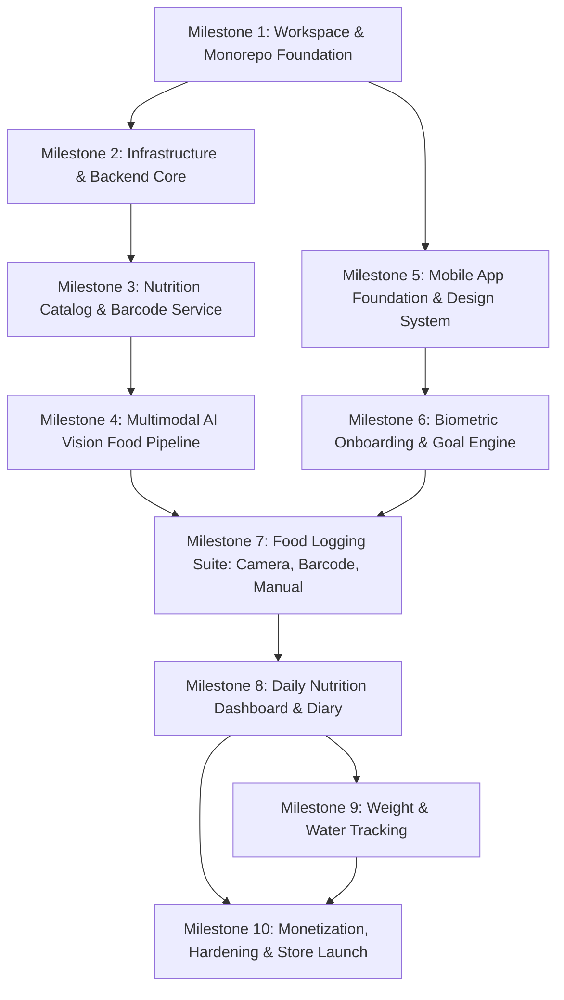

# CAL METER — Engineering Development Roadmap & Milestones

**Document Version:** 1.0.0  
**Status:** Approved Architecture Draft  
**Owner:** Technical Lead & Principal Architect  
**Last Updated:** November 2026

---

## 1. Roadmap Overview & Execution Methodology

The engineering roadmap is sequenced into **ten sequential, test-driven milestones**. Each milestone delivers an end-to-end verifiable capability with zero orphaned code, rigid type boundaries, and automated regression checks.

---

## 2. Milestone Breakdown & Measurable Acceptance Criteria

---

### Milestone 1: Workspace & Monorepo Foundation

- **Scope:**
  - Initialize `npm` monorepo configuration with npm workspaces (`apps/*`, `packages/*`).
  - Configure root TypeScript `tsconfig.base.json`, ESLint, Prettier, and environment scripts.
  - Implement `@calmeter/shared`: BMR (Mifflin-St Jeor with safe population checks), TDEE, macro formulas, food-specific regional conversion units (_katori_, _roti_, _cup_, _grams_).
  - Implement `@calmeter/contracts`: Zod schemas for Auth, Profile, Goals, Scans, Foods, Servings, and Diary requests/responses.
- **Dependencies:** None.
- **Acceptance Criteria:**
  1. `npm run build` compiles all packages with zero TypeScript warnings or errors.
  2. 100% unit test coverage for `@calmeter/shared` mathematical formulas with Vitest.
  3. Shared Zod contracts validate both valid and invalid fixtures across all domain entities.

---

### Milestone 2: Infrastructure & Backend Core

- **Scope:**
  - Docker Compose configuration for PostgreSQL 16 and Redis 7.
  - Initialize Prisma ORM with complete schema (`users`, `profiles`, `goals`, `food_items`, `meals`, `scans`, `subscriptions`).
  - Express.js server scaffolding with Helmet, CORS, Pino structured logging with `x-request-id`, and centralized error middleware.
  - Firebase Admin SDK authentication middleware verifying Bearer tokens.
  - BullMQ queue setup with Redis connection management and worker harness.
- **Dependencies:** Milestone 1.
- **Acceptance Criteria:**
  1. `docker compose up` spins up healthy PostgreSQL and Redis containers with persistent volumes.
  2. `prisma migrate dev` executes cleanly and generates the type-safe client.
  3. `GET /health` returns `{ status: "ok", db: true, redis: true }`.
  4. Authenticated routes reject invalid/expired tokens with `401 AUTH_UNAUTHORIZED` and accept valid test tokens.

---

### Milestone 3: Nutrition Database & Core Catalog Service

- **Scope:**
  - PostgreSQL full-text and trigram index configuration (`pg_trgm`) on `food_items`.
  - Ingestion seed script for common regional dishes (verifying ICMR-NIN commercial licensing terms) and USDA standard whole foods.
  - Barcode lookup engine: queries Redis L2 cache -> PostgreSQL -> Open Food Facts API with auto-caching and ODbL attribution compliance.
  - Endpoints: `GET /foods/search`, `GET /foods/barcode/:barcode`, `POST /foods/custom`.
- **Dependencies:** Milestone 2.
- **Acceptance Criteria:**
  1. Trigram fuzzy search queries ("dal tadka", "paneer butter", "chapati") respond within design targets with accurate results.
  2. Scanning a known barcode returns nutritional facts within target latency and complies with ODbL attribution requirements.
  3. Custom food creation correctly persists and is scoped strictly to the authoring user.

---

### Milestone 4: Multimodal AI Vision Food Pipeline

- **Scope:**
  - S3-compatible storage integration (Cloudflare R2 / AWS S3) with presigned PUT upload URL generation.
  - BullMQ background scan worker implementing `IVisionProvider` with the selected multimodal vision model (verified against current provider documentation).
  - System prompt and structured JSON Schema enforcement for multi-item food identification (treated as estimates with uncertainty).
  - Deterministic Nutrition Matcher reconciling visual detections against the PostgreSQL food catalog.
  - Endpoints: `POST /scans/presign-upload`, `POST /scans/:id/analyze`, `GET /scans/:id`.
- **Dependencies:** Milestone 2, Milestone 3.
- **Acceptance Criteria:**
  1. Presigned upload URLs expire after 300 seconds and enforce `image/jpeg` content-type lock.
  2. Mock and live food photos yield structured JSON items with cooking styles, portion units, and confidence scores within design target latency.
  3. Matched items calculate exact calories and macros via deterministic database multiplication.

---

### Milestone 5: Mobile App Foundation & Design System

- **Scope:**
  - Initialize pure React Native CLI project with TypeScript (Bridgeless / New Architecture enabled).
  - Configure React Navigation v7 with native stacks and bottom tab bar.
  - Implement atomic design system: Typography, Color Palette (modern dark/light mode with Cal AI aesthetic polish), Spacing, Buttons, Inputs, Cards, Progress Rings, and Macro Bars.
  - Setup Zustand root stores (AuthStore, DiaryStore, ScanStore) and TanStack Query client with `react-native-mmkv` persistence.
- **Dependencies:** Milestone 1.
- **Acceptance Criteria:**
  1. Mobile app compiles and boots on both iOS simulator and Android emulator with zero errors.
  2. Design system components render consistently across various device resolutions.
  3. Zustand state persists and rehydrates synchronously via MMKV.

---

### Milestone 6: Personal Onboarding & Goal Calculation Engine

- **Scope:**
  - Multi-step animated onboarding wizard: Gender, DOB, Height, Weight, Activity Level, Goal, Diet Preference.
  - Live calculation preview displaying BMR, TDEE, and daily calorie/macro distribution.
  - Goal confirmation screen with target timeline animation.
  - Profile sync with backend API (`PUT /profile`, `PUT /goals`).
- **Dependencies:** Milestone 5, Milestone 2.
- **Acceptance Criteria:**
  1. Onboarding wizard collects all required biometrics with React Hook Form + Zod validation.
  2. Calculated calorie targets match the clinical Mifflin-St Jeor formula within 1 kcal precision.
  3. Profile and initial goal records persist in PostgreSQL upon onboarding completion.

---

### Milestone 7: Food Logging Suite (Camera, Barcode, Manual)

- **Scope:**
  - React Native Vision Camera integration with custom camera HUD (viewfinder, shutter button, gallery picker, flash toggle).
  - Client-side image compression down to < 250 KB and direct upload to S3 presigned URL.
  - Interactive Scan Review Bottom Sheet: Item cards, confidence badges, serving unit selector (_katori_, _roti_, _grams_, _pieces_), richness toggles (_light oil_ vs _rich_).
  - Barcode scanning camera mode powered by MLKit with instant audio/haptic feedback.
  - Fast search and manual food quick-log screens.
- **Dependencies:** Milestone 4, Milestone 5, Milestone 6.
- **Acceptance Criteria:**
  1. Capturing a photo compresses and uploads the image, triggers analysis, and displays the review sheet in < 2.5 seconds.
  2. Adjusting the portion slider dynamically updates calories and macros in real time on the review card.
  3. Tapping "Confirm & Log" commits items to the selected meal slot via `POST /diary/meals`.

---

### Milestone 8: Daily Nutrition Dashboard & Historical Diary

- **Scope:**
  - Dynamic Calorie Ring showing remaining calories with smooth spring animation.
  - Macro progress bars (Protein, Carbs, Fat, Fiber) with target indicators.
  - Meal slot cards (Breakfast, Lunch, Dinner, Snack) with itemized foods, portion details, and individual calories.
  - Food editing: Tap item to edit portion, swipe-left to delete item.
  - Historical date carousel allowing navigation across past and future dates.
- **Dependencies:** Milestone 7.
- **Acceptance Criteria:**
  1. Dashboard loads within 150 ms from local cache with background revalidation.
  2. Adding, updating, or deleting a food item instantly recomputes parent meal and daily calorie ring.
  3. Historical date navigation queries and displays past diary logs seamlessly.

---

### Milestone 9: Weight & Water Tracking

- **Scope:**
  - Weight logging screen with interactive historical trend chart.
  - Quick-add water tracker with animated water bottle / glass counter.
  - Sync with backend tracking endpoints (`/tracking/weight`, `/tracking/water`).
- **Dependencies:** Milestone 8.
- **Acceptance Criteria:**
  1. Logging a new weight reading updates the historical graph with moving average.
  2. Water intake increments persist across app restarts and sync with daily targets.

---

### Milestone 10: Monetization, Hardening & Store Launch Readiness

- **Scope:**
  - RevenueCat SDK integration for Apple In-App Purchase and Google Play Billing.
  - Free tier daily scan quota enforcement (3 scans/day) with Pro paywall modal.
  - Sentry crash reporting and PostHog analytics instrumentation.
  - In-app Account Deletion and GDPR Data Export implementation.
  - Production build optimizations: Android ProGuard / R8, Hermes engine, Apple Privacy Manifests, release signing.
- **Dependencies:** All previous milestones.
- **Acceptance Criteria:**
  1. Paywall appears on the 4th daily scan; sandbox purchase immediately unlocks unlimited scans.
  2. Account deletion completely purges user data across PostgreSQL, S3, Firebase, and RevenueCat.
  3. Zero critical vulnerabilities in `npm audit` and 99.8% crash-free sessions in staging.
