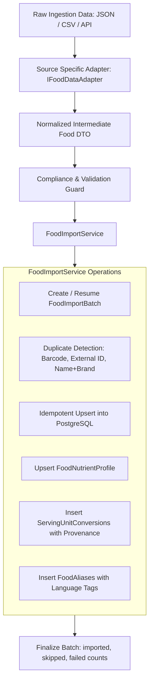

# CAL METER — Food Data Sources, Licensing & Import Specification

**Document Version:** 1.0.0  
**Status:** Approved Architecture Specification  
**Owner:** Principal Backend Architect & Data Governance Lead  
**Last Updated:** November 2026

---

## 1. Executive Summary & Legal Compliance Framework

CAL METER delivers an intelligent, culturally nuanced nutrition tracking experience spanning Indian regional cuisines, global restaurant dishes, and packaged grocery products. Providing accurate, verifiable nutritional data requires aggregating information across disparate public, commercial, and open-source databases while strictly adhering to intellectual property laws, licensing restrictions, and clinical data governance.

This specification documents:

1. Implemented versus planned food data sources and their legal classification.
2. Mandatory commercial redistribution and attribution compliance rules.
3. The clinical and biochemical distinction between unmeasured nutrients (`NULL`) and verified absence (`0`).
4. The extensible data import pipeline architecture with idempotency, provenance tracking, and duplicate prevention.
5. Step-by-step engineering instructions for adding new source adapters.

---

## 2. Source Classification & Current Implementation Status

| Data Source                        | Status                           | Source Type                     | Applicable License / Terms                         | Commercial Distribution Policy                                                                                   |
| :--------------------------------- | :------------------------------- | :------------------------------ | :------------------------------------------------- | :--------------------------------------------------------------------------------------------------------------- |
| **Reference Indian Food Database** | **Implemented**                  | Proprietary Curated Catalog     | Proprietary (CAL METER)                            | Unrestricted within CAL METER platform; culturally calibrated serving units (_katori_, _roti_, _piece_, _bowl_). |
| **USDA FoodData Central**          | **Foundation Implemented**       | National Nutrient Database      | CC0 1.0 Universal / Public Domain (US Gov)         | Unrestricted commercial use with standard attribution.                                                           |
| **Open Food Facts**                | **Foundation Implemented**       | Crowd-sourced Packaged Goods    | ODbL 1.0 (Open Database License)                   | Commercial use permitted; derived database improvements must remain ODbL; explicit attribution mandatory.        |
| **ICMR-NIN IFCT 2017**             | **Compliance Guard Implemented** | National Research Institute     | Copyright © ICMR - National Institute of Nutrition | **Automated ingestion blocked without official commercial partner license.**                                     |
| **User Custom Foods**              | **Implemented**                  | Tenant-Created Personal Catalog | Proprietary to User                                | Scoped strictly to the creating user; never published globally without verification.                             |

---

## 3. Commercial Redistribution & Legal Constraints

### 3.1. Reference Indian Food Database (Internal)

- **Scope:** 50+ hand-curated Indian staples covering North Indian, South Indian, Maharashtrian, Gujarati, and street foods.
- **Serving Units:** Directly incorporates culturally authentic serving metrics with empirically verified density and gram conversions (_katori_ = 150g dry sabzi / 200g dal, _medium roti_ = 35g, _paratha_ = 70g, _idli_ = 40g, _masala dosa_ = 180g).
- **Licensing:** Proprietary asset of CAL METER. No external license constraints.

### 3.2. USDA FoodData Central (FDC)

- **Publisher:** Agricultural Research Service, U.S. Department of Agriculture.
- **License:** CC0 1.0 Universal (Public Domain Dedication).
- **Terms:** Works created by officers or employees of the United States Government as part of their official duties are not eligible for domestic copyright protection under 17 U.S.C. § 105.
- **Attribution Requirement:** While legally public domain, standard scholarly and data integrity attribution is maintained in `food_data_sources` and visible in item provenance.
- **CAL METER Ingestion:** The `UsdaFoodDataAdapter` normalizes USDA Foundation and SR Legacy nutrients per 100g. Nutrient IDs mapped include:
  - Energy: 1008 (kcal)
  - Protein: 1003 (g)
  - Carbohydrates: 1005 (g)
  - Total Fat: 1004 (g)
  - Dietary Fiber: 1079 (g)
  - Sodium: 1093 (mg)
  - Potassium: 1092 (mg)
  - Calcium: 1087 (mg)
  - Iron: 1089 (mg)

### 3.3. Open Food Facts (OFF)

- **Publisher:** Open Food Facts Community / Open Food Facts Association.
- **License:** Open Database License (ODbL) 1.0 for the database; Database Contents License (DbCL) 1.0 for contents.
- **Legal Compliance Rules:**
  1. **Attribution:** When displaying data sourced from Open Food Facts, CAL METER must credit: _"Data sourced from Open Food Facts (opendatacommons.org/licenses/odbl)"_.
  2. **Share-Alike on Database Alterations:** If CAL METER creates an altered, adapted, or publicly redistributed version of the Open Food Facts database itself, those database adaptations must be made available under ODbL.
  3. **Collective Works vs. Derived Databases:** Storing Open Food Facts items inside the CAL METER PostgreSQL database alongside independent proprietary items constitutes a Collective Database under ODbL Section 4.4. CAL METER maintains raw source tagging (`source = OPEN_FOOD_FACTS`) to isolate ODbL-covered records from proprietary user and curated records.
  4. **Packaged Barcode Priority:** OFF serves as the primary external resolver for EAN-13, EAN-8, and UPC-A packaged food barcodes.
  5. **Unit Conversions:** Open Food Facts provides sodium in grams per 100g; `OpenFoodFactsAdapter` converts this to milligrams (`mg = g * 1000`) for consistency with clinical standards.

### 3.4. ICMR-NIN IFCT 2017 (Indian Food Composition Tables)

- **Publisher:** National Institute of Nutrition (NIN), Indian Council of Medical Research (ICMR), Department of Health Research, Ministry of Health and Family Welfare, Government of India.
- **Legal Status & Copyright:**
  - The publication _Indian Food Composition Tables 2017_ (Longvah et al.) is protected under the Indian Copyright Act, 1957.
  - Unlike US government works, publications of the Indian government and autonomous research councils like ICMR are copyrighted by default (Crown/Government Copyright).
  - While factual raw chemical measurements are scientific facts, the comprehensive compilation, specific analytical datasets, and proprietary tables cannot be scraped, bulk-reproduced, or ingested into commercial software without an express written licensing agreement or commercial data partnership with ICMR-NIN.
- **CAL METER Architectural Guard:**
  - The `IcmrNinAdapter` implements a mandatory **fail-closed compliance guard**.
  - Any attempt to ingest raw ICMR-NIN data files without an active `ICMR_NIN_LICENSE_TOKEN` throws `LicensingComplianceError`:
    ```
    ICMR-NIN IFCT data cannot be imported for commercial use without an express commercial license agreement from ICMR-NIN.
    ```
  - Standard culinary reference values in CAL METER's `ReferenceIndianFoodAdapter` are compiled from independent culinary measurements, public literature, and standard kitchen recipe analyses rather than proprietary IFCT data extracts.

---

## 4. Nutritional Data Precision: `NULL` vs. `0`

A foundational flaw in novice nutrition applications is casting missing nutrient fields to `0`. This creates dangerous clinical distortions (e.g., treating an unanalyzed food as "zero sodium" or "zero sugar" for a hypertensive or diabetic patient).

### 4.1. Semantics

- **`null` (Unknown / Not Analyzed):** The nutrient content of the food was not measured, is omitted by the manufacturer, or has not been laboratory-analyzed.
- **`0.00` (Verified Absent / True Zero):** The food has been analyzed and contains zero (or below analytical detection limits) of that nutrient.

### 4.2. Database Schema Enforcement

- In `food_items`, baseline macros (`calories`, `protein`, `carbs`, `fat`) are mandatory (`NOT NULL`) with PostgreSQL `CHECK (field >= 0)`.
- Fiber in `food_items` defaults to `0.00` for legacy backward compatibility.
- In `food_nutrient_profiles`, all detailed nutrients (`saturatedFat`, `transFat`, `sugar`, `addedSugar`, `sodium`, `cholesterol`, `potassium`, `calcium`, `iron`, `vitaminD`, `vitaminB12`) are **strictly nullable (`Decimal?`)**.
- The `micronutrients` JSON column stores unstructured micronutrients preserving `null` vs `0` keys explicitly:
  ```json
  {
    "magnesium_mg": 28.5,
    "zinc_mg": null,
    "vitamin_c_mg": 0.0
  }
  ```

### 4.3. Mathematical Aggregation Rules

- When summing daily nutrition logs in `@calmeter/shared`:
  - Standard macros with known values are summed deterministically.
  - If a micronutrient is `null` across all items, the aggregated total remains `null` (not zero).
  - If a micronutrient is `0` across items, the aggregated total is `0`.
  - If some items have `null` and others have values, the partial sum is calculated alongside an uncertainty flag indicating incomplete micronutrient coverage.

---

## 5. Extensible Import Architecture



### 5.1. Adapter Interface (`IFoodDataAdapter`)

Every data source implements the unified `IFoodDataAdapter` interface (`apps/api/src/importers/types.ts`):

```typescript
export interface IFoodDataAdapter {
  readonly source: FoodSource;
  readonly defaultProvenance: string;
  validateSourceCompliance(): Promise<void>;
  normalizeRecord(raw: unknown): Promise<NormalizedFoodData | null>;
}
```

### 5.2. Duplicate Detection Strategy

To maintain catalog hygiene during bulk imports:

1. **Barcode Match:** Packaged goods matching an existing non-archived `FoodItem.barcode` are matched first.
2. **External ID Match:** Items matching `source` and `externalId` are updated idempotently.
3. **Exact Name & Brand Match:** Non-barcode items matching case-insensitive name, brand, and source update the existing record.
4. **Ownership Protection:** An import batch can **never overwrite** a custom food created by a user (`isCustom = true`), nor can it overwrite an admin-verified item (`isVerified = true`) without explicit administrative override flags.

### 5.3. Provenance & Batch Auditing

- Every bulk execution creates a `FoodImportBatch` record with `batchNumber`, `source`, `totalRecords`, `importedRecords`, `skippedRecords`, `failedRecords`, and a detailed `errorLog` JSON array.
- Every `ServingUnitConversion` records its origin in `provenance` (`USDA_DERIVED`, `OPEN_FOOD_FACTS`, `ICMR_DERIVED`, `MANUFACTURER_LABEL`, `AI_ESTIMATED`, `USER_CONFIGURED`).

### 5.4. Dry-Run Verification

`FoodImportService.importBatch()` supports `{ dryRun: true }`:

- Runs all normalization, validation, and duplicate-checking logic.
- Verifies that nutrient numbers satisfy non-negative constraints.
- Simulates record creation without writing to the database.
- Returns comprehensive statistics (`total`, `imported`, `skipped`, `failed`) and validation errors.

---

## 6. Guide: Adding a Future Source Adapter

To add support for a new food composition source (e.g., _AusNut_, _CoFID / McCance and Widdowson_, _FoodData India Partner_):

### Step 1: Update Enums & Schema (if adding a new `FoodSource`)

1. In `packages/shared/src/constants/enums.ts`, add the identifier to `FoodSource`.
2. In `infrastructure/prisma/schema.prisma`, add the enum value to `enum FoodSource`.
3. In `apps/api/src/data/dataSources.ts`, register the source metadata, licensing URL, and attribution text.

### Step 2: Implement the Adapter Class

Create `apps/api/src/importers/adapters/<sourceName>.adapter.ts` implementing `IFoodDataAdapter`:

```typescript
import { FoodSource } from '@calmeter/shared';
import { IFoodDataAdapter, NormalizedFoodData } from '../types.js';

export class NewSourceAdapter implements IFoodDataAdapter {
  public readonly source = FoodSource.NEW_SOURCE;
  public readonly defaultProvenance = 'NEW_SOURCE_DERIVED';

  public async validateSourceCompliance(): Promise<void> {
    // Assert required API keys, licenses, or agreements
    if (!process.env.NEW_SOURCE_API_KEY) {
      throw new Error('Missing NEW_SOURCE_API_KEY');
    }
  }

  public async normalizeRecord(raw: unknown): Promise<NormalizedFoodData | null> {
    const item = raw as any;

    // 1. Validate mandatory fields
    if (!item.name || item.energyKcal === undefined) {
      return null;
    }

    // 2. Map macros per 100g
    return {
      name: item.name.trim(),
      brand: item.brand?.trim() || null,
      barcode: item.upc || null,
      source: this.source,
      externalId: String(item.id),
      cuisine: item.cuisine || null,
      isVerified: true,
      standardWeightGrams: 100,
      calories: Number(item.energyKcal),
      protein: Number(item.proteinG || 0),
      carbs: Number(item.carbsG || 0),
      fat: Number(item.fatG || 0),
      fiber: item.fiberG != null ? Number(item.fiberG) : null,
      nutrientProfile: {
        saturatedFat: item.satFatG != null ? Number(item.satFatG) : null,
        sodium: item.sodiumMg != null ? Number(item.sodiumMg) : null,
        sugar: item.sugarG != null ? Number(item.sugarG) : null,
        // ... map remaining micronutrients
      },
      servings: [
        {
          unitName: 'g',
          gramWeight: 1,
          isDefault: false,
          provenance: this.defaultProvenance,
        },
      ],
      aliases: item.synonyms?.map((syn: string) => ({ alias: syn, isPrimary: false })) || [],
    };
  }
}
```

### Step 3: Add Vitest Unit Tests

Create unit tests verifying:

1. Normalization of typical source payload into `NormalizedFoodData`.
2. Preservation of `null` vs `0` for unmeasured micronutrients.
3. Rejection of invalid records (negative calories, missing names).
4. Compliance guard enforcement when credentials or licenses are missing.

### Step 4: Register in Seed and Ingestion Service

Inject the adapter into `FoodImportService` or the automated ETL scheduled task.
