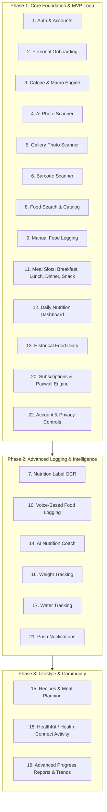

# CAL METER — Product Requirements Document (PRD)

**Document Version:** 1.1.0  
**Status:** Approved Architecture Specification  
**Owner:** Principal Software Architect & Product Engineering Team  
**Package Manager:** **npm only** (npm workspaces)  
**Last Updated:** November 2026

---

## 1. Executive Summary & Product Vision

**CAL METER** is an AI-powered nutrition intelligence and calorie tracking mobile application for iOS and Android. It transforms the burdensome task of traditional manual diet logging into an effortless, rapid visual experience. By coupling multimodal computer vision with authoritative global and regional nutrition datasets, CAL METER allows users to photograph meals, review automated portion and nutrient estimates, make granular adjustments, and log their daily nutrition in seconds.

While inspired by the visual polish, simplicity, and speed of modern apps such as Cal AI, CAL METER differentiates itself through:

1. **Regional & Home-Cooked Food Modeling:** First-class support for Indian regional dishes, complex mixed curries, home-cooked meals, and street foods alongside standard western and international cuisines.
2. **Deterministic Nutritional Rigor:** Strict decoupling of AI visual identification from nutritional valuation. Visual models identify constituents and provide volumetric estimates (treated transparently as estimates with uncertainty); authoritative reference datasets (USDA FoodData Central, Open Food Facts under ODbL terms, and ICMR-NIN Indian Food Composition Tables subject to commercial licensing verification) compute exact macronutrients and calories.
3. **Transparent Uncertainty:** The UI explicitly communicates estimation confidence and uncertainty, offering intuitive portion sliders and disambiguation choices rather than presenting artificial certainty.
4. **Zero-Guilt User Experience:** A modern, encouraging, and friction-free interface built to foster sustainable healthy habits without disordered eating triggers.

---

## 2. Target Personas

### Persona A: "Rohan" — The Indian Urban Professional

- **Demographics:** 29 years old, Software Engineer in Bengaluru, exercises 3x weekly.
- **Pain Point:** Traditional apps fail to accurately log home-cooked Indian meals. A bowl of _dal tadka_ or homemade _sabzi_ with two _chapatis_ is tedious to break down by individual raw ingredients.
- **Need:** Point the camera at a stainless steel plate (thali), automatically identify 2 _phulkas_ (rotis), 1 _katori dal_, and 1 _katori bhindi masala_, adjust the oil/ghee assumption with one tap, and save.

### Persona B: "Sarah" — The Busy Fitness Enthusiast

- **Demographics:** 34 years old, Marketing Director in London, tracks macros for strength training.
- **Pain Point:** Tired of scanning barcodes on meal-prep containers and manually weighing food during dinner with friends or at business lunches.
- **Need:** High-speed photo capture that works in restaurants, recognizes mixed protein bowls, estimates portions realistically, and syncs seamlessly with daily macro targets.

### Persona C: "Elena" — The Sustained Weight-Loss Seeker

- **Demographics:** 42 years old, Teacher, seeking sustainable fat loss without obsessive counting.
- **Pain Point:** Overwhelmed by complex nutritional jargon, intimidating charts, and tedious text searches for every single snack.
- **Need:** A friendly, minimalist daily calorie ring, quick barcode scanning for packaged snacks, smart streak tracking, and helpful feedback on nutritional balance.

---

## 3. Core Value Propositions

| Value Proposition             | Description                                                                                                                                              |
| :---------------------------- | :------------------------------------------------------------------------------------------------------------------------------------------------------- |
| **Rapid Multi-Item Scan**     | Detect multiple foods, condiments, and sides in a single photo (unverified design target: < 2.5s).                                                       |
| **Regional Kitchen Native**   | Understands cooking mediums, mixed curries, and food-specific regional serving units (_katori_, _roti_, _cup_, _piece_, _grams_).                        |
| **Editable Uncertainty**      | Machine-learning detections are transparently flagged with confidence tiers (High / Moderate / Review Needed) and immediate portion controls.            |
| **Extensive Food Coverage**   | Unified database combining USDA FoodData Central (whole foods), Open Food Facts (global packaged goods under ODbL), and curated Indian regional recipes. |
| **Offline-Resilient Logging** | Client-first caching allows users to review diary entries and log standard favorites even with intermittent cellular connectivity.                       |

---

## 4. Complete Feature Scope & Lifecycle

---

## 5. Detailed Feature Requirements (Phase 1 Focus)

### 5.1. Authentication and User Accounts (Feature 1)

- **FR-1.1:** Support passwordless authentication via Firebase Auth: Apple Sign-In (mandatory for iOS App Store), Google Sign-In, and Phone Number (SMS OTP) / Email Magic Link.
- **FR-1.2:** Support a guest mode ("Try without account") that stores data locally in encrypted client storage and seamlessly migrates records upon account creation.
- **FR-1.3:** Maintain secure session tokens via short-lived JWTs and auto-refresh mechanisms.
- **FR-1.4:** Enforce server-side user record synchronization via PostgreSQL transaction upon first authentication.

### 5.2. Personal Onboarding & Goal Calculation (Features 2 & 3)

- **FR-2.1:** Collect biometrics: Gender, Date of Birth (Age), Height (cm or ft/in), Current Weight (kg or lbs), Target Weight, Desired Pace (0.1 kg to 1.0 kg per week).
- **FR-2.2:** Collect lifestyle inputs: Baseline Activity Level (Sedentary, Lightly Active, Moderately Active, Very Active, Extra Active), Dietary Restrictions (Vegetarian, Vegan, Non-Vegetarian, Eggetarian, Jain, Keto, Halal), Primary Goal (Lose Weight, Maintain Weight, Build Muscle).
- **FR-2.3:** Calculate Basal Metabolic Rate (BMR) using the validated **Mifflin-St Jeor equation**:
  $$\text{BMR}_{\text{men}} = 10 \times \text{weight (kg)} + 6.25 \times \text{height (cm)} - 5 \times \text{age (y)} + 5$$
  $$\text{BMR}_{\text{women}} = 10 \times \text{weight (kg)} + 6.25 \times \text{height (cm)} - 5 \times \text{age (y)} - 161$$
- **FR-2.4:** Compute Total Daily Energy Expenditure (TDEE) = $\text{BMR} \times \text{PAL (Physical Activity Level)}$.
- **FR-2.5: Safe Calculation Boundaries & Unsupported Populations:**
  - BMR and TDEE are mathematical estimates, not medical prescriptions.
  - **No Universal Floor:** Do not enforce arbitrary universal calorie floors (e.g. 1,200/1,500 kcal). Safety is evaluated dynamically relative to the user's specific TDEE and BMR.
  - **No Aggressive Targets:** Daily deficits exceeding 25% of TDEE or target paces exceeding 1.0 kg/week are flagged with clinical warnings.
  - **Unsupported Populations:** Standard adult predictive equations are not clinically validated for minors (under 18) or during pregnancy and lactation. When these conditions are detected, automated calorie target generation is restricted, returning safe guidance disclaimers.
- **FR-2.6:** Generate initial Macronutrient Distribution based on goal archetype:
  - _Fat Loss:_ 30% Protein, 40% Carbohydrates, 30% Fat.
  - _Muscle Gain:_ 30% Protein, 50% Carbohydrates, 20% Fat.
  - _Maintenance:_ 25% Protein, 50% Carbohydrates, 25% Fat.
- **FR-2.7:** Provide manual override allowing users to customize exact gram/macro ratios and revise targets at any time.

### 5.3. AI Food Photo & Gallery Scanner (Features 4 & 5)

- **FR-4.1:** Native camera preview powered by React Native Vision Camera with pinch-to-zoom, tap-to-focus, and low-light flash toggle.
- **FR-4.2:** Photo capture pipeline: Capture -> Compress client-side (max 1024x1024 JPEG, quality 0.8, target size ~150-250 KB) -> Direct upload to S3-compatible private storage using short-lived presigned URL.
- **FR-4.3:** Gallery import: Select image from native photo library -> EXIF metadata stripping -> Compression -> Presigned upload.
- **FR-4.4:** Analysis pipeline: Trigger multimodal vision provider selected through formal documentation verification. Model identifies constituent items, cooking styles, and volumetric estimates.
- **FR-4.5: Transparent Uncertainty & Review UI:**
  - Photo-based portion and food identification are treated strictly as **estimates with inherent uncertainty**.
  - Review card explicitly shows:
    - Detected Food Name & Category.
    - Estimated Serving Unit & Quantity (e.g., "1.5 katori / ~225g").
    - Portion Stepper (+ / -) and custom weight slider.
    - Visual Confidence Badge (High / Moderate / Review Needed).
    - Disambiguation options (e.g. "Did you mean Chicken Tikka or Butter Chicken?").
    - "Add Missing Item" and "Remove Item" triggers.
- **FR-4.6:** Confirmation: Single tap "Log to [Meal Slot]" commits records to user's daily diary.

### 5.4. Barcode Scanner (Feature 6)

- **FR-6.1:** Real-time on-device barcode detection (UPC-A, UPC-E, EAN-8, EAN-13, Code 128) using hardware-accelerated ML scanner.
- **FR-6.2: Open Food Facts Integration & ODbL Compliance:**
  - Barcode lookup against Open Food Facts API and local PostgreSQL cache.
  - **Licensing Compliance:** Open Food Facts is published under the Open Database License (ODbL). Any redistribution or derived database modifications must adhere to ODbL attribution and share-alike terms.
- **FR-6.3:** Display of serving size, brand name, front-of-pack thumbnail, and complete nutritional facts.
- **FR-6.4:** Fallback when barcode not found: prompt user to enter details manually or photograph nutrition label.

### 5.5. Food Search & Manual Food Logging (Features 8 & 9)

- **FR-8.1:** Debounced search over verified database items (USDA and regional recipe datasets).
- **FR-8.2:** Fuzzy search supporting regional naming conventions (e.g. "Roti", "Phulka", or "Chapati").
- **FR-8.3:** Recent foods, frequent foods, and custom user-created food templates.
- **FR-8.4:** Manual quick-add: enter raw calories and optional macros directly.

### 5.6. Daily Nutrition Dashboard & Historical Diary (Features 11, 12, 13)

- **FR-12.1:** Dynamic Calorie Ring (Target - Consumed = Remaining Calories).
- **FR-12.2:** Macro Progress Bars: Protein, Carbs, Fat, and Dietary Fiber consumed vs target in grams and percentage.
- **FR-12.3:** Four distinct Meal Slots: Breakfast, Lunch, Dinner, Snacks.
- **FR-12.4:** Itemized list of foods with individual calories, serving size, and quick action sheet.
- **FR-12.5:** Historical Calendar View: Swipeable date carousel to view past dates and log retrospectively.

### 5.7. Subscription & Monetization (Feature 20)

- **FR-20.1:** RevenueCat SDK integration for cross-platform App Store and Google Play billing.
- **FR-20.2:** Free Tier Limits: 3 AI photo scans per day, unlimited manual search and barcode scanning, 7-day diary history.
- **FR-20.3:** Premium Tier ("CAL METER Pro"): Unlimited AI photo scans, unlimited history, detailed micronutrient breakdown, export data to CSV/PDF.
- **FR-20.4:** Server-side entitlement validation: Client-side receipt checks are never trusted alone; backend verifies active entitlements via RevenueCat REST API before dispatching vision jobs.

### 5.8. Account Management, Privacy & Security (Feature 22)

- **FR-22.1:** Strict tenant data isolation at the database layer (`userId` foreign keys on all operational tables).
- **FR-22.2:** Self-service Account Deletion (GDPR & Apple App Store Guideline 5.1.1(v) compliant) triggering complete cascading purge of user record, logs, and storage assets.
- **FR-22.3:** Self-service Data Export: Request JSON or CSV bundle of full user logging history.
- **FR-22.4:** Opt-in / Opt-out for model improvement data retention.

---

## 6. Food Serving Modeling & Regional Data Specifications

### 6.1. Food-Specific Household Serving Units

**Core Principle:** Never assume every food has the same density or household serving weight.
CAL METER enforces food-specific conversion matrices:

- **Katori:** Dal/curd (~200g), dry leafy sabzi (~120-150g), puffed rice (~40g).
- **Roti / Chapati:** Dry phulka (~30-35g), tandoori roti (~50g), paratha (~70-80g).
- **Ladle:** Cooked rice/biryani (~120g), liquid curry (~100g).
- **Glass:** Water (~250g), sweet lassi (~280g).
- When a reliable food-specific conversion mapping does not exist, an explicit unsupported status is returned, prompting the user to log in grams.

### 6.2. Regional Dataset Licensing & Provenance

- **ICMR-NIN / IFCT Data:** Commercial licensing terms must be formally verified before bundling or redistributing Indian Food Composition Tables data in production.
- **Open Food Facts:** ODbL requirements (attribution and share-alike) must be respected.
- Food records must preserve source and serving provenance (`USDA`, `OPEN_FOOD_FACTS`, `ICMR_NIN_IFCT`, `CUSTOM_USER`, `ESTIMATED_HOUSEHOLD`).

---

## 7. Non-Functional Requirements (NFRs)

_Note: Latency and throughput figures represent unverified engineering design targets until benchmarked in production._

| Domain                  | Unverified Design Target                                        | Rationale                                              |
| :---------------------- | :-------------------------------------------------------------- | :----------------------------------------------------- |
| **AI Scan Latency**     | **Target: P95 < 2.5 seconds** (capture to review)               | Target for responsive user experience.                 |
| **API Latency**         | **Target: P95 < 150 ms** for diary and search queries           | Prevents stuttering during navigation.                 |
| **Cold App Startup**    | **Target: < 1.2 seconds** to interactive dashboard              | Smooth consumer experience.                            |
| **Availability**        | **Target: 99.9% uptime** on core API and database               | Critical daily health tool used multiple times daily.  |
| **Network Efficiency**  | Client-side image compression down to < 250 KB                  | Smooth performance over mobile networks.               |
| **Security & Privacy**  | AES-256 at rest, TLS 1.3 in transit, zero plain-text biometrics | Strict compliance with DPDP Act (India) and GDPR (EU). |
| **Crash-Free Sessions** | **Target: > 99.8% crash-free sessions** via Sentry              | Production consumer quality threshold.                 |
