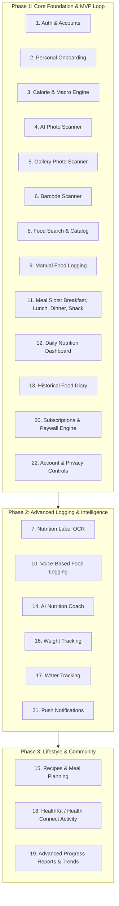

# CAL METER — Product Requirements Document (PRD)

**Document Version:** 1.1.0  
**Status:** Approved Architecture Specification  
**Owner:** Principal Software Architect & Product Engineering Team  
**Package Manager:** **npm only** (npm workspaces)  
**Last Updated:** November 2026

---

## 1. Executive Summary & Product Vision

**CAL METER** is an AI-powered nutrition intelligence and calorie tracking mobile application for iOS and Android. It transforms the burdensome task of traditional manual diet logging into an effortless, rapid visual experience. By coupling multimodal computer vision with authoritative global and regional nutrition datasets, CAL METER allows users to photograph meals, review automated portion and nutrient estimates, make granular adjustments, and log their daily nutrition in seconds.

While inspired by the visual polish, simplicity, and speed of modern apps such as Cal AI, CAL METER differentiates itself through:

1. **Regional & Home-Cooked Food Modeling:** First-class support for Indian regional dishes, complex mixed curries, home-cooked meals, and street foods alongside standard western and international cuisines.
2. **Deterministic Nutritional Rigor:** Strict decoupling of AI visual identification from nutritional valuation. Visual models identify constituents and provide volumetric estimates (treated transparently as estimates with uncertainty); authoritative reference datasets (USDA FoodData Central, Open Food Facts under ODbL terms, and ICMR-NIN Indian Food Composition Tables subject to commercial licensing verification) compute exact macronutrients and calories.
3. **Transparent Uncertainty:** The UI explicitly communicates estimation confidence and uncertainty, offering intuitive portion sliders and disambiguation choices rather than presenting artificial certainty.
4. **Zero-Guilt User Experience:** A modern, encouraging, and friction-free interface built to foster sustainable healthy habits without disordered eating triggers.

---

## 2. Target Personas

### Persona A: "Rohan" — The Indian Urban Professional

- **Demographics:** 29 years old, Software Engineer in Bengaluru, exercises 3x weekly.
- **Pain Point:** Traditional apps fail to accurately log home-cooked Indian meals. A bowl of _dal tadka_ or homemade _sabzi_ with two _chapatis_ is tedious to break down by individual raw ingredients.
- **Need:** Point the camera at a stainless steel plate (thali), automatically identify 2 _phulkas_ (rotis), 1 _katori dal_, and 1 _katori bhindi masala_, adjust the oil/ghee assumption with one tap, and save.

### Persona B: "Sarah" — The Busy Fitness Enthusiast

- **Demographics:** 34 years old, Marketing Director in London, tracks macros for strength training.
- **Pain Point:** Tired of scanning barcodes on meal-prep containers and manually weighing food during dinner with friends or at business lunches.
- **Need:** High-speed photo capture that works in restaurants, recognizes mixed protein bowls, estimates portions realistically, and syncs seamlessly with daily macro targets.

### Persona C: "Elena" — The Sustained Weight-Loss Seeker

- **Demographics:** 42 years old, Teacher, seeking sustainable fat loss without obsessive counting.
- **Pain Point:** Overwhelmed by complex nutritional jargon, intimidating charts, and tedious text searches for every single snack.
- **Need:** A friendly, minimalist daily calorie ring, quick barcode scanning for packaged snacks, smart streak tracking, and helpful feedback on nutritional balance.

---

## 3. Core Value Propositions

| Value Proposition             | Description                                                                                                                                              |
| :---------------------------- | :------------------------------------------------------------------------------------------------------------------------------------------------------- |
| **Rapid Multi-Item Scan**     | Detect multiple foods, condiments, and sides in a single photo (unverified design target: < 2.5s).                                                       |
| **Regional Kitchen Native**   | Understands cooking mediums, mixed curries, and food-specific regional serving units (_katori_, _roti_, _cup_, _piece_, _grams_).                        |
| **Editable Uncertainty**      | Machine-learning detections are transparently flagged with confidence tiers (High / Moderate / Review Needed) and immediate portion controls.            |
| **Extensive Food Coverage**   | Unified database combining USDA FoodData Central (whole foods), Open Food Facts (global packaged goods under ODbL), and curated Indian regional recipes. |
| **Offline-Resilient Logging** | Client-first caching allows users to review diary entries and log standard favorites even with intermittent cellular connectivity.                       |

---

## 4. Complete Feature Scope & Lifecycle

---

## 5. Detailed Feature Requirements (Phase 1 Focus)

### 5.1. Authentication and User Accounts (Feature 1)

- **FR-1.1:** Support passwordless authentication via Firebase Auth: Apple Sign-In (mandatory for iOS App Store), Google Sign-In, and Phone Number (SMS OTP) / Email Magic Link.
- **FR-1.2:** Support a guest mode ("Try without account") that stores data locally in encrypted client storage and seamlessly migrates records upon account creation.
- **FR-1.3:** Maintain secure session tokens via short-lived JWTs and auto-refresh mechanisms.
- **FR-1.4:** Enforce server-side user record synchronization via PostgreSQL transaction upon first authentication.

### 5.2. User Onboarding, Nutrition Goals & Personalization (Feature 2)

- **FR-2.1: Guided 6-Step Multi-Stage Onboarding Flow:**
  - **Step 1: Basic Information:** User display name (optional), Date of Birth (YYYY-MM-DD), Biological Sex (`MALE`, `FEMALE`), Height, Weight, and Unit System toggle (Metric cm/kg vs Imperial ft-in/lbs).
    - _Biological Sex Disclosure:_ Transparently informs the user that biological sex assigned at birth is required strictly for physiological accuracy in the clinical Mifflin-St Jeor equation due to lean muscle mass and organ weight variance; respects user gender identity.
    - _Age Verification:_ Strictly enforces adult validation ($\ge 18$ years old). Minors are rejected with supportive guidance regarding specialized pediatric clinical oversight.
  - **Step 2: Primary Goal Selection:** `LOSE_WEIGHT` (sustainable deficit), `MAINTAIN_WEIGHT` (energy balance and recomposition), or `BUILD_MUSCLE` (modest surplus with elevated protein). Provides explicit educational guidance on energy balance vs resistance training.
  - **Step 3: Baseline Activity Level:** Clearly defines physical activity levels with concrete daily routines (Sedentary, Lightly Active, Moderately Active, Very Active, Extra Active) to prevent common user overestimation.
  - **Step 4: Target Selection & Progression Pace:** Target weight input and safe weekly pace selector (0.25 kg/wk, 0.50 kg/wk recommended standard, 0.75 kg/wk, 1.00 kg/wk aggressive maximum). Displays safety warnings for paces exceeding 1.0 kg/week.
  - **Step 5: Nutrition Preferences:** Support for Indian regional and global dietary patterns (Any, Vegetarian, Vegan, Eggetarian, Jain with root vegetable exclusion, Keto, Halal) with an option to skip.
  - **Step 6: Blueprint Review & Results:** Real-time preview of computed BMR, TDEE, suggested daily calories, macro distribution (Protein, Carbs, Fat, Fiber), deficit/surplus breakdown, and prominent non-medical disclaimers.
- **FR-2.2: Deterministic Clinical Calculation Pipeline:**
  - Calculate Basal Metabolic Rate (BMR) via the clinically validated **Mifflin-St Jeor equation (1990)**:
    $$\text{BMR}_{\text{male}} = 10 \times \text{weight (kg)} + 6.25 \times \text{height (cm)} - 5 \times \text{age (y)} + 5$$
    $$\text{BMR}_{\text{female}} = 10 \times \text{weight (kg)} + 6.25 \times \text{height (cm)} - 5 \times \text{age (y)} - 161$$
  - Calculate Total Daily Energy Expenditure (TDEE) via Physical Activity Level (PAL) multipliers (Sedentary: 1.20, Lightly Active: 1.375, Moderately Active: 1.55, Very Active: 1.725, Extra Active: 1.90).
  - Compute target caloric intake based on metabolic rate and desired pace:
    - _Weight Loss:_ Target = $\text{TDEE} - (\text{pace (kg/wk)} \times 7700 / 7)$. Flagged if target falls below BMR.
    - _Muscle Gain:_ Target = $\text{TDEE} + (\text{pace (kg/wk)} \times 7700 / 7)$.
    - _Maintenance:_ Target = TDEE.
- **FR-2.3: Safe Calculation Boundaries & Unsupported Populations:**
  - BMR and TDEE are mathematical population estimates, not clinical or medical prescriptions.
  - **No Universal Floor:** Avoid arbitrary fixed floors (e.g. 1,200/1,500 kcal). Safety is evaluated dynamically relative to user biometrics, BMR, and TDEE.
  - **Deficit Warnings:** Daily deficits $> 25\%$ of TDEE or paces $> 1.0$ kg/week trigger explicit clinical advisories.
  - **Unsupported Populations:** Adult predictive equations are unvalidated for minors (< 18) or pregnancy/lactation. Automated goal generation is blocked with supportive guidance.
- **FR-2.4: Macronutrient & Fiber Distribution:**
  - Protein: 1.6–2.2 g/kg body weight for muscle building/deficit preservation; 1.2–1.6 g/kg for general maintenance.
  - Fat: 20–35% of total caloric energy.
  - Carbohydrates: Remaining caloric budget after protein and fat allocation.
  - Dietary Fiber: Recommended minimum 14g per 1,000 kcal (typically 28–38g daily).
- **FR-2.5: User Customization & Target Overrides:**
  - Users can manually customize daily calories or macro grams at any time.
  - Real-time Atwater factor consistency checking ($4 \times \text{P} + 4 \times \text{C} + 9 \times \text{F}$) alerts users to energy discrepancies $> 10\%$.
- **FR-2.6: Atomic Persistence & Historical Date Resolving:**
  - `POST /onboarding/complete` persists `UserProfile`, active `NutritionGoal`, and baseline `WeightLog` in a single ACID transaction.
  - Goals are versioned with `effectiveDate` and `status` (`ACTIVE`, `ARCHIVED`, `SUPERSEDED`).
  - Historical diary views resolve the goal effective on each specific date without rewriting past logs.
- **FR-2.7: Profile & Goal Management Experience:**
  - Mobile profile dashboard allows viewing biometrics and active goals, editing body measurements (syncing `WeightLog`), updating goals/activity, customizing targets, recalculating baselines, and re-running the onboarding wizard.

### 5.3. AI Food Photo & Gallery Scanner (Features 4 & 5)

- **FR-4.1:** Native camera preview powered by React Native Vision Camera with pinch-to-zoom, tap-to-focus, and low-light flash toggle.
- **FR-4.2:** Photo capture pipeline: Capture -> Compress client-side (max 1024x1024 JPEG, quality 0.8, target size ~150-250 KB) -> Direct upload to S3-compatible private storage using short-lived presigned URL.
- **FR-4.3:** Gallery import: Select image from native photo library -> EXIF metadata stripping -> Compression -> Presigned upload.
- **FR-4.4:** Analysis pipeline: Trigger multimodal vision provider selected through formal documentation verification. Model identifies constituent items, cooking styles, and volumetric estimates.
- **FR-4.5: Transparent Uncertainty & Review UI:**
  - Photo-based portion and food identification are treated strictly as **estimates with inherent uncertainty**.
  - Review card explicitly shows:
    - Detected Food Name & Category.
    - Estimated Serving Unit & Quantity (e.g., "1.5 katori / ~225g").
    - Portion Stepper (+ / -) and custom weight slider.
    - Visual Confidence Badge (High / Moderate / Review Needed).
    - Disambiguation options (e.g. "Did you mean Chicken Tikka or Butter Chicken?").
    - "Add Missing Item" and "Remove Item" triggers.
- **FR-4.6:** Confirmation: Single tap "Log to [Meal Slot]" commits records to user's daily diary.

### 5.4. Barcode Scanner & Packaged Food Recognition (Feature 6)

- **FR-6.1: Supported Barcode Symbologies:**
  - Real-time on-device barcode detection supporting **EAN-13**, **EAN-8**, **UPC-A**, **UPC-E**, and **Code 128**.
  - Strict algorithmic validation using GS1 Modulo-10 check digit verification before dispatching network requests.
  - Zero-suppressed UPC-E barcodes are automatically expanded to standard 12-digit UPC-A formats using GS1 standard rules.
  - Barcode inputs are normalized by stripping whitespace, hyphens, and leading zero noise where applicable.
- **FR-6.2: Open Food Facts Integration & Multi-Tier Resolution:**
  - Fast-path lookup against local PostgreSQL catalog (`food_barcodes` and `food_items`).
  - Fallback integration to Open Food Facts API with resilient error handling:
    - 5-second abort timeouts (triggering `504 Gateway Timeout`).
    - 429 rate limit handling.
    - 503 upstream service outage handling.
  - Products resolved from external providers are atomically persisted into the local PostgreSQL database, ensuring all subsequent lookups execute in sub-millisecond local DB time.
  - **Licensing Compliance:** Open Food Facts is published under the Open Database License (ODbL) 1.0. All responses and mobile UI sheets explicitly display mandatory attribution: _"Data sourced from Open Food Facts under Open Database License (ODbL) 1.0."_
- **FR-6.3: Strict Data Quality & Null Preservation:**
  - Never fill missing or unmeasured nutrients with zero (`0`). Unmeasured fields must be strictly preserved as `null` and displayed in the UI as `--` to prevent misleading diabetic or hypertensive users.
  - Data quality indicators classify records as `VERIFIED`, `EXTERNAL_SOURCE` (Open Food Facts), or `USER_ENTERED`.
- **FR-6.4: Mobile Scanner Experience & Camera Privacy:**
  - Camera permissions are **never requested on app mount**; permissions are deferred until the user explicitly taps "Barcode Scanner".
  - If permissions are denied, an informative fallback screen renders with a prominent "Enter Barcode Manually" option.
  - Camera scanner features a monochrome targeting reticle, flashlight/torch toggle, and duplicate scan debouncing (minimum 2-second lock window).
  - Manual entry modal provides live numeric format validation and check digit verification.
  - Packaged Product Detail Sheet presents front-of-pack images, brand, manufacturer, ingredients, allergen tags, serving size selectors (per serving vs per 100g vs custom), quantity steppers, live nutrition recalculations, and one-tap diary logging with `LoggedMethod.BARCODE`.

### 5.5. Food Search & Manual Food Logging (Features 8 & 9)

- **FR-8.1:** Debounced search over verified database items (USDA and regional recipe datasets).
- **FR-8.2:** Fuzzy search supporting regional naming conventions (e.g. "Roti", "Phulka", or "Chapati").
- **FR-8.3:** Recent foods, frequent foods, and custom user-created food templates.
- **FR-8.4:** Manual quick-add: enter raw calories and optional macros directly.

### 5.6. Daily Nutrition Dashboard & Historical Diary (Features 11, 12, 13)

- **FR-12.1:** Dynamic Calorie Ring (Target - Consumed = Remaining Calories).
- **FR-12.2:** Macro Progress Bars: Protein, Carbs, Fat, and Dietary Fiber consumed vs target in grams and percentage.
- **FR-12.3:** Four distinct Meal Slots: Breakfast, Lunch, Dinner, Snacks.
- **FR-12.4:** Itemized list of foods with individual calories, serving size, and quick action sheet.
- **FR-12.5:** Historical Calendar View: Swipeable date carousel to view past dates and log retrospectively.

### 5.6B. Weight, Hydration & Activity Tracking (Features 13, 14, 18, 19)

- **FR-13.1 (Weight Logging):** Canonical kilogram storage with user display preference support (kg or lbs). Enforces realistic bounds (30–350 kg / 66.1–771.6 lbs) with 10-second retry idempotency.
- **FR-13.2 (Profile Weight Sync):** Automatically synchronizes `UserProfile.currentWeightKg` to match the single latest weight entry by `loggedAt` without mutating historical records.
- **FR-14.1 (Hydration Tracking):** Canonical milliliter storage with quick-add actions (+250 ml, +500 ml, +750 ml) and unit display options (ml, L, fl oz).
- **FR-14.2 (Water Targets):** Dynamically evaluates daily progress against active `NutritionGoal.waterMl` (or default 2,500 ml) accompanied by explicit non-medical disclaimers.
- **FR-18.1 (Physical Activity):** Logs physical exercises across 9 standard categories with duration (1–1440 min), optional distance, and intensity rating.
- **FR-18.2 (Compendium MET Calculations):** Optional automated calorie burn estimates calculated via Compendium of Physical Activities MET formulas using the user's latest body weight.
- **FR-18.3 (Non-Diet-Credit Guarantee):** Exercise calories burned are tracked as activity progress and are strictly NOT added to the user's dietary food allowance, ensuring predictable energy balance.
- **FR-19.1 (Multi-Metric Progress):** Unified progress reporting endpoint and dashboard aggregating weight trends, hydration adherence rates, and exercise category distributions across 7D, 30D, 90D, and 1Y windows.

### 5.7. Subscription & Monetization (Feature 20)

- **FR-20.1 (Architecture & Stores):** RevenueCat SDK and server-to-server webhook integration for cross-platform billing on Apple App Store (In-App Purchases) and Google Play Billing.
- **FR-20.2 (Feature & Quota Matrix):**
  - **AI Food Photo Scans:** 3 scans/day (Free) vs 50 scans/day (Premium).
  - **Barcode & Packaged Food Lookups:** 10 lookups/day (Free) vs Unlimited (Premium).
  - **Nutrition Label OCR Scanning:** 2 scans/day (Free) vs Unlimited (Premium).
  - **AI Nutrition Coach Messages:** 5 messages/day (Free) vs Unlimited (Premium).
  - **Meal Recommendations:** 2 recommendations/day (Free) vs Unlimited (Premium).
  - **Diary History Range:** Up to 30 days (Free) vs Unlimited All-Time History (Premium).
  - **Advanced Analytics & Micronutrients:** Basic macronutrient dashboard (Free) vs Complete Micronutrient & Metabolic Trend Suite (Premium).
- **FR-20.3 (Authoritative Backend Verification):** Zero client trust. Entitlements are evaluated exclusively from PostgreSQL database state updated via authenticated webhooks. Client-reported `isPremium` booleans are never trusted for authorization.
- **FR-20.4 (Lifecycle & Cancellation Invariants):**
  - When auto-renew is cancelled (`CANCELLATION` event), premium access remains entitled until the billing cycle expires (`expiresAt`).
  - Webhooks enforce out-of-order event protection using monotonic `event_timestamp_ms` checks against `lastEventTimestamp`.
  - Duplicate events are deduplicated idempotently via unique `eventId` indexing.
- **FR-20.5 (Pricing & Regional Offerings):**
  - Monthly: $9.99 / month (or localized equivalent, e.g. ₹499 in India).
  - Annual: $79.99 / year (or localized equivalent, e.g. ₹3,999 in India) with a "Save 33%" discount.
- **FR-20.6 (Transparent Monochrome Paywall):**
  - Strictly monochrome styling conforming to CAL METER's minimal design system (pure black, white, gray).
  - Zero deceptive patterns: No fake countdown timers, no artificial scarcity, no hidden recurring fees.
  - Transparent Free vs Premium comparison table, 1-tap "Restore Purchases" button, and prominent store cancellation disclosures.

### 5.8. Account Management, Privacy & Security (Feature 22)

- **FR-22.1:** Strict tenant data isolation at the database layer (`userId` foreign keys on all operational tables).
- **FR-22.2:** Self-service Account Deletion (GDPR & Apple App Store Guideline 5.1.1(v) compliant) triggering complete cascading purge of user record, logs, and storage assets.
- **FR-22.3:** Self-service Data Export: Request JSON or CSV bundle of full user logging history.
- **FR-22.4:** Opt-in / Opt-out for model improvement data retention.

### 5.9. AI Nutrition Coach & Personalized Insights (Feature 14)

- **FR-14.1 (Conversational Nutrition Coach):** Context-aware guidance utilizing the user's authentic daily food diary, macronutrient targets, and tracking trends. Personal identifiers (name, email, user UUID) are strictly stripped before context payload transmission to external LLM providers.
- **FR-14.2 (Deterministic Numerical Calculations):** All quantitative calculations (calorie progress, protein pacing, fiber intake, hydration adherence, weight trajectory with $\ge 2$ readings, exercise habit) are executed by deterministic backend engines. The AI model translates verified numbers into educational natural language guidance without inventing statistics.
- **FR-14.3 (Tailored Meal Recommendations):** Proposes balanced meals constructed from verified food database entries, deterministically scaled to the user's remaining calories and macros, while strictly honoring dietary preferences (`VEGETARIAN`, `VEGAN`, `JAIN`, `HALAL`, etc.).
- **FR-14.4 (Safety Guardrails & Medical Refusal):** Fails closed and actively refuses queries promoting dangerous restriction (e.g. eating < 500 kcal/day, purging, extreme fasting). Strictly refuses clinical medical diagnoses or prescription medications, advising consultation with licensed physicians and dietitians.

---

## 6. Food Serving Modeling & Regional Data Specifications

### 6.1. Food-Specific Household Serving Units

**Core Principle:** Never assume every food has the same density or household serving weight.
CAL METER enforces food-specific conversion matrices:

- **Katori:** Dal/curd (~200g), dry leafy sabzi (~120-150g), puffed rice (~40g).
- **Roti / Chapati:** Dry phulka (~30-35g), tandoori roti (~50g), paratha (~70-80g).
- **Ladle:** Cooked rice/biryani (~120g), liquid curry (~100g).
- **Glass:** Water (~250g), sweet lassi (~280g).
- When a reliable food-specific conversion mapping does not exist, an explicit unsupported status is returned, prompting the user to log in grams.

### 6.2. Regional Dataset Licensing & Provenance

- **ICMR-NIN / IFCT Data:** Commercial licensing terms must be formally verified before bundling or redistributing Indian Food Composition Tables data in production.
- **Open Food Facts:** ODbL requirements (attribution and share-alike) must be respected.
- Food records must preserve source and serving provenance (`USDA`, `OPEN_FOOD_FACTS`, `ICMR_NIN_IFCT`, `CUSTOM_USER`, `ESTIMATED_HOUSEHOLD`).

---

## 7. Non-Functional Requirements (NFRs)

_Note: Latency and throughput figures represent unverified engineering design targets until benchmarked in production._

| Domain                  | Unverified Design Target                                        | Rationale                                              |
| :---------------------- | :-------------------------------------------------------------- | :----------------------------------------------------- |
| **AI Scan Latency**     | **Target: P95 < 2.5 seconds** (capture to review)               | Target for responsive user experience.                 |
| **API Latency**         | **Target: P95 < 150 ms** for diary and search queries           | Prevents stuttering during navigation.                 |
| **Cold App Startup**    | **Target: < 1.2 seconds** to interactive dashboard              | Smooth consumer experience.                            |
| **Availability**        | **Target: 99.9% uptime** on core API and database               | Critical daily health tool used multiple times daily.  |
| **Network Efficiency**  | Client-side image compression down to < 250 KB                  | Smooth performance over mobile networks.               |
| **Security & Privacy**  | AES-256 at rest, TLS 1.3 in transit, zero plain-text biometrics | Strict compliance with DPDP Act (India) and GDPR (EU). |
| **Crash-Free Sessions** | **Target: > 99.8% crash-free sessions** via Sentry              | Production consumer quality threshold.                 |
