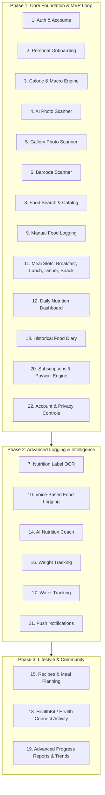

# CAL METER — Product Requirements Document (PRD)

**Document Version:** 1.0.0  
**Status:** Approved Architecture Draft  
**Owner:** Principal Software Architect & Product Engineering Team  
**Last Updated:** November 2026  

---

## 1. Executive Summary & Product Vision

**CAL METER** is an AI-powered, high-precision nutrition intelligence and calorie tracking mobile application for iOS and Android. It transforms the burdensome task of traditional manual diet logging into an effortless, near-instant visual experience. By coupling cutting-edge multimodal computer vision with authoritative global and regional nutrition datasets, CAL METER allows users to photograph meals, review automated portion and nutrient breakdowns, make granular adjustments, and log their daily nutrition in under three seconds.

While inspired by the visual polish, simplicity, and speed of modern apps such as Cal AI, CAL METER differentiates itself through:
1. **Unrivaled Regional & Home-Cooked Food Accuracy:** First-class support for Indian regional dishes, complex mixed curries, home-cooked meals, and street foods alongside standard western and international cuisines.
2. **Deterministic Nutritional Rigor:** Strict decoupling of AI visual identification from nutritional valuation. Visual models identify constituents and estimate volume/density; certified biochemical food databases (USDA, Open Food Facts, and Indian Food Composition Tables) compute exact macronutrients and calories.
3. **Transparent Uncertainty:** The UI explicitly communicates estimation confidence, offering intuitive portion sliders and disambiguation choices rather than presenting artificial certainty.
4. **Zero-Guilt User Experience:** A modern, encouraging, and friction-free interface built to foster sustainable healthy habits without disordered eating triggers.

---

## 2. Target Personas

### Persona A: "Rohan" — The Indian Urban Professional
- **Demographics:** 29 years old, Software Engineer in Bengaluru, exercises 3x weekly.
- **Pain Point:** Traditional apps (MyFitnessPal, HealthifyMe) fail to accurately log home-cooked Indian meals. A bowl of *dal tadka* or homemade *sabzi* with two *chapatis* is tedious to break down by individual raw ingredients (oil, cumin, onions, lentils).
- **Need:** Point the camera at a stainless steel plate (thali), automatically identify 2 *phulkas* (rotis), 1 *katori dal*, and 1 *katori bhindi masala*, adjust the oil/ghee assumption with one tap, and save.

### Persona B: "Sarah" — The Busy Fitness Enthusiast
- **Demographics:** 34 years old, Marketing Director in London, tracks macros for strength training.
- **Pain Point:** Tired of scanning barcodes on meal-prep containers and manually weighing food during dinner with friends or at business lunches.
- **Need:** High-speed photo capture that works in restaurants, recognizes mixed protein bowls (salmon, quinoa, avocado, dressing on the side), estimates portions realistically, and syncs seamlessly with daily macro targets.

### Persona C: "Elena" — The Sustained Weight-Loss Seeker
- **Demographics:** 42 years old, Teacher, seeking sustainable fat loss without obsessive counting.
- **Pain Point:** Overwhelmed by complex nutritional jargon, intimidating charts, and tedious text searches for every single snack.
- **Need:** A friendly, minimalist daily calorie ring, quick barcode scanning for packaged snacks, smart streak tracking, and helpful feedback on nutritional balance.

---

## 3. Core Value Propositions

| Value Proposition | Description |
| :--- | :--- |
| **Instant Multi-Item Scan** | Detect multiple foods, condiments, and sides in a single photo in < 2.5 seconds. |
| **Regional Kitchen Native** | Understands cooking mediums (mustard oil, ghee, olive oil), mixed curries, and regional serving units (*katori*, *roti*, *cup*, *scoop*, *piece*, *grams*). |
| **Editable Certainty** | Machine-learning estimates are transparently graded (High / Medium / Low) with immediate one-tap portion adjustment controls. |
| **Universal Food Coverage** | Unified database merging USDA FoodData Central (whole foods), Open Food Facts (global packaged goods), and authentic Indian Food Composition Tables (IFCT/ICMR). |
| **Offline-Resilient Logging** | Client-first caching allows users to review diary entries and log standard favorites even with intermittent cellular connectivity. |

---

## 4. Complete Feature Scope & Lifecycle

Below is the exhaustive scope across the 22 core features, delineating **Phase 1 (Engineering Foundation & Core Loop)** from **Future Phases**.

---

## 5. Detailed Feature Requirements (Phase 1 Focus)

### 5.1. Authentication and User Accounts (Feature 1)
- **FR-1.1:** Support passwordless authentication via Firebase Auth: Apple Sign-In (mandatory for iOS App Store), Google Sign-In, and Phone Number (SMS OTP) / Email Magic Link.
- **FR-1.2:** Support a guest mode ("Try without account") that stores data locally in encrypted client storage and seamlessly migrates records upon account creation.
- **FR-1.3:** Maintain secure session tokens via short-lived JWTs and auto-refresh mechanisms.
- **FR-1.4:** Enforce server-side user record synchronization via PostgreSQL transaction upon first authentication.

### 5.2. Personal Onboarding & Goal Calculation (Features 2 & 3)
- **FR-2.1:** Collect biometrics: Gender, Date of Birth (Age), Height (cm or ft/in), Current Weight (kg or lbs), Target Weight, Target Date or Desired Pace (0.25 kg to 1 kg per week).
- **FR-2.2:** Collect lifestyle inputs: Baseline Activity Level (Sedentary, Lightly Active, Moderately Active, Very Active, Extra Active), Dietary Restrictions (Vegetarian, Vegan, Non-Vegetarian, Eggetarian, Jain, Keto, Halal), Primary Goal (Lose Fat, Maintain Weight, Build Muscle).
- **FR-2.3:** Calculate Basal Metabolic Rate (BMR) using the validated **Mifflin-St Jeor equation**:
  $$\text{BMR}_{\text{men}} = 10 \times \text{weight (kg)} + 6.25 \times \text{height (cm)} - 5 \times \text{age (y)} + 5$$
  $$\text{BMR}_{\text{women}} = 10 \times \text{weight (kg)} + 6.25 \times \text{height (cm)} - 5 \times \text{age (y)} - 161$$
- **FR-2.4:** Compute Total Daily Energy Expenditure (TDEE) = $\text{BMR} \times \text{PAL (Physical Activity Level)}$.
- **FR-2.5:** Compute recommended Daily Calorie Target with safe floor boundaries (never below 1,200 kcal for women, 1,500 kcal for men unless medically supervised).
- **FR-2.6:** Generate initial Macronutrient Distribution based on goal archetype:
  - *Fat Loss:* 30% Protein, 40% Carbohydrates, 30% Fat.
  - *Muscle Gain:* 30% Protein, 50% Carbohydrates, 20% Fat.
  - *Maintenance:* 25% Protein, 50% Carbohydrates, 25% Fat.
- **FR-2.7:** Provide manual override allowing advanced users to customize exact gram/macro ratios.

### 5.3. AI Food Photo & Gallery Scanner (Features 4 & 5)
- **FR-4.1:** Native camera preview powered by React Native Vision Camera with pinch-to-zoom, tap-to-focus, and low-light flash toggle.
- **FR-4.2:** Photo capture pipeline: Capture -> Compress client-side (max 1024x1024 JPEG, quality 0.8, target size ~150-250 KB) -> Direct upload to S3-compatible private storage using short-lived presigned URL.
- **FR-4.3:** Gallery import: Select image from native photo library -> EXIF metadata stripping -> Compression -> Presigned upload.
- **FR-4.4:** Analysis pipeline: Trigger multimodal vision model (Gemini 1.5 Flash) via backend worker. Identify constituent items, cooking styles, and volumetric estimates.
- **FR-4.5:** Verification & Correction UI: Interactive review card showing:
  - Food Name & Identified Category.
  - Estimated Serving Unit & Quantity (e.g., "1.5 katori / ~225g").
  - Portion Stepper (+ / -) and custom weight slider.
  - Visual Confidence Badge (High / Moderate / Review Needed).
  - "Add Missing Item" and "Remove Item" triggers.
- **FR-4.6:** Zero-Friction Confirmation: Single tap "Log to [Meal Slot]" commits records to user's daily diary.

### 5.4. Barcode Scanner (Feature 6)
- **FR-6.1:** Real-time on-device barcode detection (UPC-A, UPC-E, EAN-8, EAN-13, Code 128) using hardware-accelerated ML scanner.
- **FR-6.2:** Instant lookup against Open Food Facts API and local PostgreSQL cache.
- **FR-6.3:** Immediate display of official serving size, brand name, front-of-pack thumbnail, and complete nutritional facts.
- **FR-6.4:** Fallback when barcode not found: prompt user to take a photo of the nutrition label (OCR) or enter details manually.

### 5.5. Food Search & Manual Food Logging (Features 8 & 9)
- **FR-8.1:** Sub-100ms debounced search over verified database items (USDA, Open Food Facts, and Indian Composition database).
- **FR-8.2:** Fuzzy search supporting regional naming conventions (e.g., searching "Roti", "Phulka", or "Chapati" returns equivalent validated base items).
- **FR-8.3:** Recent foods, frequent foods, and custom user-created food templates.
- **FR-8.4:** Manual quick-add: enter raw calories and optional macros directly without linking a specific food item.

### 5.6. Daily Nutrition Dashboard & Historical Diary (Features 11, 12, 13)
- **FR-12.1:** Top Summary Bar: Dynamic Calorie Ring (Target - Consumed = Remaining Calories).
- **FR-12.2:** Macro Progress Bars: Protein, Carbs, Fat, and Dietary Fiber consumed vs target in grams and percentage.
- **FR-12.3:** Four distinct Meal Slots: Breakfast, Lunch, Dinner, Snacks.
- **FR-12.4:** Meal Slot Details: Itemized list of foods with individual calories, serving size, and quick action sheet (Edit Portion, Move to Another Meal, Copy, Delete).
- **FR-12.5:** Historical Calendar View: Swipeable date carousel and month picker to view past dates and log retrospectively.

### 5.7. Subscription & Monetization (Feature 20)
- **FR-20.1:** RevenueCat SDK integration for cross-platform App Store and Google Play billing.
- **FR-20.2:** Free Tier Limits: 3 AI photo scans per day, unlimited manual search and barcode scanning, 7-day diary history.
- **FR-20.3:** Premium Tier ("CAL METER Pro"): Unlimited AI photo scans, unlimited history, detailed micronutrient breakdown, AI Coach access (Phase 2), export data to CSV/PDF.
- **FR-20.4:** Server-side entitlement validation: Client-side receipt checks are never trusted alone; backend verifies active entitlements via RevenueCat REST API before dispatching vision worker jobs.

### 5.8. Account Management, Privacy & Security (Feature 22)
- **FR-22.1:** Strict tenant data isolation at the database layer (`userId` foreign keys on all operational tables).
- **FR-22.2:** Self-service Account Deletion (GDPR & Apple App Store Guideline 5.1.1(v) compliant) triggering complete cascading purge of user record, logs, and storage assets.
- **FR-22.3:** Self-service Data Export: Request JSON or CSV bundle of full user logging history.
- **FR-22.4:** Opt-in / Opt-out for model improvement data retention.

---

## 6. Indian and Regional Food Support Specifications

Indian culinary preparations present unique challenges that standard western diet apps fail to handle. CAL METER implements dedicated logic for:

### 6.1. Flexible Serving Units & Conversions
Standard grams and ounces are foreign to traditional Indian home cooking. CAL METER incorporates standard density conversion tables:
- **Katori (Small ~150ml, Standard ~200ml, Large ~250ml):** Used for curries, dal, curd, sabzi, kheer.
- **Roti / Chapati (Small ~25g, Medium ~35g, Large ~50g):** Explicit tracking of *with ghee* (+30-40 kcal) vs *dry phulka*.
- **Piece / Unit:** Idli (~40g), Vada (~50g), Samosa (~80g), Dosa (plain ~80g, masala ~180g).
- **Papad:** Roasted (~25 kcal) vs Deep Fried (~65 kcal).
- **Serving Spoon / Ladle:** Biryani, Pulao, Khichdi (~100g to 150g per ladle).

### 6.2. Complex Mixed Gravies & Cooking Mediums
Home-cooked gravies vary wildly depending on the oil and base used:
- The AI vision prompt explicitly detects sheen and gravy base:
  - *Tomato-onion-based* (low-to-moderate calorie density).
  - *Cream/Cashew/Butter-based* (*Makhani*, *Korma*, *Butter Masala* — high calorie density).
  - *Coconut-based* (South Indian curries, Goan curries).
- The user is provided with a one-tap modifier chip on the review screen: **[Light Oil] | [Standard] | [Rich / Restaurant Style]**.

---

## 7. Non-Functional Requirements (NFRs)

| Domain | Metric / Requirement | Rationale |
| :--- | :--- | :--- |
| **AI Scan Latency** | **P95 < 2.5 seconds** (from capture to review screen) | Ensures friction-free adoption; mimics the speed of Cal AI. |
| **API Latency** | **P95 < 150 ms** for diary, dashboard, and search queries | Prevents stuttering during navigation. |
| **Cold App Startup** | **< 1.2 seconds** to interactive dashboard | Retains mobile users opening the app at dining tables. |
| **Availability** | **99.9% uptime** on core API and database | Critical daily health tool used 3-5 times daily per user. |
| **Network Efficiency** | Client-side image compression down to < 250 KB | Smooth performance over 4G/3G mobile networks. |
| **Offline Resilience** | Full read access to current and previous 7-day diary offline | Users can review meals without active network coverage. |
| **Security & Privacy** | AES-256 at rest, TLS 1.3 in transit, zero plain-text biometrics | Strict compliance with DPDP Act (India) and GDPR (EU). |
| **Crash-Free Sessions** | **> 99.8% crash-free sessions** monitored via Sentry | Production consumer quality threshold. |

---

## 8. Success Metrics & Key Performance Indicators (KPIs)

1. **Activation Rate:** > 65% of onboarded users complete their first food log within 24 hours of signup.
2. **Scan Accuracy Rating:** > 88% of AI-recognized items accepted by users without manual renaming.
3. **Logging Speed:** Average time to log a meal via camera < 4 seconds (including user review).
4. **Day 7 Retention:** > 38% active daily loggers at D7.
5. **Day 30 Retention:** > 22% active daily loggers at D30.
6. **Free-to-Paid Conversion:** > 4.5% conversion to CAL METER Pro subscription.
