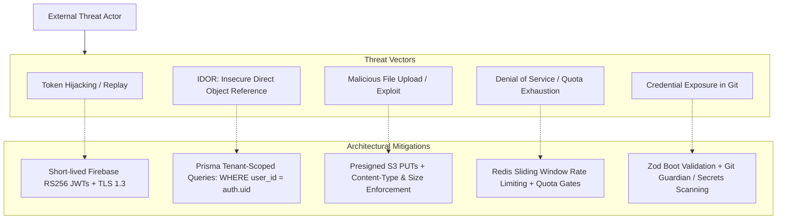
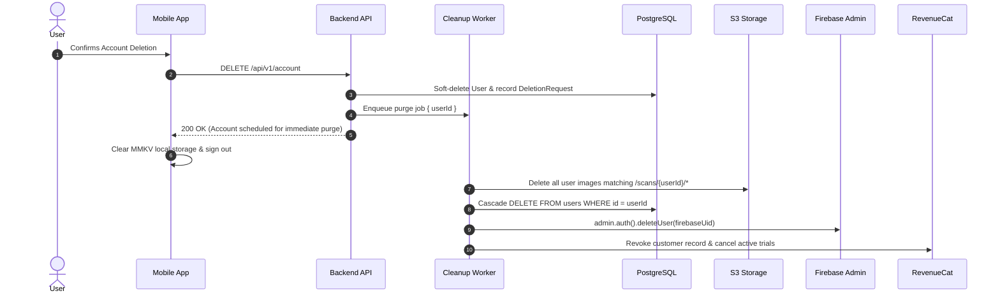

# CAL METER — Security, Privacy & Data Governance

**Document Version:** 1.0.0  
**Status:** Approved Architecture Draft  
**Owner:** Principal Security Architect & Data Protection Officer  
**Last Updated:** November 2026

---

## 1. Compliance Framework & Privacy Principles

CAL METER handles personal health, dietary, and biometric data. It is engineered from day one to comply with:

- **GDPR** (General Data Protection Regulation — European Union).
- **DPDP Act 2023** (Digital Personal Data Protection Act — India).
- **Apple App Store Review Guidelines** (Section 5.1: Privacy, Data Use, and Account Deletion).
- **Google Play Developer Policies** (Health and Sensitive Data Policies).

### Core Privacy Principles:

1. **Data Minimization:** We collect only biometrics strictly required to compute BMR/TDEE (gender, age, height, weight).
2. **Explicit Consent:** First-scan onboarding explicitly prompts users to consent to AI processing of food photographs.
3. **No Monetization of Personal Health Data:** User dietary patterns and biometrics are never sold, rented, or shared with third-party advertising networks.
4. **Complete Data Sovereignty:** Users retain absolute rights to export their complete historical log or purge their account with zero friction.

---

## 2. Threat Modeling & Attack Surface Analysis



---

## 3. Authentication & Authorization Security

### 3.1. Firebase Token Verification

- Client requests obtain an RS256-signed ID token from Firebase Auth.
- Backend middleware intercepts the `Authorization: Bearer <token>` header:
  ```typescript
  import { Request, Response, NextFunction } from 'express';
  import admin from 'firebase-admin';

  export async function requireAuth(req: Request, res: Response, next: NextFunction) {
    const authHeader = req.headers.authorization;
    if (!authHeader?.startsWith('Bearer ')) {
      return res.status(401).json({
        success: false,
        error: { code: 'AUTH_UNAUTHORIZED', message: 'Missing Bearer token.' },
      });
    }

    const token = authHeader.split(' ')[1];
    try {
      const decoded = await admin.auth().verifyIdToken(token, true); // checkRevoked = true
      req.user = {
        firebaseUid: decoded.uid,
        email: decoded.email,
        internalUserId: await resolveInternalUserId(decoded.uid),
      };
      next();
    } catch (err) {
      return res.status(401).json({
        success: false,
        error: { code: 'AUTH_TOKEN_EXPIRED', message: 'Invalid or revoked token.' },
      });
    }
  }
  ```

### 3.2. Multi-Tenant Isolation

- Insecure Direct Object References (IDOR) are eliminated at the data layer. All Prisma service operations enforce tenant constraints:
  ```typescript
  // SECURE: Automatically scoped to authenticated user
  const meal = await prisma.mealEntry.findFirst({
    where: {
      id: mealId,
      userId: req.user.internalUserId, // Enforces tenant boundary
    },
  });
  ```

### 3.3. Food Catalog & Custom Food Ownership Governance

1. **Dual Visibility Filtering:** Food search results (`GET /api/v1/foods`) automatically combine verified global foods with the authenticated user's private custom foods:
   ```typescript
   where: {
     isArchived: false,
     OR: [
       { isCustom: false },
       { isCustom: true, createdByUserId: internalUserId },
     ],
   }
   ```
2. **Anti-Enumeration Protection:** If a malicious or unauthorized user attempts to access (`GET /foods/:id`), modify (`PATCH /foods/:id`), or delete (`DELETE /foods/:id`) another user's private custom food, the service returns **`404 Not Found`** rather than `403 Forbidden`. This prevents attackers from probing and enumerating private food IDs or learning private dietary habits.
3. **Protection of Verified Global Catalog:** Global catalog entries (`isVerified = true`, `isCustom = false`) cannot be updated or deleted through user-facing food APIs. Administrative review workflows are required for catalog changes.
4. **Soft Deletion & Referential Integrity:** Custom food deletion sets `isArchived = true`. Hard deletion is prevented because historical diary entries (`meal_food_items`) depend on the immutable food ID and nutritional profile.

---

## 4. Storage Security & Image Privacy

### 4.1. Direct-to-Storage Isolation & Presigned Uploads

- Mobile clients request presigned upload URLs (`POST /scans/:id/upload-url`) or upload directly through authenticated upload gateways.
- Presigned upload tokens and URLs are strictly scoped to the tenant:
  - Cryptographically signed with a **300-second (5 minute)** expiration.
  - Storage paths are strictly generated server-side: `scans/{userId}/{scanId}.jpg` to eliminate directory traversal risks.
  - File size strictly bounded to maximum **10 MB** (minimum 100 bytes).
- Public bucket access is completely disabled. Uploads and downloads are managed via private S3/local object storage services.

### 4.2. Image Sanitization & Anti-Exploit Pipeline

All image payloads pass through deterministic byte validation before persistence:

1. **Magic Bytes Verification:** Inspects binary headers (`FF D8 FF` for JPEG, `89 50 4E 47 0D 0A 1A 0A` for PNG, `RIFF...WEBP` for WebP). Mismatched extensions or disguises are rejected immediately.
2. **Decompression Bomb Protection:** Validates image dimensions directly from binary markers without loading raw bitmap into memory. Dimensions must fall between **100x100** and **8192x8192** pixels.
3. **EXIF Metadata Stripping:** Automatically removes all EXIF segments (e.g. JPEG APP1 markers, PNG ancillary text chunks) before persisting to storage. This guarantees geolocation coordinates, camera serial numbers, and personal device timestamps are never stored or shared with upstream AI providers.

### 4.3. Quota Gates & Anti-Abuse Defenses

- **Free-Tier Daily Scan Limit:** Enforced at the service and route layer (`POST /scans`, `POST /scans/upload`). Free users are restricted to **3 scans per 24-hour UTC day**. Exceeding requests are rejected with HTTP 429 `DAILY_SCAN_LIMIT_REACHED`.
- **Multi-Tenant Scan Scoping:** Every scan lookup, update, confirmation, or cancellation enforces `WHERE id = scanId AND user_id = internalUserId`. Cross-tenant probes return HTTP 404 to prevent enumeration.

### 4.4. Automated Retention & Scrubbing

- **Raw Image Purge:** Scan photos are temporary artifacts for AI inference. The background worker schedules deletion of unconfirmed or transient image files after **30 days**.
- If a user opts into the "Photo Food Diary" feature, images are retained in encrypted cold storage and linked to the verified meal record.

---

## 5. Account Deletion & Right to Be Forgotten (Apple Guideline 5.1.1(v))

Users can delete their account directly within the app (`Settings -> Account -> Delete Account`).



---

## 6. Secrets Management & Environment Validation

All backend services enforce startup schema validation using Zod. If any required secret is missing or malformed, the process crashes immediately on boot:

```typescript
import { z } from 'zod';

const envSchema = z.object({
  NODE_ENV: z.enum(['development', 'test', 'staging', 'production']),
  PORT: z.coerce.number().default(4000),
  DATABASE_URL: z.string().url(),
  REDIS_URL: z.string().url(),
  FIREBASE_PROJECT_ID: z.string().min(1),
  FIREBASE_CLIENT_EMAIL: z.string().email(),
  FIREBASE_PRIVATE_KEY: z.string().min(1),
  GEMINI_API_KEY: z.string().min(1),
  S3_BUCKET_NAME: z.string().min(1),
  S3_ENDPOINT: z.string().url(),
  S3_ACCESS_KEY_ID: z.string().min(1),
  S3_SECRET_ACCESS_KEY: z.string().min(1),
  REVENUECAT_WEBHOOK_SECRET: z.string().min(1),
});

export const ENV = envSchema.parse(process.env);
```

- **Git Enforcement:** Pre-commit hooks (`git-secrets` / `detect-secrets`) prevent accidental commits of `.env` files or API tokens.
- **Client Bundling:** No backend API keys or database connection strings are ever included in the React Native JavaScript bundle.

---

## 7. Camera Permissions Minimization & Barcode Scanning Privacy

CAL METER adheres to strict privacy-by-design principles regarding mobile camera hardware and barcode processing:

### 7.1. JIT (Just-In-Time) Camera Permission Request

- In compliance with Apple App Store Guideline 5.1.1 and Google Play privacy policies, the application **never requests camera permissions on initial launch, onboarding, or tab switching**.
- Permissions are requested solely when the user explicitly interacts with a camera feature (e.g. tapping "Barcode Scanner").
- If permission is denied or revoked in system settings, the app transitions to a graceful fallback state with a prominent manual barcode entry pathway that requires zero hardware permissions.

### 7.2. Zero Image Upload During Barcode Scanning

- Barcode decoding is performed **entirely on-device** using native hardware vision accelerators.
- No video frames, image snapshots, camera buffers, or visual metadata are recorded, cached, or transmitted to CAL METER servers during barcode scanning.
- Only the sanitized numeric barcode string (e.g. `8901030825484`) is transmitted over TLS 1.3 to the backend API for catalog lookup.

### 7.3. Multi-Tenant Custom Food Barcode Isolation

- When users create custom food items with associated barcodes, the barcode resolution service strictly scopes ownership:
  - Global verified foods and Open Food Facts products are accessible to all users.
  - Custom food items bound to barcodes are only retrievable if `createdByUserId === req.user.id`.
  - Unauthenticated or cross-tenant requests for another user's custom barcode return `404 ProductNotFoundError` (anti-enumeration protection).

### 7.4. Third-Party Licensing Compliance (Open Food Facts / ODbL 1.0)

- In full compliance with the Open Database License (ODbL) 1.0:
  - All responses referencing Open Food Facts data retain appropriate attribution markers (`source: OPEN_FOOD_FACTS`, `license: ODbL 1.0`).
  - Mobile product detail sheets prominently display: _"Data sourced from Open Food Facts under Open Database License (ODbL) 1.0."_
  - Any local enhancements to Open Food Facts database records remain compliant with ODbL share-alike provisions.

---

## 8. Biometric Data Governance & Non-Medical Safeguards

### 8.1. Personal Biometric Isolation (Zero AI Exposure)

- Personal body measurements (height, weight, body mass index, date of birth, age, and biological sex) are classified as **Sensitive Personal Data (SPD)**.
- Biometric records are stored strictly in private, encrypted PostgreSQL tables (`user_profiles`, `nutrition_goals`, `weight_logs`) with multi-tenant row-level authorization.
- **Strict Prohibition on Third-Party AI Transmission:** Under no circumstances are user body measurements, biometrics, weight trends, or personal goals transmitted to external multimodal vision providers (such as Google Gemini, OpenAI, Anthropic, or Hugging Face). Multimodal vision pipelines receive only sanitized food imagery.

### 8.2. Medical Disclaimers & Non-Clinical Positioning

- CAL METER is a consumer wellness and lifestyle application. It is **not** a medical device, diagnostic tool, or clinical prescription service.
- All algorithmic calorie and macronutrient suggestions derived from the Mifflin-St Jeor equation (1990) and Physical Activity Level (PAL) multipliers represent mathematical approximations of statistical energy balance.
- Every results and onboarding screen includes prominent disclaimers informing users to treat values as starting reference baselines, evaluate real-world weight trends over 2–4 weeks, and consult qualified healthcare professionals before undertaking extreme dietary interventions.

### 8.3. Safe Boundary Enforcement & Minor Protection

- Mifflin-St Jeor and standard adult energy expenditure models are clinically invalid for pediatric populations.
- All onboarding and recalculation endpoints strictly reject individuals under 18 years of age, preventing the application of adult restriction targets to developing minors.
- Physiological bounds checks enforce reasonable constraints on all inputs (weight: 30–350 kg, height: 100–250 cm, age: 18–120 years). Any values outside validated bounds fail closed with `VALIDATION_ERROR`.

### 8.4. Physical Activity, Hydration & Progress Tracking Safeguards

- **Row-Level Tenant Authorization:** All operations across `weight_logs`, `water_logs`, and `exercise_logs` enforce strict compound foreign-key isolation (`WHERE id = :id AND user_id = :authUserId`). Unauthenticated or cross-tenant access attempts immediately fail closed with 404 (anti-enumeration).
- **Zero Third-Party AI Exposure for Activity & Biometrics:** Weight logs, hydration volumes, and physical exercise history are strictly sequestered from external LLM/vision inference providers. They are stored and queried only in private PostgreSQL tables.
- **Exercise Calorie Non-Diet-Credit Guarantee:** In accordance with evidence-based behavioral nutrition, exercise calories are tracked solely as physical activity progress and are strictly NOT credited to dietary food allowances. This architectural constraint protects users from overestimating expenditure and inadvertently inducing positive energy balances.
- **Hydration & Progress Educational Disclaimers:** Progress reports and water summaries include explicit notifications that day-to-day weight fluctuations of ±0.5–1.5 kg are physiologically normal due to water retention, sodium, and glycogen replenishment, and that water baselines do not constitute personalized clinical fluid prescriptions.

---

## 9. AI Nutrition Coach Data Governance & Safety Guardrails

### 9.1. Zero PII Exposure in LLM Context Payloads

- CAL METER enforces strict data minimization before dispatching user queries to large language model providers (e.g. Google Gemini 2.0 Flash):
  - **Permanently Stripped:** Full names, email addresses, phone numbers, Firebase UIDs, internal user UUIDs, IP addresses, and device identifiers are NEVER included in prompt payloads.
  - **Permitted Minimal Context:** Only physiological attributes required for nutrition guidance are passed: biological sex, height in cm, current weight, target weight, primary goal, consumed vs target calories/macros, logged meal items, hydration volume, and recent exercise sessions.
- Prompts instruct LLM models to provide habit-focused lifestyle guidance without diagnosing medical conditions or prescribing clinical interventions.

### 9.2. Guardrails Against Dangerous Restriction & Eating Disorders

- The coaching pipeline implements multi-layered safety guardrails that detect and actively reject prompts promoting:
  - Dangerous energy restriction below physiological minimums (< 500 kcal/day).
  - Purging, vomiting, or laxative misuse after eating.
  - Extreme unmonitored water fasts or unrealistic weight loss claims (e.g. losing 10 kg in 3 days).
- In such instances, the system responds with supportive, evidence-based harm-reduction messages and directs users to licensed healthcare specialists and eating disorder support resources.

### 9.3. Non-Clinical Medical Safeguards

- The AI Nutrition Coach strictly refuses clinical medical diagnosis and medication prescription:
  - Any query asking to diagnose acute symptoms, manage severe metabolic crises, or prescribe pharmacological drugs triggers an automated refusal.
  - Responses clearly state that CAL METER is an educational wellness tool and advise users to consult licensed medical physicians.

### 9.4. User Conversation Deletion & GDPR Sovereignty

- Users retain full sovereignty over their coach conversation records:
  - Self-service history deletion (`DELETE /api/v1/coach/history`) instantly purges all user and assistant messages for that account.
  - Account deletion cascade: Removing an account automatically deletes all associated `coach_messages` and `coach_insights` via PostgreSQL foreign-key cascade (`onDelete: Cascade`).
