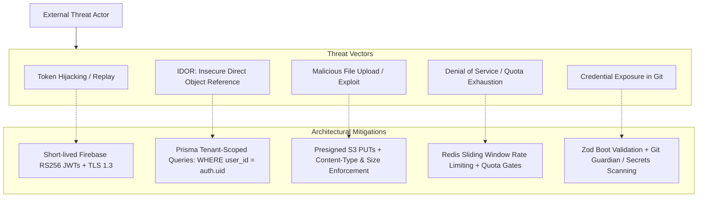
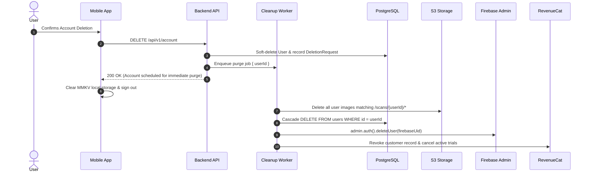

# CAL METER — Security, Privacy & Data Governance

**Document Version:** 1.0.0  
**Status:** Approved Architecture Draft  
**Owner:** Principal Security Architect & Data Protection Officer  
**Last Updated:** November 2026

---

## 1. Compliance Framework & Privacy Principles

CAL METER handles personal health, dietary, and biometric data. It is engineered from day one to comply with:

- **GDPR** (General Data Protection Regulation — European Union).
- **DPDP Act 2023** (Digital Personal Data Protection Act — India).
- **Apple App Store Review Guidelines** (Section 5.1: Privacy, Data Use, and Account Deletion).
- **Google Play Developer Policies** (Health and Sensitive Data Policies).

### Core Privacy Principles:

1. **Data Minimization:** We collect only biometrics strictly required to compute BMR/TDEE (gender, age, height, weight).
2. **Explicit Consent:** First-scan onboarding explicitly prompts users to consent to AI processing of food photographs.
3. **No Monetization of Personal Health Data:** User dietary patterns and biometrics are never sold, rented, or shared with third-party advertising networks.
4. **Complete Data Sovereignty:** Users retain absolute rights to export their complete historical log or purge their account with zero friction.

---

## 2. Threat Modeling & Attack Surface Analysis



---

## 3. Authentication & Authorization Security

### 3.1. Firebase Token Verification

- Client requests obtain an RS256-signed ID token from Firebase Auth.
- Backend middleware intercepts the `Authorization: Bearer <token>` header:
  ```typescript
  import { Request, Response, NextFunction } from 'express';
  import admin from 'firebase-admin';

  export async function requireAuth(req: Request, res: Response, next: NextFunction) {
    const authHeader = req.headers.authorization;
    if (!authHeader?.startsWith('Bearer ')) {
      return res.status(401).json({
        success: false,
        error: { code: 'AUTH_UNAUTHORIZED', message: 'Missing Bearer token.' },
      });
    }

    const token = authHeader.split(' ')[1];
    try {
      const decoded = await admin.auth().verifyIdToken(token, true); // checkRevoked = true
      req.user = {
        firebaseUid: decoded.uid,
        email: decoded.email,
        internalUserId: await resolveInternalUserId(decoded.uid),
      };
      next();
    } catch (err) {
      return res.status(401).json({
        success: false,
        error: { code: 'AUTH_TOKEN_EXPIRED', message: 'Invalid or revoked token.' },
      });
    }
  }
  ```

### 3.2. Multi-Tenant Isolation

- Insecure Direct Object References (IDOR) are eliminated at the data layer. All Prisma service operations enforce tenant constraints:
  ```typescript
  // SECURE: Automatically scoped to authenticated user
  const meal = await prisma.mealEntry.findFirst({
    where: {
      id: mealId,
      userId: req.user.internalUserId, // Enforces tenant boundary
    },
  });
  ```

---

## 4. Storage Security & Image Privacy

### 4.1. Direct-to-Storage Isolation

- Mobile clients upload images directly to private S3-compatible buckets (Cloudflare R2 or AWS S3) via presigned URLs.
- Presigned URLs are cryptographically signed with:
  - Maximum expiration: **300 seconds (5 minutes)**.
  - Strict Content-Type lock: `image/jpeg`.
  - Content-Length boundary: Maximum **10 MB** (client-compressed to ~200 KB).
- Public bucket access is completely disabled. Images are accessed by the background worker using private AWS IAM / S3 SDK credentials.

### 4.2. Automated Retention & Scrubbing

- **Raw Image Purge:** Scan photos are temporary artifacts for AI inference. The background worker schedules deletion of unconfirmed or transient image files after **30 days**.
- If a user opts into the "Photo Food Diary" feature, images are retained in encrypted cold storage and linked to the verified meal record.

---

## 5. Account Deletion & Right to Be Forgotten (Apple Guideline 5.1.1(v))

Users can delete their account directly within the app (`Settings -> Account -> Delete Account`).



---

## 6. Secrets Management & Environment Validation

All backend services enforce startup schema validation using Zod. If any required secret is missing or malformed, the process crashes immediately on boot:

```typescript
import { z } from 'zod';

const envSchema = z.object({
  NODE_ENV: z.enum(['development', 'test', 'staging', 'production']),
  PORT: z.coerce.number().default(4000),
  DATABASE_URL: z.string().url(),
  REDIS_URL: z.string().url(),
  FIREBASE_PROJECT_ID: z.string().min(1),
  FIREBASE_CLIENT_EMAIL: z.string().email(),
  FIREBASE_PRIVATE_KEY: z.string().min(1),
  GEMINI_API_KEY: z.string().min(1),
  S3_BUCKET_NAME: z.string().min(1),
  S3_ENDPOINT: z.string().url(),
  S3_ACCESS_KEY_ID: z.string().min(1),
  S3_SECRET_ACCESS_KEY: z.string().min(1),
  REVENUECAT_WEBHOOK_SECRET: z.string().min(1),
});

export const ENV = envSchema.parse(process.env);
```

- **Git Enforcement:** Pre-commit hooks (`git-secrets` / `detect-secrets`) prevent accidental commits of `.env` files or API tokens.
- **Client Bundling:** No backend API keys or database connection strings are ever included in the React Native JavaScript bundle.
