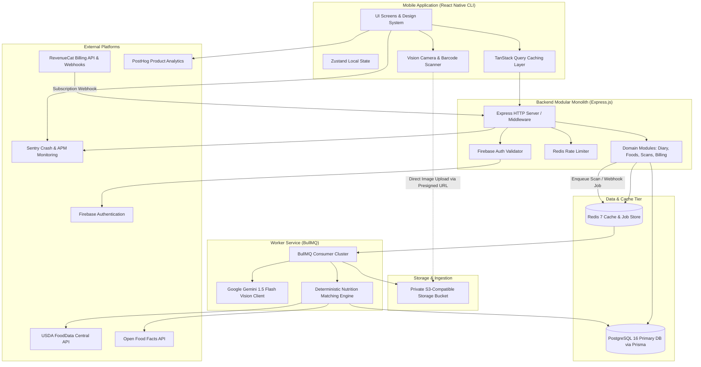
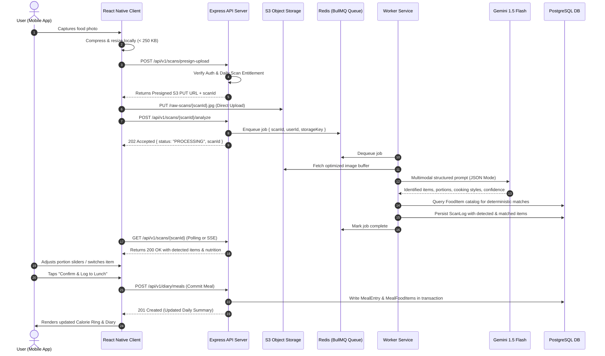
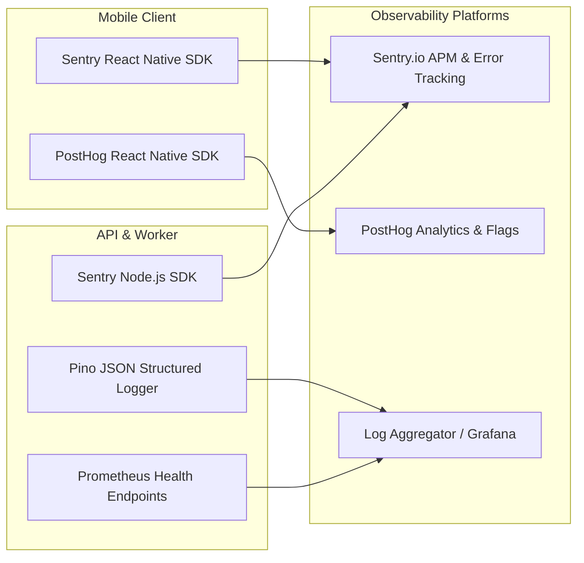

# CAL METER — System Architecture Document

**Document Version:** 1.0.0  
**Status:** Approved Architecture Draft  
**Owner:** Principal Software Architect & Technical Lead  
**Last Updated:** November 2026  

---

## 1. High-Level Architectural Pattern: The Modular Monolith

CAL METER adopts a **Modular Monolith** architecture organized inside a single TypeScript monorepo. This balances high engineering velocity, strict type safety, and zero deployment friction during early stages, while enforcing clean architectural boundaries that can be split into microservices if scaling demands dictate in the future.

### Key Architectural Tenets:
1. **Single Source of Truth for Data Contracts:** The API, Worker, and Mobile Client share validation schemas, DTOs, and domain calculations via local packages (`@calmeter/contracts` and `@calmeter/shared`).
2. **Decoupled Asynchronous Processing:** Resource-intensive workloads (AI image recognition, external catalog hydration, and third-party webhooks) are offloaded from the main Express HTTP thread to a dedicated BullMQ worker cluster backed by Redis.
3. **Stateless API Services:** The API nodes maintain zero session state. Authentication is derived cryptographically from verified Firebase ID tokens; caching and transient state reside in Redis.
4. **Direct-to-Storage Ingestion:** Raw food images never transit through the Node.js API servers. Clients request short-lived presigned upload URLs and push JPEG payloads directly to private S3-compatible object storage.

---

## 2. Monorepo Structure

```
CAL-METER/
├── apps/
│   ├── mobile/                    # React Native CLI client (iOS & Android)
│   │   ├── android/
│   │   ├── ios/
│   │   └── src/
│   │       ├── api/               # Centralized TanStack Query hooks & Axios client
│   │       ├── components/        # Reusable design system components (Atoms/Molecules)
│   │       ├── navigation/        # React Navigation stacks & tab bars
│   │       ├── screens/           # Feature screens (Dashboard, Scanner, Review, etc.)
│   │       ├── state/             # Zustand stores (Auth, Diary, ScanReview, Settings)
│   │       ├── utils/             # Formatters, camera helpers, unit converters
│   │       └── App.tsx
│   ├── api/                       # Primary Node.js / Express REST API
│   │   ├── src/
│   │   │   ├── config/            # Validated environment variables & clients
│   │   │   ├── middleware/        # Firebase Auth, Zod validator, Error handlers, Rate limits
│   │   │   ├── modules/           # Feature modules (auth, diary, foods, scans, tracking, billing)
│   │   │   │   ├── *.controller.ts
│   │   │   │   ├── *.service.ts
│   │   │   │   └── *.routes.ts
│   │   │   ├── server.ts
│   │   │   └── app.ts
│   └── worker/                    # Asynchronous BullMQ background worker
│       ├── src/
│       │   ├── processors/        # AI Scan processor, Webhook processor, Cleanup jobs
│       │   ├── queues/            # Queue definitions and connection managers
│       │   └── worker.ts
├── packages/
│   ├── contracts/                 # Shared Zod schemas, API request/response DTOs
│   │   └── src/
│   │       ├── auth.contract.ts
│   │       ├── diary.contract.ts
│   │       ├── foods.contract.ts
│   │       ├── scans.contract.ts
│   │       └── tracking.contract.ts
│   └── shared/                    # Pure TypeScript domain utilities & nutrition math
│       └── src/
│           ├── constants/         # Macro ratios, serving unit definitions, error codes
│           ├── formulas/          # BMR (Mifflin-St Jeor), TDEE, macro conversions
│           └── types/             # Common domain interfaces and enums
├── infrastructure/
│   ├── docker/                    # Local development containerization (PostgreSQL, Redis)
│   │   └── docker-compose.yml
│   └── prisma/                    # Prisma database schema, seeds, and migrations
│       ├── schema.prisma
│       ├── migrations/
│       └── seed.ts
└── docs/                          # Comprehensive technical documentation
```

---

## 3. System Context & Component Architecture



---

## 4. End-to-End Data Flows

### 4.1. AI Photo Scanning & Logging Sequence


### 4.2. Barcode Scanning Flow
```mermaid
sequenceDiagram
    autonumber
    actor User as User
    participant Client as Mobile Client (MLKit / Vision)
    participant API as Express API
    participant Redis as Redis Cache
    participant DB as PostgreSQL
    participant OFF as Open Food Facts API

    User->>Client: Scans packaged food barcode
    Client->>API: GET /api/v1/foods/barcode/{barcode}
    API->>Redis: Check key "barcode:{barcode}"
    alt Redis Cache Hit
        Redis-->>API: Cached FoodItem DTO
    else Redis Cache Miss
        API->>DB: SELECT * FROM "FoodItem" WHERE barcode = {barcode}
        alt Database Hit
            DB-->>API: Existing FoodItem record
        else Database Miss
            API->>OFF: GET /api/v2/product/{barcode}.json
            OFF-->>API: Product name, serving size, nutrients per 100g
            API->>DB: INSERT into "FoodItem" (source = 'OPEN_FOOD_FACTS')
            API->>Redis: SETEX "barcode:{barcode}" 86400 (24h TTL)
        end
    end
    API-->>Client: Return normalized FoodItem DTO
    User->>Client: Selects serving multiplier (e.g. 1.5 packages)
    User->>Client: Taps "Log Item"
    Client->>API: POST /api/v1/diary/meals/items
```

---

## 5. Synchronous vs Asynchronous Workload Isolation

To preserve high API responsiveness, workloads are partitioned strictly based on execution time and external latency risks:

| Workload Type | Processing Channel | Latency SLA | Failure Strategy |
| :--- | :--- | :--- | :--- |
| **Authentication & Profile Sync** | Synchronous (Express HTTP) | < 80 ms | Immediate HTTP 401 / 400 |
| **Diary Query & Dashboard Calculation** | Synchronous (Express HTTP + Redis L2) | < 120 ms | Fallback to PostgreSQL read query |
| **Manual & Barcode Food Search** | Synchronous (Postgres Full-Text + Redis) | < 100 ms | Partial matching fallback |
| **AI Food Image Recognition** | Asynchronous (BullMQ Worker) | 1.5s - 2.5s | 3x retry with exponential backoff |
| **RevenueCat Webhook Ingestion** | Asynchronous (BullMQ Worker) | < 500 ms (ack) | Instant 200 ACK to RevenueCat, job queued |
| **User Data Purge / Export** | Asynchronous (BullMQ Worker) | < 30 seconds | Transactional multi-table cascade deletion |
| **Expired Image Cleanup** | Asynchronous (BullMQ Cron) | Scheduled | Nightly purge of unconfirmed scan assets |

---

## 6. Caching Strategy (Redis L2 Tier)

CAL METER leverages Redis 7 for three distinct operational tiers:

### 6.1. Dynamic User Caches
- **Key Pattern:** `user:{userId}:summary:{YYYY-MM-DD}`
- **Contents:** Cached total calories, macro progress, and meal IDs for the user's active day.
- **TTL:** 1 hour.
- **Invalidation Trigger:** Flushed immediately whenever any meal entry or food item for that date is created, updated, or deleted.

### 6.2. Food Catalog Caches
- **Key Pattern:** `food:item:{foodId}`, `food:barcode:{barcode}`, `food:search:{sha256(query)}`
- **Contents:** Serialized verified food nutrition contracts.
- **TTL:** 24 hours for barcode items; 7 days for USDA/IFCT canonical items; 15 minutes for frequent search queries.

### 6.3. Distributed Rate Limiting & Semaphore Buckets
- **Key Pattern:** `ratelimit:ip:{ip}`, `ratelimit:user:{userId}:scan`
- **Engine:** Sliding window counter implemented via Redis sorted sets.
- **Limits:** 100 general requests/min per IP; 10 scan requests/min per user (prevents bot abuse).

---

## 7. Observability, Logging, and Monitoring



- **Structured Logging:** Powered by `pino` with zero-overhead JSON output. Every incoming HTTP request is stamped with a unique `x-request-id` header generated by middleware, which propagates through BullMQ job payloads to correlate end-to-end logs.
- **Error Tracking:** Sentry captures uncaught exceptions, unhandled Promise rejections, and slow transactions across both React Native and Node.js.
- **Product Telemetry:** PostHog tracks high-level funnel events (e.g., `scan_initiated`, `scan_analyzed`, `portion_adjusted`, `meal_logged`, `paywall_viewed`) while strictly excluding sensitive health metrics and personal identifiers.
