# CAL METER — Technology Stack & Engineering Decisions

**Document Version:** 1.0.0  
**Status:** Approved Architecture Draft  
**Owner:** Principal Software Architect  
**Last Updated:** November 2026  

---

## 1. Stack Overview & Strategic Rationale

The CAL METER technology stack is selected based on five production pillars:
1. **Type Safety Across Boundaries:** End-to-end TypeScript spanning mobile apps, backend APIs, background workers, and shared validation contracts.
2. **Deterministic Performance:** Native camera pipelines, sub-200ms API response times, and sub-2.5s end-to-end vision AI inference.
3. **Data Integrity & Compliance:** Strict ACID relational guarantees for financial/subscription and health diary data, coupled with isolated tenant scopes.
4. **Developer Velocity & Maintainability:** Lean, industry-standard libraries that avoid premature abstraction while preventing vendor lock-in.
5. **No Expo Restriction:** Native React Native CLI configuration ensures absolute control over native iOS/Android camera drivers, MLKit frame processors, and native build optimizations.

---

## 2. Mobile Client Stack (React Native CLI)

| Component | Selected Technology | Version / Target | Engineering Justification |
| :--- | :--- | :--- | :--- |
| **Platform Framework** | **React Native CLI** | 0.76+ (New Architecture / Bridgeless) | Provides bare-metal native access to camera hardware, custom build configurations, and C++ TurboModules. Eliminates Expo managed workflow constraints. |
| **Language** | **TypeScript** | 5.5+ (Strict Mode) | Prevents runtime null/undefined errors; enables direct import of shared Zod contracts and DTO types. |
| **Navigation** | **React Navigation** | v7 | Industry standard for mobile React Native; supports native stack navigation (smooth 60/120fps transitions), deep links, and tab persistence. |
| **Client State** | **Zustand** | 5.0+ | Lightweight (< 2KB), zero-boilerplate state store. Supports out-of-React state access (e.g. inside Axios interceptors) and seamless persistence with `react-native-mmkv`. |
| **Server State & Cache** | **TanStack Query (React Query)** | v5 | Robust asynchronous state management. Handles request deduplication, background caching, stale-while-revalidate, and offline persistence. |
| **Form Handling** | **React Hook Form** | 7.50+ | Uncontrolled form inputs avoid unnecessary re-renders during high-frequency user typing in onboarding and custom food entry. |
| **Schema Validation** | **Zod** | 3.23+ | Declarative runtime validation shared identically between mobile client forms and backend API request bodies. |
| **Camera & Vision** | **React Native Vision Camera** | v4 | High-performance native camera abstraction with direct hardware capture control, photo compression, and frame processing. |
| **Barcode Detection** | **MLKit Vision Camera Plugin** | Current | On-device, hardware-accelerated barcode reader supporting UPC, EAN, and Code 128 formats with zero network overhead. |
| **Local Storage** | **react-native-mmkv** | v3 | Ultra-fast synchronous key-value store (written in C++), up to 30x faster than legacy AsyncStorage for caching settings and tokens. |
| **Image Compression** | **react-native-image-resizer** | Current | Compresses photos on-device to < 250 KB prior to network dispatch, saving mobile bandwidth and backend ingress latency. |

---

## 3. Backend API & Asynchronous Processing Stack

| Component | Selected Technology | Version / Target | Engineering Justification |
| :--- | :--- | :--- | :--- |
| **Runtime** | **Node.js** | 20.x or 22.x LTS | High-throughput asynchronous event loop; universal JavaScript ecosystem allowing shared TypeScript packages. |
| **Web Framework** | **Express.js** | 4.x / 5.x | Mature, battle-tested, unopinionated routing engine with minimal abstraction overhead and comprehensive middleware ecosystem. |
| **Language** | **TypeScript** | 5.5+ (Strict Mode) | Strict typing across controllers, services, database models, and external API wrappers. |
| **Database** | **PostgreSQL** | 16+ | Enterprise-grade relational database. Offers ACID guarantees for food logging and subscription records, combined with native `JSONB` for flexible nutrient schemas. |
| **ORM / Query Builder** | **Prisma ORM** | 5.x / 6.x | Type-safe database client auto-generated from declarative schema; automated schema migrations; intuitive relation handling. |
| **In-Memory Cache** | **Redis** | 7+ | High-performance caching layer (L2) for user daily summaries, barcode lookups, and distributed token-bucket rate limiting. |
| **Job Queue & Worker** | **BullMQ** | 5.x | Distributed background task queue running on Redis. Provides concurrency management, job retry with exponential backoff, and delayed jobs. |
| **Logging** | **Pino** | 9.x | Ultra-fast JSON structured logging with minimal CPU overhead. Integrates request correlation IDs (`x-request-id`). |
| **HTTP Security** | **Helmet & CORS** | Standard | Enforces security headers (HSTS, CSP, X-Frame-Options) and strict origin verification. |

---

## 4. Infrastructure & Third-Party Integrations

```mermaid
graph TD
    Client[React Native App] -->|Token Authentication| Firebase[Firebase Authentication]
    Client -->|Direct S3 PUT Upload| Storage[Cloudflare R2 / AWS S3]
    Client -->|In-App Purchases| RevenueCat[RevenueCat SDK]
    Client -->|Crash Logs & Telemetry| Sentry[Sentry Mobile SDK]
    Client -->|Analytics Events| PostHog[PostHog Mobile SDK]

    API[Backend API] -->|Verify Bearer JWT| FirebaseAdmin[Firebase Admin SDK]
    API -->|Generate Presigned PUT| Storage
    API -->|Validate Webhooks & Entitlements| RevCatAPI[RevenueCat REST API]
    API -->|APM & Error Capture| SentryNode[Sentry Node SDK]

    Worker[Worker Cluster] -->|Read Photo Buffer| Storage
    Worker -->|Multimodal Visual Recognition| Gemini[Google Gemini 1.5 Flash]
    Worker -->|Nutritional Search| USDA[USDA FoodData Central]
    Worker -->|Packaged Product Lookup| OFF[Open Food Facts]
```

### 4.1. Firebase Authentication
- **Role:** Identity Provider (IdP).
- **Justification:** Manages multi-provider OAuth (Apple, Google), Phone SMS OTP, and token refresh lifecycles securely without storing passwords or plain credentials on our infrastructure.
- **Server Verification:** Backend uses `firebase-admin` to cryptographically verify RS256-signed JWTs on every authenticated route.

### 4.2. Multimodal AI Vision: Google Gemini 1.5 Flash
- **Role:** Food identification, cooking method detection, and portion estimation.
- **Justification:**
  - Sub-1.5s time-to-first-token on multimodal image inputs.
  - Native **JSON Mode / Structured Outputs** (enforces strict schema compliance with zero markdown parsing errors).
  - Extremely cost-effective pricing (~$0.075 per million input tokens) making high-volume consumer scanning commercially viable.
  - Pluggable interface: All vision requests pass through an abstract `IVisionProvider` interface, allowing hot-swapping to Claude 3.5 Sonnet or OpenAI GPT-4o if business or operational requirements change.

### 4.3. Authoritative Nutrition Datasets
- **USDA FoodData Central (FDC):** Foundation for raw ingredients, whole foods, cuts of meat, and standard western staples.
- **Open Food Facts (OFF):** Over 3 million global packaged food products indexed by barcode, providing exact brand nutrition labels.
- **Indian Food Composition Tables (IFCT / ICMR-NIN):** Proprietary curated database of regional Indian recipes, lentils, curries, breads, and authentic density conversions (*katoris*, *ladles*, *pieces*).

### 4.4. Object Storage: S3-Compatible (Cloudflare R2 / AWS S3)
- **Role:** Storing user-uploaded food photos.
- **Justification:** Cloudflare R2 provides zero egress fees and S3 API compatibility. Private bucket configuration guarantees photos are inaccessible publicly and reachable only via signed URLs.

### 4.5. RevenueCat
- **Role:** In-App Purchase (IAP) infrastructure and subscription lifecycle management.
- **Justification:** Abstract away Apple App Store and Google Play Store billing edge cases (grace periods, billing retries, refunds, upgrades). Backend validates entitlements via server-side webhooks.

### 4.6. Sentry & PostHog
- **Sentry:** Production error tracking, breadcrumb tracing, and crash reporting with symbolication for React Native JS bundles and native binaries.
- **PostHog:** Privacy-first product analytics, event funnels, and feature flags without third-party ad tracking.

---

## 5. Architectural Anti-Patterns & Prohibited Practices

To maintain code quality and production standards, the following practices are strictly prohibited:
1. **No Expo Managed Workflow:** Do not add `expo` dependencies or introduce Expo configuration files.
2. **No Monolithic Contexts:** Do not use massive React Context providers for high-frequency state (e.g. food logging state); use Zustand.
3. **No Unsanitized SQL:** All database interactions must execute through Prisma ORM or parameterized queries.
4. **No Direct Image Streaming via API:** Never stream binary image files through Express routes; always use presigned S3 URLs.
5. **No Hardcoded AI Secrets in Mobile Builds:** API keys for Gemini, USDA, or databases must never exist in the mobile codebase.
6. **No Client-Only Subscription Checks:** Entitlements must always be verified on the backend before serving premium features.
