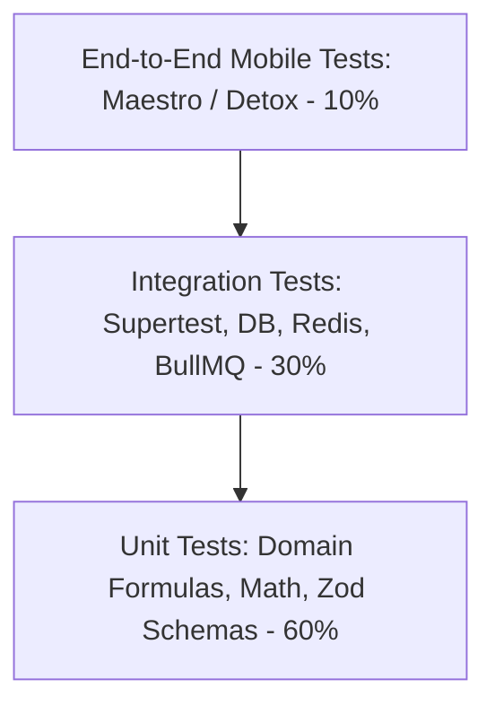
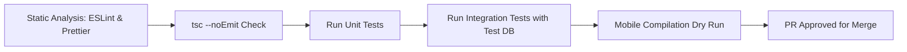

# CAL METER — Quality Assurance & Testing Strategy

**Document Version:** 1.0.0  
**Status:** Approved Architecture Draft  
**Owner:** Technical Lead & QA Lead  
**Last Updated:** November 2026

---

## 1. Quality Philosophy & The Testing Pyramid

CAL METER guarantees high reliability through an automated testing pyramid. Because the application manages health decisions and calorie budgets, calculation errors or data loss directly destroy user trust.



---

## 2. Test Execution Tiers

### 2.1. Unit Testing (Target Coverage: > 85%)

- **Test Runner:** Jest / Vitest with TypeScript support.
- **Scope:**
  - Nutritional math: BMR formulas (Mifflin-St Jeor), TDEE, macro caloric densities (4 kcal/g protein, 4 kcal/g carb, 9 kcal/g fat).
  - Serving unit conversions (_katori_, _roti_, _tablespoon_, _cup_ to metric grams).
  - Zod validation schemas for all incoming API payloads and client form models.
  - Zustand state store actions and reducers.

```typescript
// Example: BMR calculation unit test
describe('Nutrition Math Engine', () => {
  it('calculates Mifflin-St Jeor BMR correctly for men', () => {
    // 80kg, 180cm, 30yo male
    // BMR = 10(80) + 6.25(180) - 5(30) + 5 = 800 + 1125 - 150 + 5 = 1780 kcal
    const bmr = calculateBmr({
      gender: 'MALE',
      weightKg: 80,
      heightCm: 180,
      ageYears: 30,
    });
    expect(bmr).toBe(1780);
  });
});
```

### 2.2. Integration Testing (Target Coverage: > 80%)

- **Test Runner:** Supertest + Jest executing against a dedicated PostgreSQL test container.
- **Scope:**
  - HTTP endpoints: Request validation, Firebase auth mock interceptors, response envelopes.
  - Prisma database queries: Cascading deletes, tenant isolation constraints, trigram search accuracy.
  - Redis cache: Key expiration, invalidation on meal updates, rate limiter sliding windows.
  - BullMQ Worker: Job dispatch, retry on simulated Gemini API timeout, database persistence.

### 2.3. End-to-End (E2E) Testing (Maestro & Detox)

- **Tool:** Maestro for cross-platform, declarative mobile UI flows.
- **Core Critical Flows Tested:**
  1. Complete onboarding from splash to dashboard.
  2. Camera simulation: Inject static mock image -> review sheet -> adjust slider -> log meal.
  3. Barcode scan simulation: Feed mock barcode -> assert product details -> log.
  4. Edit logged meal: Change portion from 1 to 2 -> assert ring updates.

---

## 3. Golden Benchmark Dataset for Vision Testing

To prevent prompt drift or regressions when updating Gemini prompts or models, CAL METER maintains a curated **Golden Food Dataset of 100 benchmark images**:

- 40 Indian Regional Meals (Thalis, Dal Tadka with Phulkas, Biryani, Dosa, Idli-Vada, Sabzis).
- 30 Western / International Dishes (Salads, Steaks, Pasta, Burgers, Protein Bowls).
- 15 Packaged Snacks & Beverages (Chips, protein bars, coffee with milk).
- 15 Edge Cases (Blurry photos, non-food objects, empty plates, poor lighting).

A nightly automated CI job runs the benchmark suite and asserts:

- **Food Recognition Accuracy:** $\ge 88\%$ top-3 match rate.
- **Portion Plausibility:** Estimated weight within $\pm 25\%$ of ground truth.
- **Zero Hallucinated Toxic/Non-Food Objects.**

---

## 4. Mobile Device Testing Matrix

| OS          | Versions Supported              | Target Devices Tested                                                                        |
| :---------- | :------------------------------ | :------------------------------------------------------------------------------------------- |
| **iOS**     | iOS 16.0 to iOS 18.x            | iPhone SE (3rd Gen - 4.7"), iPhone 13/14 (6.1"), iPhone 15/16 Pro Max (6.7" Dynamic Island). |
| **Android** | API 28 (Android 9.0) to API 34+ | Samsung Galaxy S23/S24, Google Pixel 7/8, Xiaomi Redmi Note series, OnePlus 11/12.           |

---

## 5. Performance & Load Testing Benchmarks

Executed using **k6** against staging infrastructure:

- **Baseline Load:** 500 concurrent virtual users (VUs) simulating active lunch logging.
- **P95 Latency SLA:**
  - `GET /api/v1/diary/:date`: < 120 ms.
  - `GET /api/v1/foods/search`: < 80 ms.
  - `POST /api/v1/scans/analyze`: < 2.5 seconds total (worker completion).
- **Error Rate SLA:** < 0.05% under peak stress.

---

## 6. Continuous Integration & Quality Gates

Every Pull Request must pass the GitHub Actions CI pipeline prior to merging:


