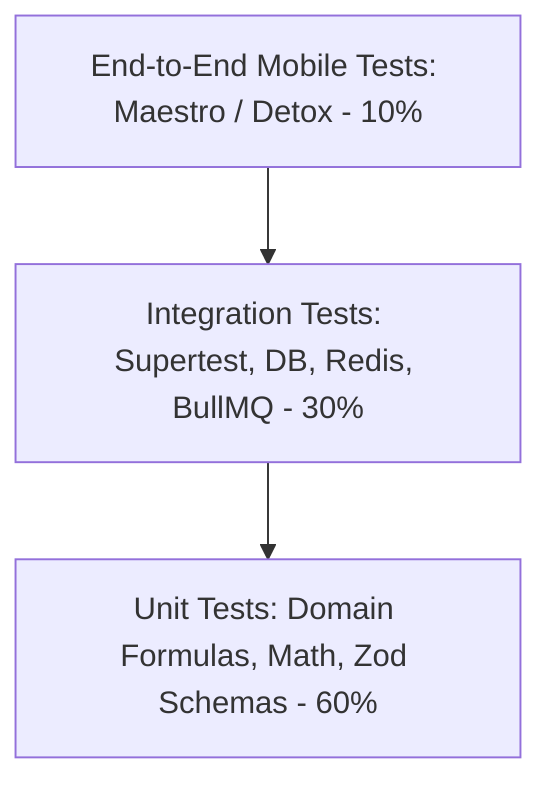
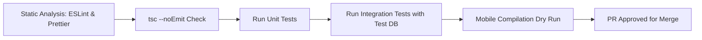

# CAL METER — Quality Assurance & Testing Strategy

**Document Version:** 1.0.0  
**Status:** Approved Architecture Draft  
**Owner:** Technical Lead & QA Lead  
**Last Updated:** November 2026

---

## 1. Quality Philosophy & The Testing Pyramid

CAL METER guarantees high reliability through an automated testing pyramid. Because the application manages health decisions and calorie budgets, calculation errors or data loss directly destroy user trust.



---

## 2. Test Execution Tiers

### 2.1. Unit Testing (Target Coverage: > 85%)

- **Test Runner:** Jest / Vitest with TypeScript support.
- **Scope:**
  - Nutritional math: BMR formulas (Mifflin-St Jeor), TDEE, macro caloric densities (4 kcal/g protein, 4 kcal/g carb, 9 kcal/g fat).
  - Serving unit conversions (_katori_, _roti_, _tablespoon_, _cup_ to metric grams).
  - Zod validation schemas for all incoming API payloads and client form models.
  - Zustand state store actions and reducers.

```typescript
// Example: BMR calculation unit test
describe('Nutrition Math Engine', () => {
  it('calculates Mifflin-St Jeor BMR correctly for men', () => {
    // 80kg, 180cm, 30yo male
    // BMR = 10(80) + 6.25(180) - 5(30) + 5 = 800 + 1125 - 150 + 5 = 1780 kcal
    const bmr = calculateBmr({
      gender: 'MALE',
      weightKg: 80,
      heightCm: 180,
      ageYears: 30,
    });
    expect(bmr).toBe(1780);
  });
});
```

### 2.2. Integration Testing (Target Coverage: > 80%)

- **Test Runner:** Vitest + Supertest executing against a dedicated, isolated PostgreSQL test database (`calmeter_test`).
- **Safety Policy & Migration Guard:**
  - Database integration tests and test migrations strictly require `NODE_ENV=test`.
  - An explicit `TEST_DATABASE_URL` targeting a database named `calmeter_test` or ending with `_test` is mandatory.
  - Test commands fail closed and will NEVER fall back to `DATABASE_URL` or substitute default database URLs.
  - Production credentials or databases must never be used for tests or test migrations.
  - Run test migrations via: `NODE_ENV=test TEST_DATABASE_URL=<url> npm run prisma:migrate:test`.
- **Scope:**
  - HTTP endpoints: Request validation, Firebase auth mock interceptors, response envelopes.
  - Prisma database queries: Cascading deletes, tenant isolation constraints, PostgreSQL CHECK constraint verification.
  - Redis cache: Key expiration, invalidation on meal updates, rate limiter sliding windows.
  - BullMQ Worker: Job dispatch, retry on simulated Gemini API timeout, database persistence.
  - **Food Database & Search Subsystems (`apps/api/tests/`):**
    - `foodImport.test.ts`: Ingestion normalization, source licensing validation, USDA and Open Food Facts mapping, ICMR-NIN commercial compliance gate, duplicate resolution, batch progress tracking, dry-run simulation.
    - `foodSearch.test.ts`: Text search query parsing, Indian regional alias ranking priority (_phulka_ -> _roti_), barcode lookups, cuisine filtering, pagination, sort orders.
    - `foodCustom.test.ts`: Custom food creation, multi-tenant isolation (User A vs. User B), anti-enumeration 404 security checks, update constraints, soft deletion preservation.
    - `foodDatabase.test.ts`: PostgreSQL real CHECK constraints enforcement (`calories >= 0`, `confidence_score` [0, 1]), null vs. 0 nutrient preservation, shared nutrient aggregation formula verification, idempotency.
  - **AI Food Recognition & Estimation Pipeline (`apps/api/tests/`):**
    - `aiImageHandling.test.ts`: Magic bytes detection (JPEG, PNG, WebP), dimension bounds (100x100 to 8192x8192), EXIF metadata stripping (APP1 markers and PNG text chunks), size limits.
    - `aiRecognition.test.ts`: Provider abstraction, single food, multi-plate, Indian thali (8 components), empty scene / low confidence handling, upstream error taxonomy (timeout, rate limit, outage, malformed JSON).
    - `aiFoodMatching.test.ts`: Exact canonical match, Indian alias matching (_phulka_ -> Whole Wheat Roti), ambiguous match ranking, multi-tenant custom food isolation (User A custom food never matched for User B).
    - `aiNutritionCalculation.test.ts`: Deterministic calculation per 100g via `@calmeter/shared` formulas, serving unit conversion (piece, katori, cup), strict preservation of `null` vs `0` micronutrients, whole-meal nutrient aggregation, portion adjustment recalculations.
    - `aiScanWorkflow.test.ts`: End-to-end scan lifecycle REST API tests (`POST /scans`, image upload, process, corrections, diary confirmation, cancellation), daily quota gate (3 scans/day -> 429), multi-tenant 404 security barriers, idempotent diary confirmation.
  - **Food Diary & Daily Nutrition Tracking Subsystem (`apps/api/tests/diary.test.ts`):**
    - Empty diary initial state rendering with default zero totals.
    - Logging items to Breakfast and Lunch with deterministic unit scaling (`piece`, `katori` to grams).
    - Daily summary endpoint calculation against active `NutritionGoal` with consumed vs target and remaining macros.
    - Immutable historical snapshot persistence (modifying food items in catalog does not alter past logged entries).
    - Multi-tenant data isolation and anti-enumeration security: User A cannot read, modify, or delete User B's diary entries (`404 Not Found`).
    - Logged item portion patch updates with atomic re-aggregation of meal totals.
    - Logged item deletion with atomic recalculation of meal totals.
    - Payload validation guards (invalid date formats, non-positive portions).
    - Direct manual logging without `foodItemId` using custom nutritional values.
    - Atomic transaction rollback on failure.
  - **Barcode Scanning & Packaged Food Recognition Subsystem (`apps/api/tests/barcodeLookup.test.ts`):**
    - Input barcode sanitation (stripping spaces, hyphens, and leading zero noise).
    - Strict GS1 Modulo-10 checksum validation (rejecting malformed check digits with 400).
    - Zero-suppressed UPC-E expansion to full 12-digit UPC-A formats.
    - Fast-path lookup against internal PostgreSQL catalog (`food_barcodes` and `food_items`).
    - Fallback querying of external Open Food Facts API with resilient error handling:
      - 504 Gateway Timeout simulation on request abort / latency exceed.
      - 429 Too Many Requests propagation on upstream rate limits.
      - 503 Service Unavailable handling on upstream outages.
      - 404 Product Not Found for non-existent items.
    - Atomic persistence of newly resolved external products into local PostgreSQL database (`food_items`, `food_barcodes`, `food_nutrient_profiles`, `serving_unit_conversions`).
    - Strict preservation of `null` vs `0` for unmeasured micronutrients across providers.
    - Multi-tenant custom food isolation: custom foods bound to barcodes are strictly hidden from other tenants (`404 Not Found`).
  - **Onboarding, Profile & Goal Personalization Subsystem (`apps/api/tests/onboardingAndProfile.test.ts`):**
    - Minor protection: strictly rejects date of birth for users under 18 years of age.
    - Physiological boundary checking: validates height (100–250 cm) and weight (30–350 kg) bounds.
    - Transactional onboarding completion (`POST /onboarding/complete`): atomically upserts `UserProfile`, creates active `NutritionGoal` with calculated Mifflin-St Jeor values, and creates baseline `WeightLog` in a single ACID transaction.
    - Idempotency: repeated submissions update profile without duplicating records.
    - Profile management (`GET /profile`, `PATCH /profile`): handles unonboarded 404 state; tracks weight changes automatically in `WeightLog`.
    - Active goal resolution (`GET /goals/current`): resolves active goal by `effectiveDate <= targetDate` ordered by `effectiveDate DESC, createdAt DESC`.
    - Goal history timeline (`GET /goals`) and manual overrides (`POST /goals`, `PATCH /goals/:id`).
    - Preview target recalculations (`POST /goals/recalculate`) without database side effects.
    - Weight tracking subsystem (`POST /tracking/weight`, `GET /tracking/weight`).
    - Multi-tenant security: cross-tenant access to another user's goals or profile returns 404.

### 2.3. Mobile Component & Workflow Testing (`apps/mobile/tests/`)

- **Test Runner:** Vitest + React Test Renderer with full design system mock environment.
- **Onboarding & Profile Suite (`apps/mobile/tests/onboarding.test.tsx`):**
  - Full 6-step guided onboarding workflow: basic info, primary goal, activity level, target selection, diet preferences, blueprint review.
  - Non-destructive back navigation preserving draft state across steps.
  - Dynamic unit conversion: switches between Metric (cm/kg) and Imperial (ft-in/lbs).
  - ProfileScreen hydration: loads and displays user biometrics, active calorie target, and macro distribution.
  - Body measurements modal: modifies height/weight and commits updates.
  - Target customization modal: modifies daily calories, protein, carbs, fat, fiber.
  - Recalculate targets action: triggers mathematical recalculation and updates active goal.
- **Diary Screen Suite (`apps/mobile/tests/diary.test.tsx`):**
  - Initial loading skeleton/spinner followed by daily summary card hydration.
  - All four canonical meal sections (Breakfast, Lunch, Dinner, Snacks) rendered with food item rows and empty state placeholders.
  - Calendar date navigation (Next day, Previous day, Jump to Today shortcut).
  - Item deletion flow with confirmation dialog and automatic summary refresh.
  - API failure error state rendering with accessible retry action.
- **Barcode Scanner Suite (`apps/mobile/tests/barcodeScanner.test.tsx`):**
  - Menu rendering with capture modes and manual entry fallback button.
  - Camera permission lifecycle: denial state renders informative screen with manual fallback; granted state mounts active scanner view.
  - Real-time manual barcode modal validation: detects EAN-13, EAN-8, UPC-A, UPC-E; validates check digit; disables search on invalid checksums; enables search on valid inputs.
  - Scanner camera integration: triggers API lookup on read; throttles and debounces duplicate frames; presents loading indicator and error alerts.
  - Product detail sheet: renders brand, manufacturer, ingredients, allergens; switches portion units (per serving vs per 100g); adjusts quantity steppers; dynamically recalculates live nutrition; strictly preserves `null` values; displays Open Food Facts ODbL attribution notice; commits to diary with `LoggedMethod.BARCODE`.

### 2.4. End-to-End (E2E) Testing (Maestro & Detox)

- **Tool:** Maestro for cross-platform, declarative mobile UI flows.
- **Core Critical Flows Tested:**
  1. Complete onboarding from splash to dashboard.
  2. Camera simulation: Inject static mock image -> review sheet -> adjust slider -> log meal.
  3. Barcode scan simulation: Feed mock barcode -> assert product details -> log.
  4. Edit logged meal: Change portion from 1 to 2 -> assert ring updates.

---

## 3. Golden Benchmark Dataset for Vision Testing

To prevent prompt drift or regressions when updating Gemini prompts or models, CAL METER maintains a curated **Golden Food Dataset of 100 benchmark images**:

- 40 Indian Regional Meals (Thalis, Dal Tadka with Phulkas, Biryani, Dosa, Idli-Vada, Sabzis).
- 30 Western / International Dishes (Salads, Steaks, Pasta, Burgers, Protein Bowls).
- 15 Packaged Snacks & Beverages (Chips, protein bars, coffee with milk).
- 15 Edge Cases (Blurry photos, non-food objects, empty plates, poor lighting).

A nightly automated CI job runs the benchmark suite and asserts:

- **Food Recognition Accuracy:** $\ge 88\%$ top-3 match rate.
- **Portion Plausibility:** Estimated weight within $\pm 25\%$ of ground truth.
- **Zero Hallucinated Toxic/Non-Food Objects.**

---

## 4. Mobile Device Testing Matrix

| OS          | Versions Supported              | Target Devices Tested                                                                        |
| :---------- | :------------------------------ | :------------------------------------------------------------------------------------------- |
| **iOS**     | iOS 16.0 to iOS 18.x            | iPhone SE (3rd Gen - 4.7"), iPhone 13/14 (6.1"), iPhone 15/16 Pro Max (6.7" Dynamic Island). |
| **Android** | API 28 (Android 9.0) to API 34+ | Samsung Galaxy S23/S24, Google Pixel 7/8, Xiaomi Redmi Note series, OnePlus 11/12.           |

---

## 5. Performance & Load Testing Benchmarks

Executed using **k6** against staging infrastructure:

- **Baseline Load:** 500 concurrent virtual users (VUs) simulating active lunch logging.
- **P95 Latency SLA:**
  - `GET /api/v1/diary/:date`: < 120 ms.
  - `GET /api/v1/foods/search`: < 80 ms.
  - `POST /api/v1/scans/analyze`: < 2.5 seconds total (worker completion).
- **Error Rate SLA:** < 0.05% under peak stress.

---

## 6. Continuous Integration & Quality Gates

Every Pull Request must pass the GitHub Actions CI pipeline prior to merging:



---

## 7. Progress, Water & Exercise Tracking Test Suites (Part 10)

Part 10 introduces rigorous end-to-end verification across the entire monorepo stack:

### 7.1. Shared Formulas & Unit Conversions (`packages/shared/tests/exercise.test.ts`)

- **MET Calorie Formula Verification:** Validates standard Compendium of Physical Activities equations:
  $$\text{Calories Burned} = \text{MET} \times \text{weightKg} \times \left(\frac{\text{durationMinutes}}{60}\right)$$
- **Boundary & Clamp Assertions:** Tests intensity variations (Light, Moderate, Vigorous) across all 9 categories (Walking, Running, Cycling, Swimming, Gym, Strength, Yoga, Sports, Other).
- **Error Assertions:** Verifies negative or non-finite inputs, duration $> 1440$ min, and weight bounds ($< 30$ kg or $> 350$ kg) throw `DomainValidationError`.

### 7.2. Contract Validation (`packages/contracts/tests/contracts.test.ts`)

- **Weight Contracts:** Validates `LogWeightSchema` and `UpdateWeightLogSchema` boundary constraints.
- **Water Contracts:** Validates `LogWaterSchema` ($1 \le \text{amountMl} \le 5000$) and `UpdateWaterLogSchema`.
- **Exercise Contracts:** Validates `LogExerciseSchema`, `UpdateExerciseLogSchema`, and duration bounds ($1 \le \text{minutes} \le 1440$).
- **Progress Report Contracts:** Validates date range validation and multi-metric response schemas.

### 7.3. Backend Integration & Security Tests (`apps/api/tests/trackingProgress.test.ts`)

- **10-Second Retry Idempotency:** Submitting duplicate weight measurements within a 10-second window returns the existing record without generating duplicate rows.
- **Profile Synchronization:** Creating, updating, or deleting weight measurements automatically synchronizes `UserProfile.currentWeightKg` to reflect the chronological latest entry.
- **Goal-Linked Hydration:** Validates daily summaries dynamically resolve targets against `NutritionGoal.waterMl` effective on the target date.
- **Multi-Tenant Scoping:** Verifies User A cannot read, update, or delete User B's weight, water, or exercise records (anti-enumeration 404s).
- **Exercise Calorie Isolation:** Verifies exercise records and progress summaries explicitly maintain non-diet-credit disclaimers.

### 7.4. Mobile Component & Workflow Tests (`apps/mobile/tests/progress.test.tsx`)

- **Dashboard Metric Rendering:** Verifies body weight, hydration bar, activity summary, and non-medical disclaimers render correctly.
- **Interactive Range Toggles:** Asserts switching between `7D`, `30D`, `90D`, and `1Y` triggers parameterized API queries with corresponding day counts.
- **Unit Conversions:** Validates client-side toggling between `kg`/`lbs` and `ml`/`L`/`fl oz` converts displayed values accurately.
- **Quick-Add Actions:** Asserts tapping hydration quick-add buttons dispatches API calls with `{ source: "QUICK_ADD" }` and updates the progress indicator.
- **Error & Offline Resilience:** Asserts network errors display `ErrorState` with retry pathways.

---

## 8. AI Nutrition Coach & Personalized Insights Test Suites (Part 11)

Part 11 establishes complete test coverage across shared formulas, contracts, backend services, and mobile components:

### 8.1. Shared Deterministic Insights Formulas (`packages/shared/tests/insights.test.ts`)

- **Calorie Progress Pacing:** Validates calculations across normal, over-target, and empty daily logs with accurate percentage and delta tracking.
- **Protein Pacing:** Validates protein distribution against targets with category flags (`CELEBRATION`, `RECOMMENDATION`, `OBSERVATION`).
- **Fiber Intake Analysis:** Validates fiber benchmarks (adequate vs catch-up recommendation).
- **Hydration Adherence:** Analyzes logged water volume against active targets.
- **Weight Trajectory ($N \ge 2$ Invariant):** Strictly validates that weight trajectory analysis requires at least 2 distinct entries over time; returns `null` if fewer entries exist to avoid drawing conclusions from isolated readings.
- **Physical Activity Habit:** Evaluates weekly aerobic activity minutes against WHO 150-minute guidelines.

### 8.2. Contract Validation (`packages/contracts/tests/contracts.test.ts`)

- **Coach Message Schemas:** Validates `SendCoachMessageSchema` (length limits, non-empty) and `CoachMessageResponseSchema`.
- **Insight Schemas:** Validates `PersonalizedInsightSchema` and `InsightsResponseSchema`.
- **Meal Recommendation Schemas:** Validates `MealRecommendationSchema`, `MealRecommendationItemSchema`, and query parameter schemas.

### 8.3. Backend Integration & AI Safety Tests (`apps/api/tests/coachInsights.test.ts`)

- **Context-Aware Coaching:** Validates user message dispatch with anonymized context (logged food, macros, remaining calories).
- **Safety Guardrails (Starvation Refusal):** Asserts requests for extreme restriction (< 500 kcal/day, purging, vomiting) trigger automated refusal and guidance toward healthcare specialists.
- **Safety Guardrails (Medical Diagnosis Refusal):** Asserts clinical medical diagnosis and prescription requests are actively refused with clinical disclaimers.
- **Conversation History Lifecycle:** Verifies chronological history retrieval and complete deletion on `DELETE /api/v1/coach/history`.
- **Deterministic Insight API:** Evaluates actual database meal logs, water logs, weight readings, and workouts into deterministic insight payloads.
- **Tailored Meal Recommendations:** Asserts recommendations respect dietary preferences (e.g. Vegetarian users receive zero meat dishes) and correctly scale database foods.
- **Multi-Tenant Isolation:** Asserts User B cannot access or clear User A's coach messages.

### 8.4. Mobile Component & Workflow Tests (`apps/mobile/tests/coach.test.tsx`)

- **Chat Interface:** Verifies header, educational disclaimer, user/assistant chat bubbles, and suggested prompt chips.
- **Message Dispatch:** Simulates typing and submitting messages, asserting assistant replies update the conversation.
- **Prompt Chip Quick-Send:** Validates tapping prompt chips automatically dispatches queries.
- **Deterministic Insights Tab:** Validates switching to the Insights tab fetches and displays metric cards with progress bars and tips.
- **Meal Ideas Tab:** Validates switching to the Meal Ideas tab displays remaining budget, meal cards, and "Log This Meal" confirmation.
- **Error & Retry Handling:** Verifies network failures trigger `ErrorState` with retry pathways.

---

## 9. Subscriptions, Payments & Premium Entitlements Test Suites (Part 12)

Part 12 implements end-to-end testing across shared entitlement formulas, contract schemas, backend webhook and status APIs, and mobile UI/hooks:

### 9.1. Shared Formulas & Entitlements (`packages/shared/tests/subscriptions.test.ts`)

- **Effective Tier Calculation:**
  - Active subscription (`ACTIVE` / `TRIAL`) resolves to `PREMIUM`.
  - Active subscription past `expiresAt` resolves to `FREE`.
  - Cancelled subscription (`CANCELED`) with future `expiresAt` remains entitled to `PREMIUM`.
  - Cancelled subscription past `expiresAt` resolves to `FREE`.
  - Expired, past-due, or null subscription resolves to `FREE`.
- **Feature Policy Evaluation:**
  - Evaluates daily quotas for `AI_PHOTO_SCAN`, `BARCODE_SCAN`, `COACH_CHAT`, and `MEAL_RECOMMENDATIONS`.
  - Enforces `ADVANCED_ANALYTICS` premium-only restriction.
  - Enforces 30-day history limit for free users while granting unlimited access to premium subscribers.

### 9.2. Contract Validation (`packages/contracts/tests/contracts.test.ts`)

- **Subscription Status Schemas:** Validates `SubscriptionStatusResponseSchema` and `SyncSubscriptionRequestSchema`.
- **Feature Access Schemas:** Validates `FeatureCheckQuerySchema` and `FeatureAccessResponseSchema`.
- **RevenueCat Webhook Schemas:** Validates `RevenueCatWebhookPayloadSchema` with nested event attributes and store types.

### 9.3. Backend Integration & Webhook Engine (`apps/api/tests/subscriptions.test.ts`)

- **Webhook Authentication:**
  - Rejects webhook requests missing the `Authorization` header (`401 Unauthorized`).
  - Rejects webhook requests with invalid bearer credentials (`401 Unauthorized`).
  - Accepts authentic webhooks matching `REVENUECAT_WEBHOOK_AUTH_TOKEN` (`200 OK`).
- **Lifecycle Event Processing:**
  - `INITIAL_PURCHASE`: Creates active premium subscription record.
  - `RENEWAL`: Updates latest purchase date and extends expiration timestamp.
  - `CANCELLATION`: Sets status to `CANCELED` and `autoRenewStatus = false`, but preserves `PREMIUM` entitlement until `expiresAt`.
  - `EXPIRATION`: Sets status to `EXPIRED` and revokes tier to `FREE`.
  - `BILLING_ISSUE`: Sets `billingIssueDetectedAt` for store grace period processing.
- **Idempotency & Replay Defense:**
  - Re-sending an identical `event_id` returns `200 OK` with status `IGNORED_DUPLICATE` without duplicating database writes.
- **Out-of-Order Event Protection:**
  - Deliberately dispatching an older event after a newer event returns `200 OK` with status `IGNORED_OUT_OF_ORDER` without regressing the user's active state.
- **Subscription Status & Multi-Tenant Isolation:**
  - User A cannot observe, query, or sync User B's subscription record.
- **Atomic Usage Increment Concurrency:**
  - 10 parallel atomic increments executed concurrently on `(userId, feature, date)` execute without race condition lost updates.

### 9.4. Mobile UI & Hook Tests (`apps/mobile/tests/subscription.test.tsx`)

- **`useEntitlements` Hook:**
  - Evaluates free tier quotas and blocks access when limits are exceeded.
  - Evaluates premium tier status with unlimited feature access.
  - Returns remaining daily quota numbers.
- **`FeatureLimitModal` Component:**
  - Displays feature title, explanation of daily free limit, "Upgrade to Premium" button, and "Maybe Later" dismiss button.
- **`PaywallScreen` Component:**
  - Renders title, subtitle, localized offerings, toggle between Monthly and Annual plans, feature comparison table, purchase triggers, and store disclosures.
- **`ManageSubscriptionView` Component:**
  - Renders Free Plan badge and upgrade CTA for free users.
  - Renders Premium badge and renewal date for active subscribers.

---

## 10. Notifications, Analytics & Production Hardening Test Suite (Part 13)

### 10.1. Timezone & Sanitization Unit Tests (`packages/shared/tests/`)

- **`timezone.test.ts`:**
  - `parseTimeToMinutes` and `formatMinutesToTime`: Verifies accurate conversions, boundary edge cases (00:00 to 23:59), wrapping, and invalid time string rejections.
  - `isWithinQuietHours`: Verifies same-day quiet windows (`13:00` to `15:00`), midnight-crossing quiet windows (`22:00` to `07:00`), unconfigured preferences, and equal start/end edge cases.
  - `isValidIanaTimezone`: Validates common Indian (`Asia/Kolkata`) and global timezones (`America/New_York`, `UTC`, `Europe/London`), rejecting corrupted strings.
  - `getCurrentTimeInTimezone`: Verifies timezone calculation, day boundary transitions, and fallback to UTC.
  - `isReminderDue`: Verifies window matching and midnight wrap-around tolerance.
- **`analyticsSanitizer.test.ts`:**
  - `isSensitiveKey`: Verifies detection of passwords, secrets, tokens, auth headers, private medical notes, and coach messages.
  - `sanitizeAnalyticsProperties`: Verifies that blocked keys are redacted to `[REDACTED]`, embedded emails to `[REDACTED_EMAIL]`, JWTs to `[REDACTED_TOKEN]`, and deep objects/arrays are safely cleaned.

### 10.2. Contract Validation (`packages/contracts/tests/contracts.test.ts`)

- **Device Token Contracts:** Validates `RegisterDeviceTokenSchema` with platform and hardware version constraints.
- **Notification Preference Contracts:** Validates `NotificationPreferenceSchema` with custom reminder times (`HH:mm`), quiet hours, and regex constraints.
- **Analytics Contracts:** Validates `TrackAnalyticsEventSchema` and `BatchAnalyticsEventsSchema`.
- **Operational Metrics Contracts:** Validates `OperationalMetricsResponseSchema` structure including memory, HTTP latencies, and AI counters.

### 10.3. Backend Integration & Observability (`apps/api/tests/`)

- **`notifications.test.ts`:**
  - `POST /api/v1/notifications/device-token`: Registers active device token and updates metadata idempotently.
  - `DELETE /api/v1/notifications/device-token`: Deactivates token on logout.
  - `GET /api/v1/notifications/preferences` & `PATCH`: Fetches defaults, updates custom reminder times and quiet hours, rejects invalid formats.
  - `POST /api/v1/notifications/test`: Dispatches mock notification, logs delivery history, and honors quiet hours / category disabling.
- **`analytics.test.ts`:**
  - `POST /api/v1/analytics/track`: Ingests event, proves zero-PII scrubbing in database record, and verifies anonymous pre-auth events.
  - `POST /api/v1/analytics/batch`: Ingests mobile event batches in bulk.
  - `GET /api/v1/metrics`: Surfaces JSON operational telemetry and Prometheus plaintext exposition format.
- **`securityHardening.test.ts`:**
  - `createRateLimiter`: Verifies request throttling with 429 status, `Retry-After`, and `X-RateLimit-*` headers.
  - Security headers: Emits Helmet security headers (`X-Content-Type-Options: nosniff`).
  - CORS policies: Blocks unauthorized cross-origin preflight requests with `403 Forbidden`.

### 10.4. Background Worker Queues & Processors (`apps/worker/tests/worker.test.ts`)

- **`notification.queue.ts`:** Instantiates BullMQ queue with exponential backoff retry policy.
- **Deduplication:** Verifies deterministic job ID generation (`notif-${userId}-${category}-${dateIso}`) to eliminate duplicate alerts.
- **Processor:** Verifies `processNotificationJob` checks preferences, quiet hours, and dispatches without error.

### 10.5. Mobile UI & Services (`apps/mobile/tests/`)

- **`notifications.test.tsx`:**
  - `PushNotificationService`: Verifies token registration, logout deactivation, and deep link routing for `calmeter://diary`, `calmeter://progress`, `calmeter://coach`, and `calmeter://paywall`.
  - `NotificationPreferencesView`: Renders reminder switches, quiet hours inputs, and verifies preference save interactions.
- **`analytics.test.tsx`:**
  - `AnalyticsService`: Enqueues events with PII sanitization, flushes batches to backend, and handles offline network interruptions without crashing UI.

---

## 15. Web Admin Panel & Operations Dashboard Testing Strategy (Part 14)

### 15.1. Scope & Verification Layers

Testing for the administrative platform covers both backend security/integrity and frontend operational workflows:

1. **RBAC & Authentication Integrity Tests (`apps/api/tests/adminOperations.test.ts`):**
   - Unauthenticated requests rejected with `401 Unauthorized`.
   - Regular application users rejected from administrative routes with `403 Forbidden`.
   - Inactive/suspended administrator accounts rejected with `403 Forbidden`.
   - Role privilege boundaries verified (e.g. `SUPPORT_ADMIN` denied from `/admins`).
   - Self-suspension and last-super-admin demotion prevention verified.
2. **Operations & Audit Ledger Verification (`apps/api/tests/adminOperations.test.ts`):**
   - User suspension and reactivation state updates and audit event recording.
   - Food database item creation, modification, deletion, and verified status updates with audit records.
   - Scan operation failure inspection and status reset for job retries.
   - Support ticket creation, status/priority updates, and internal staff note appending.
   - Notification campaign creation and simulated FCM dispatch.
   - System telemetry and infrastructure health metrics aggregation.
3. **Frontend Component & Route Guard Tests (`apps/admin/src/test/AdminApp.test.tsx`):**
   - `LoginView` rendering with token input and developer test persona buttons.
   - `ProtectedRoute` redirection to `/login` for unauthenticated visitors.
   - `ProtectedRoute` clearance restriction banner for insufficient operator roles.
   - `AdminAuthContext` token persistence in `localStorage` and cleanup on logout.
   - Authorized navigation and layout rendering.
