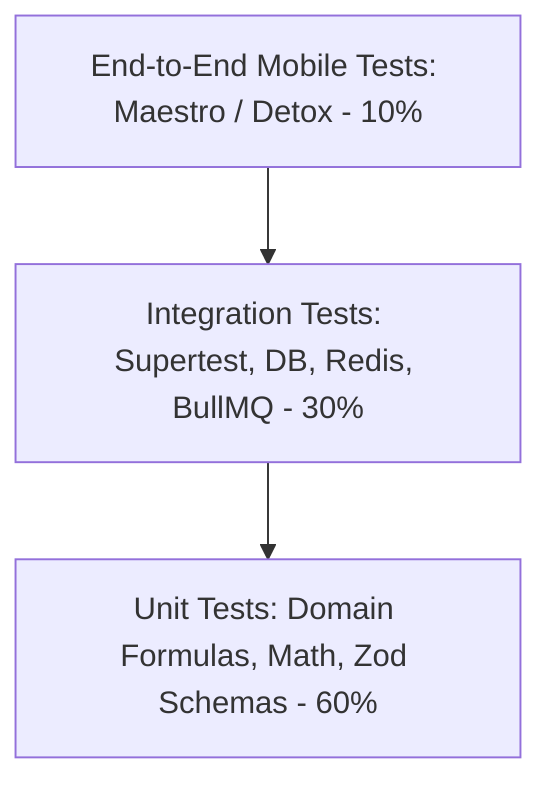
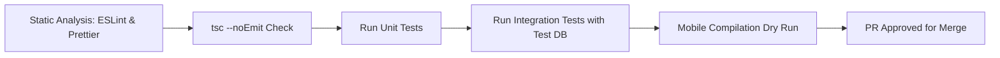

# CAL METER — Quality Assurance & Testing Strategy

**Document Version:** 1.0.0  
**Status:** Approved Architecture Draft  
**Owner:** Technical Lead & QA Lead  
**Last Updated:** November 2026

---

## 1. Quality Philosophy & The Testing Pyramid

CAL METER guarantees high reliability through an automated testing pyramid. Because the application manages health decisions and calorie budgets, calculation errors or data loss directly destroy user trust.



---

## 2. Test Execution Tiers

### 2.1. Unit Testing (Target Coverage: > 85%)

- **Test Runner:** Jest / Vitest with TypeScript support.
- **Scope:**
  - Nutritional math: BMR formulas (Mifflin-St Jeor), TDEE, macro caloric densities (4 kcal/g protein, 4 kcal/g carb, 9 kcal/g fat).
  - Serving unit conversions (_katori_, _roti_, _tablespoon_, _cup_ to metric grams).
  - Zod validation schemas for all incoming API payloads and client form models.
  - Zustand state store actions and reducers.

```typescript
// Example: BMR calculation unit test
describe('Nutrition Math Engine', () => {
  it('calculates Mifflin-St Jeor BMR correctly for men', () => {
    // 80kg, 180cm, 30yo male
    // BMR = 10(80) + 6.25(180) - 5(30) + 5 = 800 + 1125 - 150 + 5 = 1780 kcal
    const bmr = calculateBmr({
      gender: 'MALE',
      weightKg: 80,
      heightCm: 180,
      ageYears: 30,
    });
    expect(bmr).toBe(1780);
  });
});
```

### 2.2. Integration Testing (Target Coverage: > 80%)

- **Test Runner:** Vitest + Supertest executing against a dedicated, isolated PostgreSQL test database (`calmeter_test`).
- **Safety Policy & Migration Guard:**
  - Database integration tests and test migrations strictly require `NODE_ENV=test`.
  - An explicit `TEST_DATABASE_URL` targeting a database named `calmeter_test` or ending with `_test` is mandatory.
  - Test commands fail closed and will NEVER fall back to `DATABASE_URL` or substitute default database URLs.
  - Production credentials or databases must never be used for tests or test migrations.
  - Run test migrations via: `NODE_ENV=test TEST_DATABASE_URL=<url> npm run prisma:migrate:test`.
- **Scope:**
  - HTTP endpoints: Request validation, Firebase auth mock interceptors, response envelopes.
  - Prisma database queries: Cascading deletes, tenant isolation constraints, PostgreSQL CHECK constraint verification.
  - Redis cache: Key expiration, invalidation on meal updates, rate limiter sliding windows.
  - BullMQ Worker: Job dispatch, retry on simulated Gemini API timeout, database persistence.
  - **Food Database & Search Subsystems (`apps/api/tests/`):**
    - `foodImport.test.ts`: Ingestion normalization, source licensing validation, USDA and Open Food Facts mapping, ICMR-NIN commercial compliance gate, duplicate resolution, batch progress tracking, dry-run simulation.
    - `foodSearch.test.ts`: Text search query parsing, Indian regional alias ranking priority (_phulka_ -> _roti_), barcode lookups, cuisine filtering, pagination, sort orders.
    - `foodCustom.test.ts`: Custom food creation, multi-tenant isolation (User A vs. User B), anti-enumeration 404 security checks, update constraints, soft deletion preservation.
    - `foodDatabase.test.ts`: PostgreSQL real CHECK constraints enforcement (`calories >= 0`, `confidence_score` [0, 1]), null vs. 0 nutrient preservation, shared nutrient aggregation formula verification, idempotency.
  - **AI Food Recognition & Estimation Pipeline (`apps/api/tests/`):**
    - `aiImageHandling.test.ts`: Magic bytes detection (JPEG, PNG, WebP), dimension bounds (100x100 to 8192x8192), EXIF metadata stripping (APP1 markers and PNG text chunks), size limits.
    - `aiRecognition.test.ts`: Provider abstraction, single food, multi-plate, Indian thali (8 components), empty scene / low confidence handling, upstream error taxonomy (timeout, rate limit, outage, malformed JSON).
    - `aiFoodMatching.test.ts`: Exact canonical match, Indian alias matching (_phulka_ -> Whole Wheat Roti), ambiguous match ranking, multi-tenant custom food isolation (User A custom food never matched for User B).
    - `aiNutritionCalculation.test.ts`: Deterministic calculation per 100g via `@calmeter/shared` formulas, serving unit conversion (piece, katori, cup), strict preservation of `null` vs `0` micronutrients, whole-meal nutrient aggregation, portion adjustment recalculations.
    - `aiScanWorkflow.test.ts`: End-to-end scan lifecycle REST API tests (`POST /scans`, image upload, process, corrections, diary confirmation, cancellation), daily quota gate (3 scans/day -> 429), multi-tenant 404 security barriers, idempotent diary confirmation.
  - **Food Diary & Daily Nutrition Tracking Subsystem (`apps/api/tests/diary.test.ts`):**
    - Empty diary initial state rendering with default zero totals.
    - Logging items to Breakfast and Lunch with deterministic unit scaling (`piece`, `katori` to grams).
    - Daily summary endpoint calculation against active `NutritionGoal` with consumed vs target and remaining macros.
    - Immutable historical snapshot persistence (modifying food items in catalog does not alter past logged entries).
    - Multi-tenant data isolation and anti-enumeration security: User A cannot read, modify, or delete User B's diary entries (`404 Not Found`).
    - Logged item portion patch updates with atomic re-aggregation of meal totals.
    - Logged item deletion with atomic recalculation of meal totals.
    - Payload validation guards (invalid date formats, non-positive portions).
    - Direct manual logging without `foodItemId` using custom nutritional values.
    - Atomic transaction rollback on failure.
  - **Barcode Scanning & Packaged Food Recognition Subsystem (`apps/api/tests/barcodeLookup.test.ts`):**
    - Input barcode sanitation (stripping spaces, hyphens, and leading zero noise).
    - Strict GS1 Modulo-10 checksum validation (rejecting malformed check digits with 400).
    - Zero-suppressed UPC-E expansion to full 12-digit UPC-A formats.
    - Fast-path lookup against internal PostgreSQL catalog (`food_barcodes` and `food_items`).
    - Fallback querying of external Open Food Facts API with resilient error handling:
      - 504 Gateway Timeout simulation on request abort / latency exceed.
      - 429 Too Many Requests propagation on upstream rate limits.
      - 503 Service Unavailable handling on upstream outages.
      - 404 Product Not Found for non-existent items.
    - Atomic persistence of newly resolved external products into local PostgreSQL database (`food_items`, `food_barcodes`, `food_nutrient_profiles`, `serving_unit_conversions`).
    - Strict preservation of `null` vs `0` for unmeasured micronutrients across providers.
    - Multi-tenant custom food isolation: custom foods bound to barcodes are strictly hidden from other tenants (`404 Not Found`).

### 2.3. Mobile Component & Workflow Testing (`apps/mobile/tests/`)

- **Test Runner:** Vitest + React Test Renderer with full design system mock environment.
- **Diary Screen Suite (`apps/mobile/tests/diary.test.tsx`):**
  - Initial loading skeleton/spinner followed by daily summary card hydration.
  - All four canonical meal sections (Breakfast, Lunch, Dinner, Snacks) rendered with food item rows and empty state placeholders.
  - Calendar date navigation (Next day, Previous day, Jump to Today shortcut).
  - Item deletion flow with confirmation dialog and automatic summary refresh.
  - API failure error state rendering with accessible retry action.
- **Barcode Scanner Suite (`apps/mobile/tests/barcodeScanner.test.tsx`):**
  - Menu rendering with capture modes and manual entry fallback button.
  - Camera permission lifecycle: denial state renders informative screen with manual fallback; granted state mounts active scanner view.
  - Real-time manual barcode modal validation: detects EAN-13, EAN-8, UPC-A, UPC-E; validates check digit; disables search on invalid checksums; enables search on valid inputs.
  - Scanner camera integration: triggers API lookup on read; throttles and debounces duplicate frames; presents loading indicator and error alerts.
  - Product detail sheet: renders brand, manufacturer, ingredients, allergens; switches portion units (per serving vs per 100g); adjusts quantity steppers; dynamically recalculates live nutrition; strictly preserves `null` values; displays Open Food Facts ODbL attribution notice; commits to diary with `LoggedMethod.BARCODE`.

### 2.4. End-to-End (E2E) Testing (Maestro & Detox)

- **Tool:** Maestro for cross-platform, declarative mobile UI flows.
- **Core Critical Flows Tested:**
  1. Complete onboarding from splash to dashboard.
  2. Camera simulation: Inject static mock image -> review sheet -> adjust slider -> log meal.
  3. Barcode scan simulation: Feed mock barcode -> assert product details -> log.
  4. Edit logged meal: Change portion from 1 to 2 -> assert ring updates.

---

## 3. Golden Benchmark Dataset for Vision Testing

To prevent prompt drift or regressions when updating Gemini prompts or models, CAL METER maintains a curated **Golden Food Dataset of 100 benchmark images**:

- 40 Indian Regional Meals (Thalis, Dal Tadka with Phulkas, Biryani, Dosa, Idli-Vada, Sabzis).
- 30 Western / International Dishes (Salads, Steaks, Pasta, Burgers, Protein Bowls).
- 15 Packaged Snacks & Beverages (Chips, protein bars, coffee with milk).
- 15 Edge Cases (Blurry photos, non-food objects, empty plates, poor lighting).

A nightly automated CI job runs the benchmark suite and asserts:

- **Food Recognition Accuracy:** $\ge 88\%$ top-3 match rate.
- **Portion Plausibility:** Estimated weight within $\pm 25\%$ of ground truth.
- **Zero Hallucinated Toxic/Non-Food Objects.**

---

## 4. Mobile Device Testing Matrix

| OS          | Versions Supported              | Target Devices Tested                                                                        |
| :---------- | :------------------------------ | :------------------------------------------------------------------------------------------- |
| **iOS**     | iOS 16.0 to iOS 18.x            | iPhone SE (3rd Gen - 4.7"), iPhone 13/14 (6.1"), iPhone 15/16 Pro Max (6.7" Dynamic Island). |
| **Android** | API 28 (Android 9.0) to API 34+ | Samsung Galaxy S23/S24, Google Pixel 7/8, Xiaomi Redmi Note series, OnePlus 11/12.           |

---

## 5. Performance & Load Testing Benchmarks

Executed using **k6** against staging infrastructure:

- **Baseline Load:** 500 concurrent virtual users (VUs) simulating active lunch logging.
- **P95 Latency SLA:**
  - `GET /api/v1/diary/:date`: < 120 ms.
  - `GET /api/v1/foods/search`: < 80 ms.
  - `POST /api/v1/scans/analyze`: < 2.5 seconds total (worker completion).
- **Error Rate SLA:** < 0.05% under peak stress.

---

## 6. Continuous Integration & Quality Gates

Every Pull Request must pass the GitHub Actions CI pipeline prior to merging:


