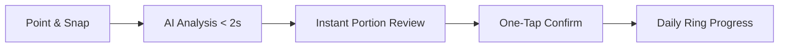
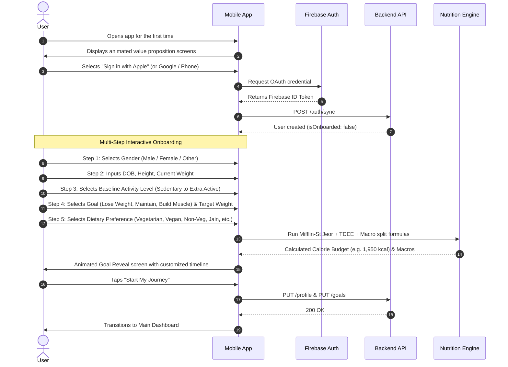
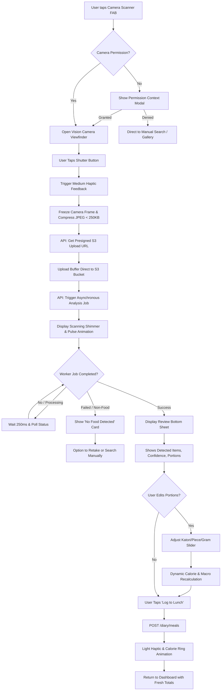
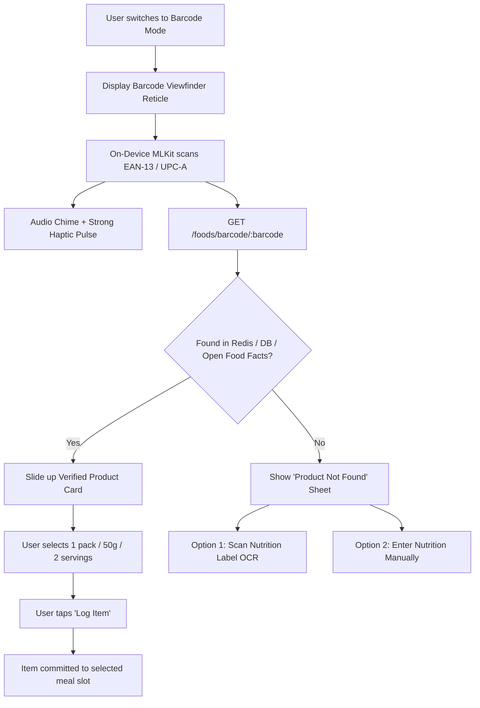
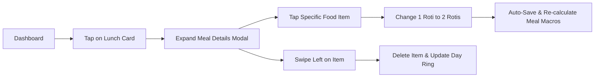
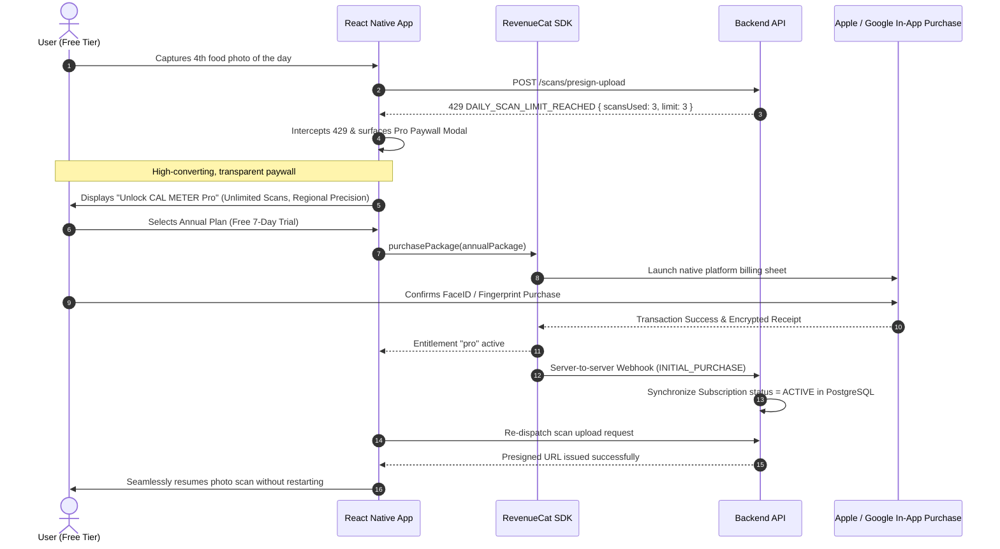

# CAL METER — User Journeys & Interaction Flows

**Document Version:** 1.0.0  
**Status:** Approved Architecture Draft  
**Owner:** Senior React Native Engineer & Product Designer  
**Last Updated:** November 2026  

---

## 1. Journey Overview & Design Philosophy

CAL METER is engineered around a **zero-friction nutrition feedback loop**. The typical calorie tracking app demands 15-20 taps and 60 seconds per meal, resulting in rapid user churn. CAL METER reduces this to **1 tap, 1 photo, and 1 confirmation tap in under 4 seconds**.

---

## 2. Journey 1: Authentication & Biometric Onboarding

### Guest Mode Contingency
Users may tap "Explore as Guest". In this state:
- An anonymous Firebase session is created silently.
- Profile and logs are stored locally with cloud backup.
- A subtle persistent banner appears on the Diary: *"Create an account to protect your data across devices."*
- Tapping the banner triggers non-destructive account linking (`linkWithCredential`), preserving all logged history.

---

## 3. Journey 2: AI Food Photo Scanning (The Core Loop)

### Interaction Details on the Review Screen:
- **Visual Confidence Pills:**
  - `High Confidence` (Green dot): Item identified with > 85% certainty.
  - `Estimated Portion` (Amber dot): Multi-unit items where volume is estimated.
- **Serving Switcher:** User can tap "1 katori" and switch directly to "150g" or "1.5 katori" with an intuitive scroll wheel.
- **Oil/Richness Modifier:** One-tap toggle: `[Dry / Light Oil] | [Standard] | [Rich / Restaurant]`.

---

## 4. Journey 3: Barcode Scanning (Packaged Foods)

---

## 5. Journey 4: Historical Diary & Meal Adjustments

- **Date Switching:** Swipe left/right anywhere on the top calendar header to jump backward in time.
- **Copying Meals:** Tap the three-dot menu on "Yesterday's Breakfast" -> "Copy to Today's Breakfast" for repeat meal routines.

---

## 6. Journey 5: Paywall & Subscription Entitlement Flow

