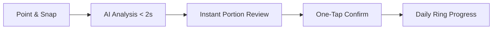
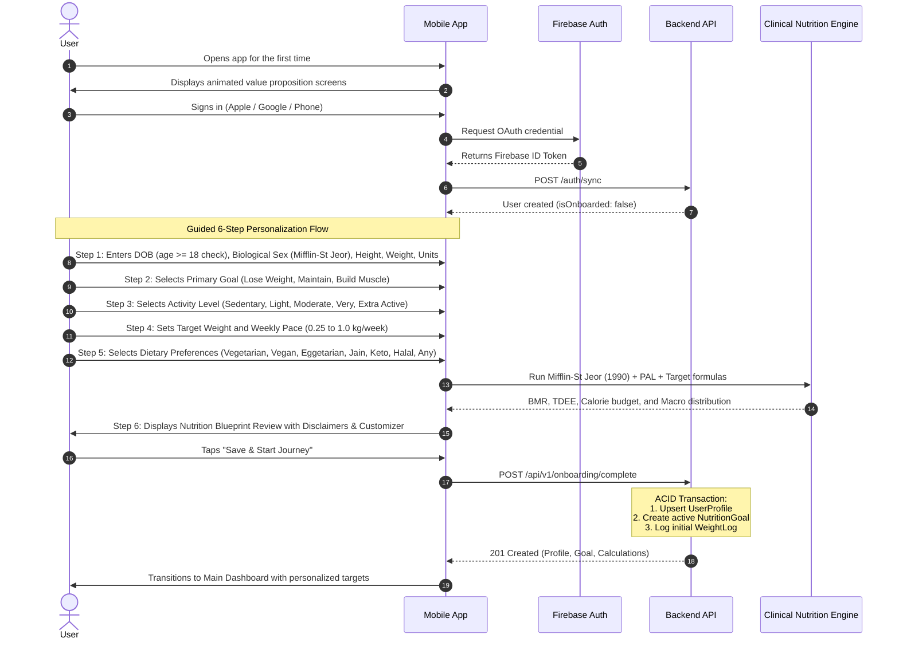
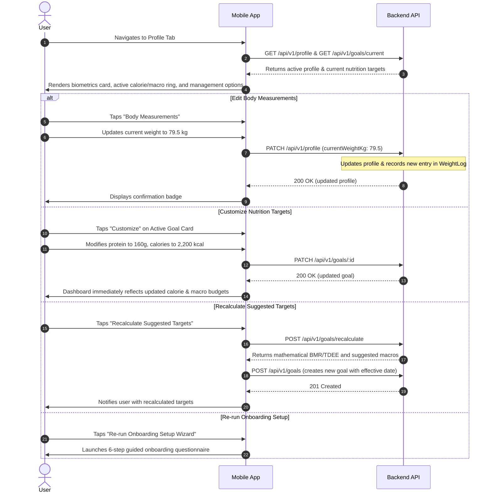
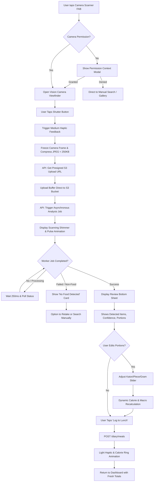
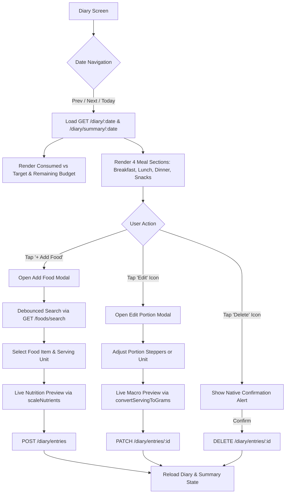
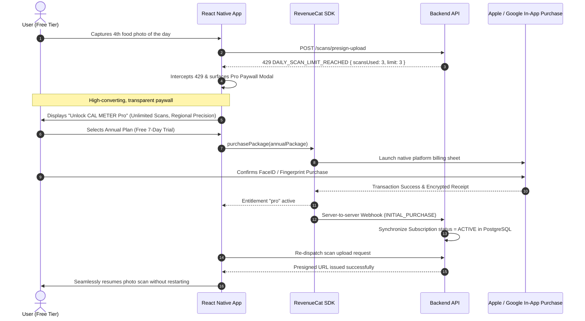

# CAL METER — User Journeys & Interaction Flows

**Document Version:** 1.0.0  
**Status:** Approved Architecture Draft  
**Owner:** Senior React Native Engineer & Product Designer  
**Last Updated:** November 2026

---

## 1. Journey Overview & Design Philosophy

CAL METER is engineered around a **zero-friction nutrition feedback loop**. The typical calorie tracking app demands 15-20 taps and 60 seconds per meal, resulting in rapid user churn. CAL METER reduces this to **1 tap, 1 photo, and 1 confirmation tap in under 4 seconds**.



---

## 2. Journey 1: Authentication & Guided 6-Step Onboarding



### Guest Mode Contingency

Users may tap "Explore as Guest". In this state:

- An anonymous Firebase session is created silently.
- Profile and logs are stored locally with cloud backup.
- A subtle persistent banner appears on the Diary: _"Create an account to protect your data across devices."_
- Tapping the banner triggers non-destructive account linking (`linkWithCredential`), preserving all logged history.

---

## 2.1. Journey 1B: Profile & Goal Management Flow



## 3. Journey 2: AI Food Photo Scanning (The Core Loop)



### Interaction Details on the Review Screen:

- **Visual Confidence Pills:**
  - `High Confidence` (Green dot): Item identified with > 85% certainty.
  - `Estimated Portion` (Amber dot): Multi-unit items where volume is estimated.
- **Serving Switcher:** User can tap "1 katori" and switch directly to "150g" or "1.5 katori" with an intuitive scroll wheel.
- **Oil/Richness Modifier:** One-tap toggle: `[Dry / Light Oil] | [Standard] | [Rich / Restaurant]`.

---

## 4. Journey 3: Barcode Scanning (Packaged Foods)

```mermaid
flowchart TD
    UserLaunch[User taps 'Barcode Scanner' on Scan Tab] --> PermCheck{Camera Permission Granted?}
    PermCheck -- No --> PermRequest[Request Camera Permission]
    PermRequest -- Denied --> DeniedState[Show Permission Denied Screen]
    DeniedState --> ManualFallback[Offer 'Enter Barcode Manually']
    ManualFallback --> ManualModal[Open Manual Numeric Barcode Dialog]

    PermCheck -- Yes --> ActiveScanner[Mount Camera Scanner View]
    PermRequest -- Granted --> ActiveScanner

    ActiveScanner --> Viewfinder[Render Monochrome Reticle & Frame Instructions]
    ActiveScanner --> TorchToggle[User can toggle Flashlight / Torch]
    ActiveScanner --> ManualCTA[User can tap 'Enter Barcode Manually']
    ManualCTA --> ManualModal

    ActiveScanner --> BarcodeDetected[Camera reads EAN-13 / UPC-A / UPC-E / Code 128]
    ManualModal --> ManualSubmit[User inputs digits & taps Search]

    BarcodeDetected --> DebounceCheck{Debounced? > 2s since last read}
    DebounceCheck -- No --> IgnoreScan[Ignore duplicate frame trigger]
    DebounceCheck -- Yes --> LockScan[Lock scanner & show Loading Spinner]
    ManualSubmit --> LockScan

    LockScan --> APIQuery[GET /foods/barcode/:barcode or POST /foods/barcode/lookup]
    APIQuery --> ProductFound{Product Resolved?}

    ProductFound -- No --> ErrorBanner[Display Error Alert with 'Try Again' or 'Enter Manually']
    ErrorBanner --> ActiveScanner

    ProductFound -- Yes --> ProductSheet[Present Packaged Product Bottom Sheet]

    ProductSheet --> ReviewProduct[Display Image, Name, Brand, Quality Badge, Allergens, Ingredients]
    ProductSheet --> SelectPortion[Select Serving Unit: Per Serving / Per 100g / Custom Weight]
    ProductSheet --> AdjustQuantity[Adjust Quantity Stepper: - and +]
    AdjustQuantity --> LiveRecalc[Dynamically recalculate calories, macros, and sodium]
    LiveRecalc --> PreservesNull[Unmeasured nutrients display as '--', never falsely 0]

    ProductSheet --> SelectMealSlot[Select Meal Slot: Breakfast, Lunch, Dinner, or Snack]
    ProductSheet --> Attribution[Display Open Food Facts ODbL Attribution Notice]
    ProductSheet --> ConfirmLog[User taps 'Log to [Meal Slot]']

    ConfirmLog --> DiaryAPI[POST /diary/entries with loggedMethod: BARCODE]
    DiaryAPI --> SuccessToast[Display 'Added to Diary!' Confirmation]
    SuccessToast --> CloseSheet[Dismiss sheet & ready for next scan]
```

### Detailed Interaction States in Barcode Mode:

1. **Camera Permission Deferral:** Camera permissions are strictly requested at the instant the user taps "Barcode Scanner". If denied, users retain full ability to look up products via manual numeric barcode entry without ever granting camera access.
2. **Viewfinder & Reticle:** The camera preview renders full-screen with top and bottom darkened masks, framing a high-contrast monochrome targeting reticle with corner guides and instruction text _"Align barcode inside frame"_.
3. **Real-time Manual Modal Validation:** As users type barcode numbers into the manual dialog, client-side algorithms instantly detect symbology (`EAN-13`, `UPC-A`, `UPC-E`, `Code 128`) and compute the GS1 Modulo-10 checksum, displaying green checkmarks for valid barcodes and explicit error warnings for mistyped check digits.
4. **Live Portion & Nutrition Preview:** Users can switch between manufacturer-declared standard servings (e.g., _"1 Serving (50 packet)"_) and _"Per 100g"_, adjust unit multipliers with stepper buttons, and observe instantaneous, deterministic nutrient updates.
5. **ODbL Legal Attribution:** In full compliance with Open Food Facts Open Database License 1.0, the product sheet renders clear attribution to Open Food Facts and its contributors.

---

## 5. Journey 4: Historical Diary & Meal Adjustments



### Detailed Diary Interactions

1. **Date Navigation:**
   - Previous/Next icon buttons decrement/increment the displayed calendar day.
   - When viewing any date other than the current calendar day, a **"Go to Today"** shortcut badge appears in the header.
   - All dates are formatted canonically as `YYYY-MM-DD` and displayed with human-friendly headers (_"Today, 10 Nov"_, _"Yesterday, 9 Nov"_, or _"Fri, 12 Dec"_).

2. **Daily Nutrition Summary Card:**
   - Renders total calories consumed alongside the daily calorie goal.
   - Displays a dynamic badge indicating remaining calorie budget or excess.
   - Visualizes protein, carbs, and fat progress bars with individual target indicators and grams remaining.

3. **Four Canonical Meal Slots:**
   - Always renders `Breakfast`, `Lunch`, `Dinner`, and `Snacks` in fixed order.
   - Each meal card displays its aggregate calorie subtotal and a quick `+` button.
   - If empty, renders a clean monochrome placeholder (_"No food logged for breakfast."_).
   - Logged items display the food name, portion amount, serving unit, gram weight, calories, and macro breakdown (P/C/F).

4. **Add Food Flow:**
   - Opens an accessible modal with search input, 300ms debounce, and auto-focus.
   - Users can select from global catalog foods, verified regional items, or private custom foods.
   - Configurable serving unit selector and quantity stepper (+/- 0.5 or direct numeric input).
   - Live nutrition preview calculates calories, protein, carbs, and fat before submission using `@calmeter/shared`.

5. **Edit Food Flow:**
   - Allows fine-grained portion adjustments (+/- 0.5 increments) or serving unit modifications.
   - Previews recalculated nutrients in real time.
   - Updates the backend via `PATCH /diary/entries/:id` and atomically synchronizes the meal subtotal.

6. **Delete Food Flow:**
   - Tapping the delete icon prompts a destructive confirmation dialog.
   - Upon confirmation, calls `DELETE /diary/entries/:id`, removing the item and updating the daily total without reloading full screen state.

---

## 6. Journey 5: Paywall & Subscription Entitlement Flow


